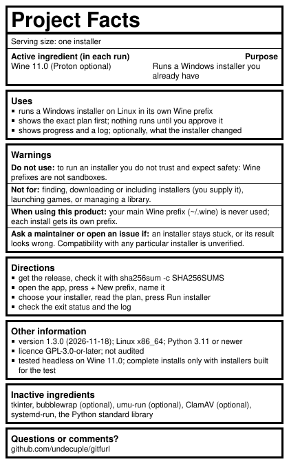
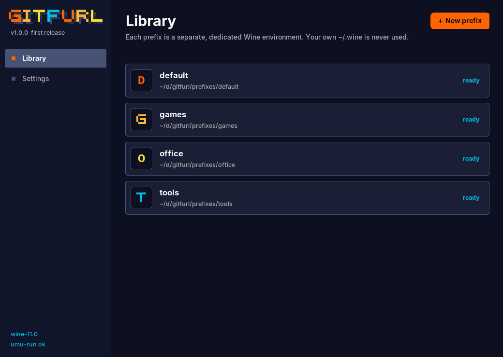

  

<h1 align="center">gitfurl</h1>

<b>Run a Windows installer you already have on Linux, in its own Wine environment, with a plan you approve first.</b>

  
  
  
  
  
  

<a href="#getting-started">Getting started</a> · <a href="docs/user-guide.md">User guide</a> · <a href="docs/status.md">Status and known issues</a> · <a href="#ai-use">AI use</a> · <a href="#community">Community</a> · <a href="https://github.com/undecuple/gitfurl/issues/new/choose">Report a bug</a>

gitfurl is a graphical app (with an optional command line) for running a Windows installer on Linux through Wine. **You supply the installer.** Gitfurl does not find, download or include any.

When the installer's payload is FreeArc archives that gitfurl can read (storing, lzma, exe, x86, delta, rep, 4x4 with lzma inside, srep, and the cm stage with gitfurl's optional native module), gitfurl unpacks them itself and does not run Setup. Otherwise Setup runs under Wine, or under Proton through umu-run. The plan names the route and says why.

Each run gets a timeline: one line per step, saying what it did and why. It shows in the window's Timeline card, under "Last run" in the library, and with `gitfurl cli log PREFIX`.

Two options are off by default. One links your archives under the names the setup expects, when the match is clear (`--link-names`); your files are not renamed. The other adds the setup's registry entries and menu shortcuts to the prefix after a native unpack (`--apply-setup-entries`). Both are switches in the window's Options too. They are tested only with synthetic installers: whether Setup under Wine finds the linked files, and whether a real program reads the entries, is unverified.

To remove a prefix, use **Delete...** in the library or `gitfurl cli prefix delete NAME` (`--dry-run` shows the plan only). It deletes only that prefix folder and the menu entries gitfurl marked for it, after an approval that lists them. This cannot be undone. It refuses while Wine or anything else still uses the prefix.

  

> **Version 1.4.0, released 2026-11-26.** The app, the command line and the safety checks are complete for the scope in [docs/scope.md](docs/scope.md). That does **not** mean any particular installer works: compatibility is unverified, a complete install has been tested only with an installer built for the test, and the code has not been audited. Details: [docs/status.md](docs/status.md).

*The Library page with demo prefixes (empty folders), under the File, View and Help menus. No installer was run to make this picture. More pictures are in the [user guide](docs/user-guide.md).*

## Getting started

### Get it
Install the latest release's program as `~/.local/bin/gitfurl` (Linux x86_64; checked against the release's `SHA256SUMS` first, no sudo). Both files come from the same release, so the check catches a damaged download, not a release someone changed:

    curl -fsSL https://raw.githubusercontent.com/undecuple/gitfurl/main/install.sh | sh

Or run it once without installing anything (downloaded and checked into a temporary folder, deleted afterwards):

    curl -fsSL https://raw.githubusercontent.com/undecuple/gitfurl/main/install.sh | sh -s -- --run cli install ~/setup.exe --dry-run

Better, read the script before you run it:

    curl -fsSL https://raw.githubusercontent.com/undecuple/gitfurl/main/install.sh -o install.sh
    less install.sh
    sh install.sh            # --help lists --version, --dir, --desktop-entry, --uninstall, --run and --dry-run

Or by hand: download the program and `SHA256SUMS` from the [latest release](https://github.com/undecuple/gitfurl/releases/latest), run `sha256sum -c SHA256SUMS` in that folder, then `chmod +x` the program and put it on your PATH. More in the [user guide](docs/user-guide.md#install-script).

### Use it
From the next release on, the release program includes gitfurl's native decoder module (the cm and rolz stages); from source the module is optional (see [docs/development.md](docs/development.md)). The release program is not proven on every desktop (see [docs/status.md](docs/status.md#known-issues)). You need Linux and Wine; to run from source, also Python 3.11 or newer and tkinter (`python3-tk` on Debian and Ubuntu). From source (with the installed program, type `gitfurl` where the steps say `python -m gitfurl`):

1. `git clone https://github.com/undecuple/gitfurl.git && cd gitfurl`
2. `python -m gitfurl cli doctor` reports Wine, tkinter, bubblewrap and umu-run.
3. `python -m gitfurl`, press **+ New prefix** (or File > New prefix), name it, open it.
4. Pick your installer, read the plan and its route, press **Run installer** and confirm.
5. Gitfurl shows the result (Setup's exit status, or what was unpacked), the run's timeline and where the log is.

The menu bar has File, View and Help. Text size, reduced motion and remembering the window size are in the View menu and in Settings > Window.

Terminal instead: `python -m gitfurl cli --help` (same code, same approvals).

Optional: `python -m gitfurl cli desktop-entry` (or `gitfurl cli desktop-entry` once installed; the release program is not yet checked for this) adds it to your application menu. It shows the plan and asks first; `--remove` takes it away.

## When you probably do not need it
- If you are happy running Wine yourself, you do not.
- Gitfurl is for the installer step. It is **not** a game launcher or a library manager, and it does not claim to run any particular installer.
- Wine prefixes are not sandboxes. Gitfurl makes the run visible and tidy; it does not make an untrusted installer safe.

## Read more
| Topic | Where |
|---|---|
| What it is for, every option, screenshots, the command line | [docs/user-guide.md](docs/user-guide.md) |
| Every command and option on one page, with recipes | [docs/cli.md](docs/cli.md) |
| What happens to an installer, stage by stage, on both routes | [docs/pipeline.md](docs/pipeline.md) |
| What it does and does not do; who it is for | [docs/scope.md](docs/scope.md) |
| Tested setups, known issues | [docs/status.md](docs/status.md) |
| How the core, app and progress reading fit together | [docs/architecture.md](docs/architecture.md), [docs/code-map.md](docs/code-map.md) (diagrams) |
| Building, tests, the sandbox wrapper, repository layout | [docs/development.md](docs/development.md), [docs/testing.md](docs/testing.md) |
| Docker image and compose file (experimental) | [docs/docker.md](docs/docker.md) |
| What is read from `/proc` and what is not | [SECURITY.md](SECURITY.md) |
| Plans for later | [ROADMAP.md](ROADMAP.md) |

## Privacy
Nothing goes online from gitfurl itself: no network requests, no telemetry, no uploads. The one exception is `install.sh`, which is not part of the app: when you run it yourself, it downloads the release's program and `SHA256SUMS` from GitHub (over HTTPS) and nothing else. Two other things you start yourself can use the network: umu-run downloading its runtime on first use, and anything the installer does. Nothing is written to `~/.wine`. Gitfurl keeps its own files here:
- Prefixes in `~/.local/share/gitfurl/prefixes/`.
- Logs in `~/.local/state/gitfurl/logs/`, with each run's timeline beside its log (`.timeline.txt`), and a `.delete.log` when you delete a prefix. Before the setup's registry entries change a prefix's `system.reg` or `user.reg`, a copy of each goes into the log folder. These files are readable only by you; they can hold your user name and local paths, so remove those before sharing one, or share a scrubbed support report instead (`gitfurl cli report PREFIX`, or "Copy support report" in the window), which gitfurl only prints, copies or saves.
- View settings in `~/.config/gitfurl/view.json`.
- With `--link-names` on the Setup route: a staging folder of links in `~/.local/state/gitfurl/staging/`, removed after the run.
- Menu entries in `~/.local/share/applications/`, only when you ask: `gitfurl-PREFIX-NAME.desktop` files with `--apply-setup-entries`, and `gitfurl.desktop` (with a copy of the icon) from `cli desktop-entry`.

## Community

Questions and discussion: the gitfurl forum on the [undecuple Discord server](https://discord.gg/W8fMT78Q7k). Bugs go to [GitHub issues](https://github.com/undecuple/gitfurl/issues/new/choose), security problems to [private advisories](SECURITY.md). Remove your user name and local paths from logs before posting them. Contributing: [CONTRIBUTING.md](CONTRIBUTING.md).

## Related projects
[Wine](https://www.winehq.org/) (the compatibility layer gitfurl drives), [umu-launcher](https://github.com/Open-Wine-Components/umu-launcher) with [Proton](https://github.com/ValveSoftware/Proton) and [GE-Proton](https://github.com/GloriousEggroll/proton-ge-custom) (the optional runtime; gitfurl ships none of them) and [vim-tictoc](https://github.com/adonaldson/vim-tictoc) (the colour scheme). Gitfurl is not affiliated with these projects or with any software publisher.

## Licence
Copyright (C) 2026 undecuple. GPL-3.0-or-later; see [LICENSE](LICENSE). The images in `assets/` are generated by `tools/make_assets.py` and are under the same licence. The licence covers gitfurl only, not any installer or software you run with it. The release program also contains third-party components (the Rust crates in the native module, CPython, Tcl/Tk and PyInstaller's bootloader) under their own licences, listed with their texts in [THIRD_PARTY.md](THIRD_PARTY.md).

## AI use
Gitfurl is written with AI coding agents. Much of its code, tests and documentation was written by Claude (Anthropic's model, used through Claude Code) under the maintainer's direction. A second Claude session reviews each change before it goes public, and the maintainer approves every merge, tag and release. The code has not been audited by a security professional (see [SECURITY.md](SECURITY.md)). Read the plan before you approve a run, and report problems through the issue forms.

## Disclaimer
Gitfurl comes with no warranty, as in section 15 of the GPL. You are responsible for what you run and for being authorised to use it. Names of other products belong to their owners; gitfurl is not affiliated with them. Running an installer can harm your system; a Wine prefix is not a sandbox.
