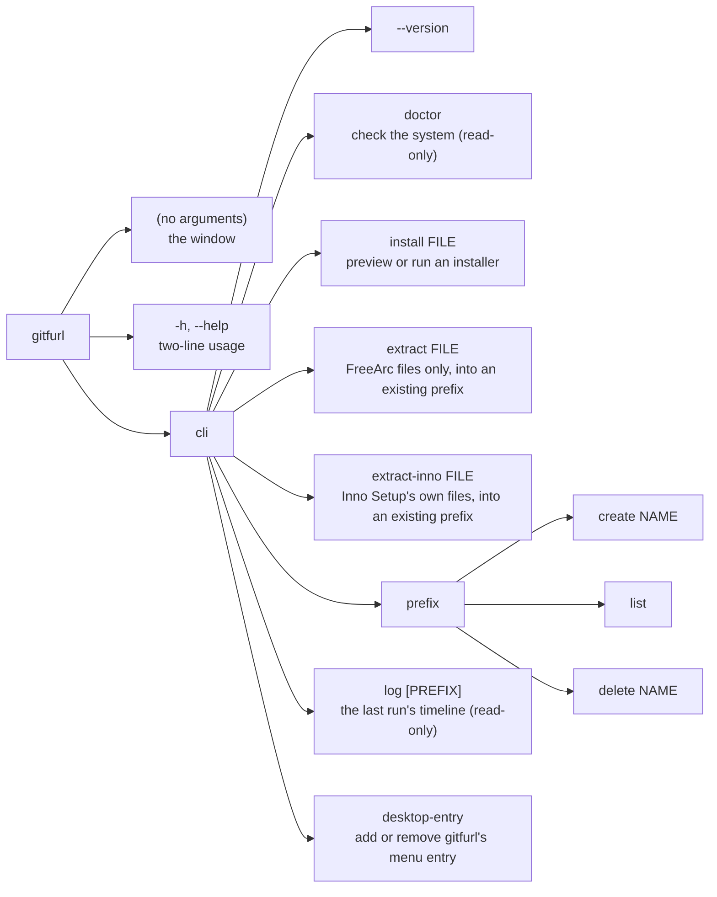

# Command line

The window is the default: `gitfurl` with no arguments opens it. The command line is opt-in, behind `gitfurl cli`, and uses the same code, the same plan and the same approval. This page lists every command and option, then recipes for common tasks. What happens inside a run is in [pipeline.md](pipeline.md); the longer explanations are in the [user guide](user-guide.md).

Checked against `main` at 0a8237ce (2026-11-27; the source is the same as at 9142afa7): every option below was read from `cli.build_parser()` and from `PYTHONPATH=src python3 -m gitfurl cli <command> --help`. From a source checkout, use `python -m gitfurl` where this page says `gitfurl`.

To get the program, see `install.sh` in the [README](../README.md#get-it): `curl -fsSL https://raw.githubusercontent.com/undecuple/gitfurl/main/install.sh | sh` installs it, and `… | sh -s -- --run cli install setup.exe --dry-run` runs it once without installing.

## The commands

Anything else after `gitfurl` (for example `gitfurl install`) is refused with status 2 and a hint to use `gitfurl cli`.

Common rules:
- **Approval.** Every command that changes something prints its plan and asks you to type `yes`. `--yes` approves without asking. With no terminal and no `--yes`, nothing changes and the status is 2.
- **Dry run.** `--dry-run` prints the plan and changes nothing, on every command that has it.
- **Root.** Commands that change something refuse to run as root.
- **Exit status.** 0 success; 1 an error (nothing was done, or the run failed); 2 not approved, or a memory check stopped it; 130 stopped with Ctrl-C.

## Options

The **Route** column says where an option has an effect: **both**, **native** (gitfurl unpacks the archives itself; Setup is not run) or **Setup** (Setup runs under Wine or Proton). See [How gitfurl picks the route](user-guide.md#how-gitfurl-picks-the-route).

### `gitfurl cli install INSTALLER`

| Option | What it does | Default | Route |
|---|---|---|---|
| `INSTALLER` | The installer file you have. | required | both |
| `--prefix NAME` | The dedicated prefix to use: 1 to 64 letters, digits, `-` or `_`. | `default` for a dry run; a real run needs it | both |
| `--dry-run` | Show the plan and change nothing. | off | both |
| `--create-prefix` | Create the prefix first if it does not exist. | off | both |
| `--route auto\|native\|wine` | Who picks the route. `auto`: gitfurl, and it says why. `native`: unpack the archives, or refuse with the reason. `wine`: always run Setup. | `auto` | both |
| `--link-names` | When the setup expects archives under other names, use one clear mapping (`other-01.bin` for `fg-01.bin`). Setup route: Setup runs from a folder of links that gitfurl removes afterwards. Native route: the archives are read under their own names. The route check counts them as named either way. | off | both |
| `--accept-bad-index-crc` | Read a FreeArc index or footer whose CRC-32 is wrong, with a warning. Each file's CRC is still checked. | off | native |
| `--keep-bad-file-crc` | Keep a file whose CRC-32 does not match instead of removing it, and list it. Its size must still match. Only for an installer you trust. | off | native |
| `--dest WINPATH` | Unpack into this new folder on the prefix's drive C:, for example `'C:\Games\My Game'`. Not in `C:\windows`, `C:\users` or `C:\ProgramData`; missing folders above it are created; no link is followed. | `C:\Games\PREFIX` | native |
| `--apply-setup-entries` | After a complete unpack, also add the registry values and menu entries the setup declares that gitfurl can apply exactly, without Wine. | off | native |
| `--runtime wine\|proton` | Run Setup with Wine, or with Proton through `umu-run`. `proton` makes the automatic route Setup. | `wine` | Setup |
| `--proton-path DIR` | The Proton folder you already have. Never downloaded. | `$PROTONPATH` | Setup |
| `--wine-addons` | When gitfurl creates the prefix with the wine runtime, let Wine show its Mono and Gecko dialogs. | off | Setup |
| `--portable` | Run Setup in bwrap: only the prefix writable, no network, no menu entries. Wine runtime only; not with `--link-names`. Makes the automatic route Setup. | off | Setup |
| `--unattended` | Inno Setup only: run without the wizard (`/VERYSILENT` and friends), into `C:\Games\PREFIX`, and read Inno's log afterwards. Makes the automatic route Setup. | off | Setup |
| `--wine-debug CHANNELS` | Set `WINEDEBUG` for the run, for example `err+all`. Makes the automatic route Setup. | not set | Setup |
| `--show-changes` | After the run, list what Setup changed (files, registry keys). Makes the automatic route Setup. | off | Setup |
| `--find-exe` | After the run, guess which new program was installed. | off | Setup |
| `--stall-after SECONDS` | Print an advisory note each time nothing moves for this long. Never stops anything. | off | Setup |
| `--no-memory-limit` | Setup route: run without the systemd memory scope. Native route: create the prefix without it, and skip the check of the decoders' memory against free memory. | the limit is on | both |
| `--progress` | Print progress lines while it runs (read, rate, ETA). | off | both |
| `--progress-interval SECONDS` | How often progress is sampled and printed. Must be above 0. (No help text in `--help`.) | `10` | both |
| `--timeline` | Also print the timeline rows as they come. The timeline is saved either way. | off | both |
| `--detailed-log` | Also write a JSON-lines event log beside the log. | off | both |
| `--scan` | Scan the installer and the files beside it with the `clamscan` on PATH first. A match or a scan error stops the run. | off | both |
| `--allow-scan-hit` | With `--scan`: run even if ClamAV matched a signature. Never overrides a scan error. Refused without `--scan`. | off | both |
| `--scan-timeout SECONDS` | With `--scan`: stop the scan after this long. | `600` | both |
| `--cleanup none\|installer\|folder` | After a complete run, delete the installer, or every file in its folder. Skipped after an error, a Stop, or a kept CRC mismatch. | `none` | both |
| `--yes` | Approve without typing `yes`. | off | both |

When an option does not apply to the route taken, the plan says so: `--apply-setup-entries`, `--keep-bad-file-crc` and `--dest` on the Setup route; `--wine-addons`, `--stall-after` and, with `--route native`, the Setup-only options on the native route. Two say nothing: `--find-exe` on the native route (which lists program candidates by itself), and `--accept-bad-index-crc` on the Setup route.

### `gitfurl cli extract INSTALLER`

Files only: the FreeArc archives beside the installer go into `C:\Games\PREFIX` of an existing prefix. Setup is not run. See [Native extraction (FreeArc)](user-guide.md#native-extraction-freearc).

| Option | What it does | Default | Route |
|---|---|---|---|
| `INSTALLER` | The installer; the FreeArc archives beside it are read. | required | native |
| `--prefix NAME` | An existing dedicated prefix. | required | native |
| `--dry-run` | Show the plan and change nothing. | off | native |
| `--yes` | Approve without typing `yes`. | off | native |
| `--accept-bad-index-crc` | As for `install`. | off | native |
| `--keep-bad-file-crc` | As for `install`. | off | native |
| `--dest WINPATH` | As for `install`. | `C:\Games\PREFIX` | native |

With either CRC option on, `extract` also writes a log and a timeline.

### `gitfurl cli extract-inno INSTALLER`

The files Inno Setup itself holds for the program folder (`{app}`) go into `C:\Games\PREFIX` of an existing prefix. Setup is not run. See [Native extraction (Inno Setup's own files)](user-guide.md#native-extraction-inno-setups-own-files).

| Option | What it does | Default | Route |
|---|---|---|---|
| `INSTALLER` | The Inno Setup installer (setup.exe). | required | native |
| `--prefix NAME` | An existing dedicated prefix. | required | native |
| `--dry-run` | Show the plan and change nothing. | off | native |
| `--yes` | Approve without typing `yes`. | off | native |

### `gitfurl cli prefix create NAME`

| Option | What it does | Default |
|---|---|---|
| `NAME` | The new prefix's name. | required |
| `--runtime wine\|proton` | Create it with `wine wineboot --init`, or `umu-run wineboot --init`. Use the runtime its installs will use. | `wine` |
| `--proton-path DIR` | The Proton folder you already have. | `$PROTONPATH` |
| `--wine-addons` | Let Wine show its Mono and Gecko dialogs. Refused with `--runtime proton`. | off |
| `--yes` | Approve without typing `yes`. | off |

### `gitfurl cli prefix list`

No options. Prints the prefixes folder and the prefixes in it.

### `gitfurl cli prefix delete NAME`

Deletes a prefix in gitfurl's prefixes folder and the menu entries gitfurl wrote for it. See [Deleting a prefix](user-guide.md#deleting-a-prefix).

| Option | What it does | Default |
|---|---|---|
| `NAME` | The prefix to delete. | required |
| `--dry-run` | Show the plan and delete nothing. | off |
| `--yes` | Approve without typing `yes`. | off |

### `gitfurl cli doctor`

No options. Read-only: versions of `wine`, `bwrap`, `umu-run`, `innoextract` and `clamscan` (with the ClamAV database date), tkinter, whether the memory limit can be used, memory and CPU threads.

### `gitfurl cli log [PREFIX]`

| Option | What it does | Default |
|---|---|---|
| `PREFIX` | Print this prefix's latest timeline. | needed unless `--all` |
| `--all` | List the timelines kept, for this prefix or for every prefix. | off |

### `gitfurl cli desktop-entry`

Adds a menu entry and an icon for the window in your own data folder. See the [README](../README.md#getting-started).

| Option | What it does | Default |
|---|---|---|
| `--remove` | Remove the entry and icon gitfurl wrote; files it did not write are left. | off |
| `--dry-run` | Show the plan and change nothing. | off |
| `--yes` | Approve without typing `yes`. | off |

### `gitfurl cli`

| Option | What it does |
|---|---|
| `--version` | Print gitfurl's version. |
| `-h`, `--help` | Help; also after any command, for example `gitfurl cli install --help`. |

## Recipes

Each recipe is a task, then the command. Add `--dry-run` to any of them first to see the plan.

**See what would happen, change nothing.**

    gitfurl cli install setup.exe --dry-run

The plan names the route and why, the prefix, every step, and the checks. Nothing runs.

**Install into a new prefix.**

    gitfurl cli install setup.exe --prefix mygame --create-prefix

gitfurl picks the route. Without `--create-prefix` the prefix must exist already (`gitfurl cli prefix create mygame`).

**The setup looks for archives under other names.**

    gitfurl cli install setup.exe --prefix mygame --link-names

The plan shows which archive stands for which name, or why there is no clear mapping. Your files are not renamed. Whether Setup under Wine finds its archives through the links has not been tested.

**The archive's checksums are wrong, but I trust it.**

    gitfurl cli install setup.exe --prefix mygame --accept-bad-index-crc

This reads an index or footer whose CRC-32 is wrong, with a warning. Each file is still checked, and a file that fails is removed. If files then fail their CRC-32 and you still trust the installer, run again into a new prefix (or delete the destination folder first) with:

    gitfurl cli install setup.exe --prefix mygame2 --create-prefix --accept-bad-index-crc --keep-bad-file-crc

Warning: gitfurl cannot tell a damaged file from an archive with wrong checksums. With `--keep-bad-file-crc` every kept file is listed with its stored and computed CRC-32, and `--cleanup` is skipped so the installer stays. Both options are off by default and last for one run.

**Unpack into another folder.**

    gitfurl cli install setup.exe --prefix mygame --dest 'C:\Apps\My Game'

Native route only. The folder must be new and on the prefix's drive C:; in the window, use **Browse…** in Options.

**Add the setup's menu entries and registry values after a native unpack.**

    gitfurl cli install setup.exe --prefix mygame --apply-setup-entries

Native route only. The plan lists every value and menu entry, and every entry it skips with the reason. Whether a real program reads these entries has not been tested.

**Force Setup under Wine.**

    gitfurl cli install setup.exe --prefix mygame --route wine

**Use Proton.**

    gitfurl cli prefix create mygame --runtime proton --proton-path ~/Proton
    gitfurl cli install setup.exe --prefix mygame --runtime proton --proton-path ~/Proton

`--runtime proton` runs `umu-run`; `--proton-path` (or `PROTONPATH`) names a Proton folder you already have. umu-run downloads the Steam Linux Runtime on its first run unless it is there; gitfurl does not. With the automatic route, Proton takes the Setup route.

**Scan first.**

    gitfurl cli install setup.exe --prefix mygame --scan

A match stops the run; add `--allow-scan-hit` to go on anyway (a scan error always stops it). gitfurl never updates the ClamAV database.

**Watch progress or the timeline.**

    gitfurl cli install setup.exe --prefix mygame --progress --timeline

Add `--progress-interval 3` for more frequent lines, and on the Setup route `--stall-after 120` for a note when nothing moves for two minutes.

**Read the last run.**

    gitfurl cli log mygame
    gitfurl cli log --all

**Delete a prefix.**

    gitfurl cli prefix delete mygame --dry-run
    gitfurl cli prefix delete mygame

**Add gitfurl to the menu.**

    gitfurl cli desktop-entry

`gitfurl cli desktop-entry --remove` takes it away again.

**Check my system.**

    gitfurl cli doctor

**Unpack the files only, into a prefix that exists.**

    gitfurl cli extract setup.exe --prefix mygame --dry-run
    gitfurl cli extract setup.exe --prefix mygame

### A full example: archives under other names, with wrong checksums

For an installer whose archives sit beside it under another name and carry wrong CRC-32 values, and which you trust:

    gitfurl cli install setup.exe --prefix mygame --create-prefix --link-names --accept-bad-index-crc --keep-bad-file-crc --apply-setup-entries

- `--prefix mygame --create-prefix`: a new dedicated prefix, made with `wineboot` first (no Mono or Gecko dialogs, Wine's menu builder off).
- `--link-names`: the archives count as the ones the setup names, so the automatic route can be native; no links are made on that route.
- `--accept-bad-index-crc`: the archives' indexes are read although their CRC-32 is wrong, with a warning.
- `--keep-bad-file-crc`: files whose CRC-32 does not match are kept and listed, not removed.
- `--apply-setup-entries`: after the unpack, the setup's registry values and menu entries that gitfurl can apply exactly are written.

Tested: this combination was run end to end in the sandbox (`tools/sandbox.sh`, no network) on 2026-11-27 on one approved test installer, with `--no-memory-limit` added because the sandbox has no user systemd; the exit status was 0. It was not run outside the sandbox or with the memory limit on, and it says nothing about other installers.
