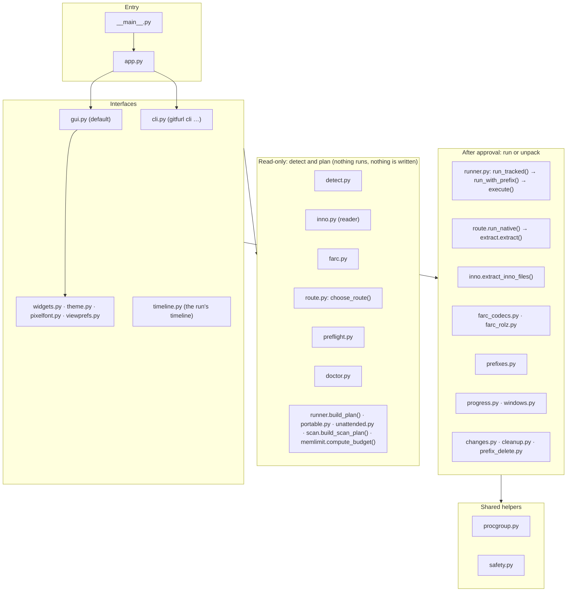
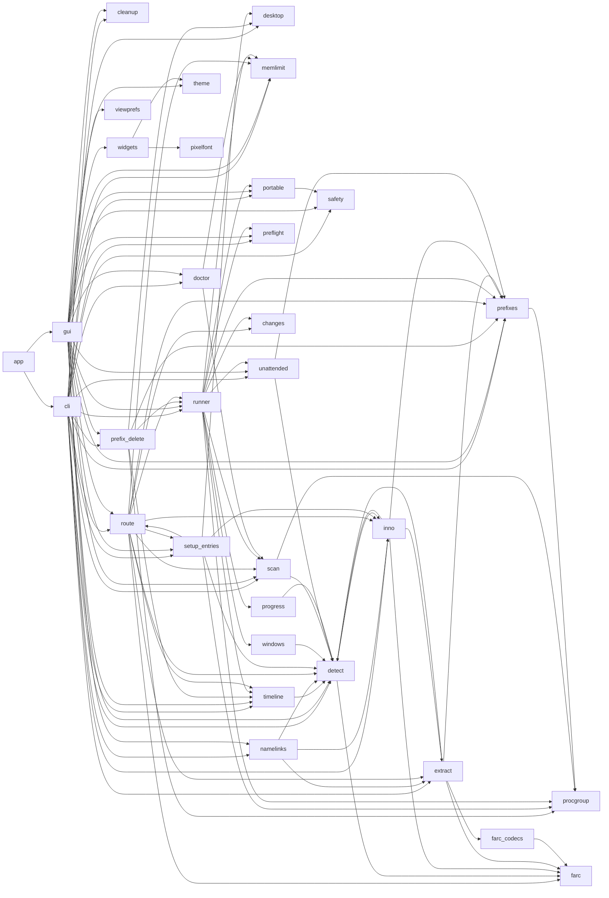
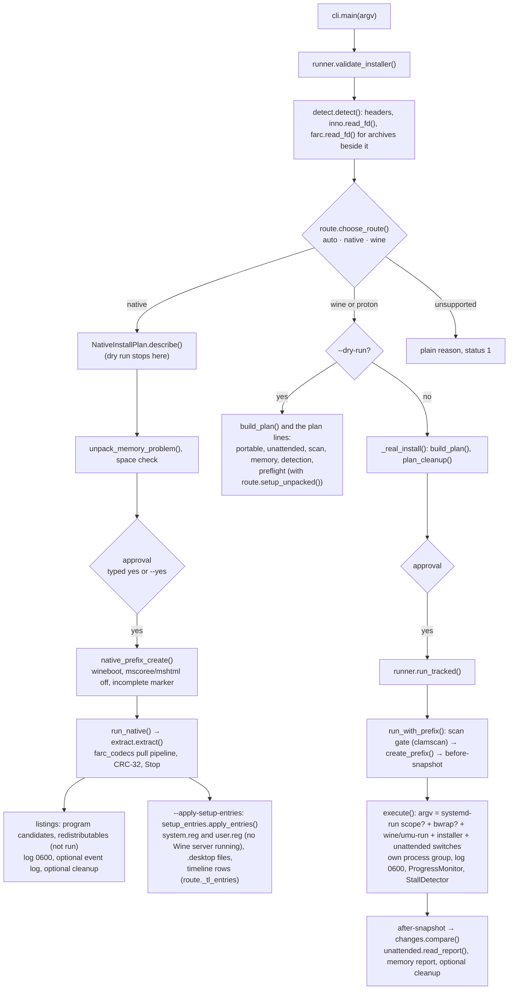
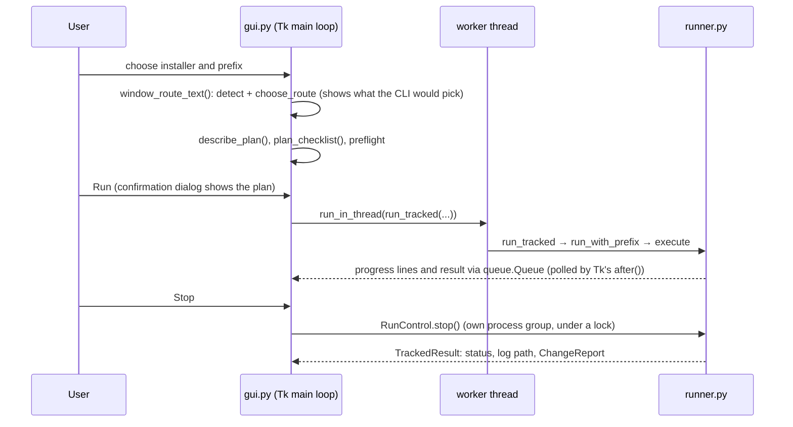
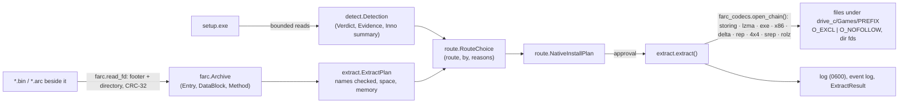
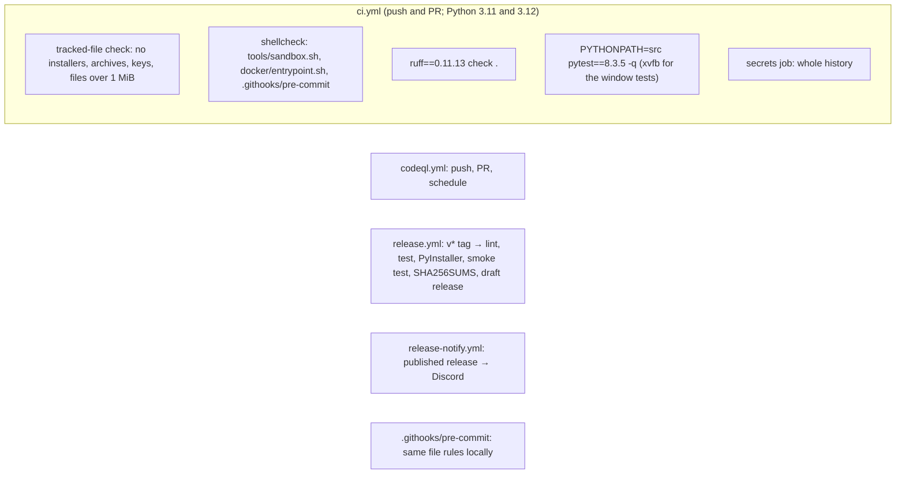

# Code map

A map of the source for people changing it: layers, which module uses which, the main control and data flows, the entry points, and which tests and CI jobs cover what. The per-module details are in [architecture.md](architecture.md); this page is the overview. The diagrams are Mermaid (GitHub draws them).

Checked against `main` at b63da882 (2026-11-24). The import graph below was read from the source with Python's `ast` module, so it lists every `from gitfurl… import` in each file, including imports inside functions.

## Layers

- **Entry**: `app.main()` opens the window with no arguments, hands `cli …` to `cli.main()`, and refuses anything else with status 2.
- **Interfaces**: the window and the command line call the same core. Logic in `gui.py` that can be tested without a display is kept in plain functions (`describe_plan`, `plan_checklist`, `window_route_text`, …).
- **Read-only layer**: reads file headers, archive indexes and `/proc`, and builds plans. It starts no process except the read-only probes in `doctor.py` and `memlimit.availability()`.
- **Run layer**: anything that starts Wine, `wineboot`, `clamscan`, `bwrap` or `systemd-run`, or writes into a prefix; also the read-only `xwininfo` and `xprop` probes in `windows.py`, used only for the stall and crash notes. It is reached only after the approval that shows the plan.

## Module dependencies

Arrows point from a module to the modules it imports. Modules with no gitfurl imports: `changes`, `cleanup`, `desktop`, `farc`, `memlimit`, `pixelfont`, `preflight`, `procgroup`, `safety`, `theme`, `viewprefs`. `timeline` imports only `detect` (for `clean`).

Notes:
- `detect` ↔ `inno` is a cycle by design: `detect.detect()` calls `inno.read_fd()` on the open file (top-level import), and `inno.py` imports `detect.clean` inside a function, so loading either module first works. `inno` also imports `extract` and `prefixes` inside functions.
- `inno` imports `extract` to reuse its folder handling (`_Tree`, `_make_dest`, name checks) and the `ExtractPlan` checks.
- `inno._temporary_files()` lists the stored `{tmp}` and `dontcopy` files; `_carried_names()` keeps those the `[Code]` also names bare or with `{tmp}`. `beside_files()` skips them and `summarise()` explains them once.
- `route` and `setup_entries` import each other inside functions only (`route.run_native()` calls `setup_entries.apply_entries`; `setup_entries` uses `route.written_files`), so loading either module first works.
- `route` imports `runner` only for `logs_root()`; the Wine fallback is run by `cli.py` through `runner`. The native route starts no process except `wineboot` (and `clamscan` with `--scan`).

## Entry points

| What | Where | Notes |
|---|---|---|
| `gitfurl` (console script) | `app.main()` | from `pyproject.toml` `[project.scripts]` |
| `python -m gitfurl` | `__main__.py` → `app.main()` | |
| The window | `gui.main(start="library", prefix=None, driver=None)` | `driver` is the test hook `tests/gui_stop_driver.py` and `tests/gui_native_driver.py` use |
| `gitfurl cli doctor` | `doctor.run_doctor()`, `format_report()` | read-only probes with a timeout |
| `gitfurl cli install` | `cli.main()` → `choose_route()` → `_native_install()` or `_real_install()` (dry run printed inline) | see the flow below |
| `gitfurl cli extract` | `cli._extract_command()` → `extract.plan_extract()`, `extract.extract()` | FreeArc archives beside the installer, into an existing prefix |
| `gitfurl cli extract-inno` | `cli._extract_inno_command()` → `inno.plan_inno_extract()`, `inno.extract_inno_files()` | files Inno Setup stores for `{app}` |
| `gitfurl cli prefix create` / `list` | `cli._prefix_command()` → `runner.runtime_env()`, `prefixes.create_prefix()`, `list_prefixes()` | Wine or Proton (`umu-run`) |
| `gitfurl cli prefix delete` | `cli._prefix_delete_command()` → `prefix_delete.plan_delete_prefix()`, `perform_delete_prefix()` | also the library's "Delete..." (`gui.delete_clicked`, on a thread) |
| `gitfurl cli desktop-entry` | `cli._desktop_command()` → `desktop.plan_desktop()`, `check()`, `apply()` | optional menu entry and icon in the user's data folder |
| `gitfurl cli log` | `cli._log_command()` → `timeline.latest()`, `kept()`, `read_text()` | read-only: a prefix's latest timeline, or the list |
| Sandbox wrapper (manual) | `tools/sandbox.sh` | bubblewrap, network off, NixOS only; not part of the app |
| Asset generator | `tools/make_assets.py` | `assets/*.svg`, dividers, the facts label colours |
| Release build | `.github/workflows/release.yml` | PyInstaller single file on a `v*` tag, draft release |

## Control flow: `gitfurl cli install`

Rules visible in the flow:
- A dry run never falls through to a real run; both routes print the plan and stop.
- Without a terminal and without `--yes`, real actions exit with status 2 and change nothing.
- The process group gitfurl starts is the only thing it stops (`RunControl`, `procgroup.SigintGuard`); Ctrl-C ends with status 130.

## Control flow: the window

When the route is native, `run_clicked` hands over to `run_native_clicked`. It builds the plan with `native_plan_for` (the same stop checks as the command line, `route.native_stops`) and shows one approval. It then runs `route.perform_native` in a thread (scan, prefix creation, unpack), with `NativeControl` as Stop; the progress arrives as `NativeSample`s, and the end text comes from `native_end_text`. The "Run Setup instead" switch and the Setup-only options choose the Wine/Proton flow above.

## Data flow: from the installer to files in the prefix (native route)

For `extract-inno` the source is the setup file itself: `inno.read_setup()` gives the header and entry lists, `plan_inno_extract()` chooses the `{app}` files, and `extract_inno_files()` streams each chunk (stored, zlib, bzip2, LZMA, LZMA2), undoes the x86 call filter and checks SHA-1 or SHA-256.

## Where files go

| Data | Location | Written by |
|---|---|---|
| Prefixes | `prefixes.prefixes_root()` (per user) / NAME | `prefixes.create_prefix()`, `route.native_prefix_create()` |
| Logs and event logs (mode 0600) | `runner.logs_root()` | `runner.execute()`, `route.run_native()` |
| Timelines `<prefix>-<stamp>.timeline.txt` (mode 0600) | `runner.logs_root()`, beside the run's log | `timeline.Timeline.attach()` (from `execute()`, `run_native()`), or `Timeline.save()` when the run made no log |
| Staging folders of links (mode 0700, removed after the run) | `namelinks.staging_root()` / PREFIX-DATE-TIME-PID | `namelinks.Staging.create()`, `remove()` (`--link-names` on the Setup route) |
| Extracted files | `drive_c/Games/NAME` in the prefix | `extract.extract()`, `inno.extract_inno_files()` |
| Setup's registry values (opt-in) | `system.reg`, `user.reg` in the prefix; copies from before the change in `runner.logs_root()` (0600) | `setup_entries.apply_entries()` |
| Setup's menu entries (opt-in, outside the prefix) | `$XDG_DATA_HOME/applications/gitfurl-NAME-*.desktop` (0644) | `setup_entries.apply_entries()` |
| Prefix deletion log `<prefix>-<stamp>.delete.log` and timeline (mode 0600) | `runner.logs_root()` | `prefix_delete.perform_delete_prefix()` (it also removes the prefix and the menu entries gitfurl wrote for it) |
| Inno Setup's own log (unattended) | inside the prefix | Setup itself; read by `unattended.read_report()` |
| Nothing else | - | the read-only layer writes nothing |

## Build and test map

| Test file | Covers | Test-only helpers |
|---|---|---|
| `tests/test_gitfurl.py` | `app`, `cli`, `doctor`, `detect`, `prefixes`, `runner`, `preflight`, `procgroup`, `progress`, `changes`, `cleanup`, `gui` plain functions, `route` | - |
| `tests/test_route.py` | `route` (choice, native plan and run, `setup_unpacked`), `cli install` on both routes, `extract.unpacked_size` and the Setup route's preflight, `gui.window_route_text` | `tests/farc_writer.py` |
| `tests/test_farc.py` | `farc` index reader, `detect` with archives | `tests/farc_writer.py` |
| `tests/test_extract.py` | `extract`, `cli extract` | `tests/farc_writer.py` |
| `tests/test_codecs.py` | `farc_codecs` (lzma, exe, delta, rep, 4x4, srep, VHASH, SipHash, AES), chains through `extract` | `tests/farc_writer.py` |
| `tests/test_farc_rolz.py` | `farc_rolz` (tables, bit reader, container, tokens and special blocks, the x86 call stage, records, damage, caps) and the rolz stage in `farc_codecs` (method strings, plan, chains from a file, Stop, an extraction) | `tests/rolz_writer.py`, `tests/farc_writer.py` |
| `tests/test_farc_x86.py` | `farc_codecs` x86 stage (blocks, framing, damage, caps, memory), its method strings, chains and an extraction; the specification's vectors when `GITFURL_X86_VECTORS` is set | `tests/farc_writer.py` |
| `tests/test_inno.py` | `inno` reader, `[Code]` scan, preflight, `extract-inno`, `detect` and `cli` lines | `tests/inno_writer.py` |
| `tests/test_unattended.py` | `unattended`, its CLI and window options | - |
| `tests/test_portable.py` | `portable`, `runner` wrapping, window option | - |
| `tests/test_scan.py` | `scan`, the scan gate, the database version (with the `clamconf` fallback), `doctor` lines | - |
| `tests/test_memlimit.py` | `memlimit`, `runner` scope, `doctor`, window option | - |
| `tests/test_progress.py` | `progress` (fake `/proc`), stall detector | - |
| `tests/test_crash.py` | `progress.prefix_processes` (crash handler), `windows` (fake `xwininfo`/`xprop`: order, size and map-state filters, the newest and top window), the crash and stall notes in `runner` | `tests/test_gitfurl.py` (`RunEventHelpers`) |
| `tests/test_gui_polish.py` | `theme`, `widgets`, window polish (window parts skipped without `xvfb-run` or tkinter) | - |
| `tests/test_timeline.py` | `timeline` (format, folding, caps, cleaning, the file), rows from a mocked Wine run and a native unpack, `cli log` and `install --timeline` | `tests/test_gitfurl.py` (`RunEventHelpers`), `tests/test_native_run.py` (`NativeBase`) |
| `tests/test_view.py` | `viewprefs`, the result headline and done row, the Help texts (no window) | - |
| `tests/test_gui_stop.py` | Stop in the real window | `tests/gui_stop_driver.py` (`xvfb-run -a`) |
| `tests/test_namelinks.py` | `namelinks` (mapping, staging folder and its removal), the route with links, `cli install --link-names`, the window's plain functions | `tests/inno_writer.py`, `tests/farc_writer.py` |
| `tests/test_setup_entries.py` | `setup_entries` (constants, Wine's registry format and edits, plan, apply, menu entries), `procgroup.prefix_server_running`, `route.run_native` with the entries and their timeline rows, `cli install --apply-setup-entries` (also with `--timeline`) | `tests/test_route.py` (`Base`), `tests/inno_writer.py` (`WReg`, `WIcon`), `tests/farc_writer.py` |
| `tests/test_native_run.py` | `route.native_stops`, `route.perform_native` (stop checks, Stop during the scan and wineboot, cancel) | `tests/test_route.py` (`Base`, archive builders on `tests/farc_writer.py`) |
| `tests/test_gui_native.py` | the window's native-route plain functions (route switches, stop texts, footer, root refusal, plan and approval, progress, end text, cleanup) | `tests/test_native_run.py` (`NativeBase`) |
| `tests/test_gui_native_xvfb.py` | the native route in the real window: Run and the unpack, Stop, the "Run Setup instead" switch, the setup entries switch in the plan and the approval, declining the approval; the Timeline card (the plan's rows before the run, the route reason, Stop and the done line) and the library's Last run | `tests/gui_native_driver.py` (`xvfb-run -a`) |
| `tests/test_wineboot.py` | `prefixes.wineboot_env`, `with_wineboot_env`, `wineboot_line`; `--wine-addons` on `install` and `prefix create`; the window's plan line | - |
| `tests/test_gui_stall.py` | which crash and stall notes the window keeps on screen; the 120 s stall advice | - |
| `tests/test_desktop.py` | `desktop`, `cli desktop-entry` | - |
| `tests/test_prefix_delete.py` | `prefix_delete` (refusals, `in_use`, counts, deletion with links, swaps, menu-entry matching, log and timeline), `cli prefix delete`, the window's plan and result texts | `setup_entries.shortcut_text` for the entries |
| `tests/test_gui_delete_xvfb.py` | the library's "Delete..." in the real window (Cancel and OK) | `tests/gui_delete_driver.py` (`xvfb-run -a`) |

Local check with the pinned versions: `ruff==0.11.13 check src tests` and `PYTHONPATH=src pytest==8.3.5 -q tests` on Python 3.11 (see [development.md](development.md)). Manual runs with real or synthetic installers go through `tools/sandbox.sh` only; they are recorded in [testing.md](testing.md).

## What this map does not show

- The internal structure of `gui.py` (about 1,760 lines: pages, dialogs and the run loop in one `main()` closure). Its pages are named in the [user guide](user-guide.md); the map shows only its calls into the core.
- Decoder internals of `farc_codecs.py` and `farc_rolz.py` and the record layouts of `inno.py`: they follow the clean-room specifications, which are not in the repository.
- Timing: which calls happen on Tk's thread and which on the worker thread beyond the sequence above.

## FreeArc index CRC opt-in

`cli.py` and the window's Options pass `accept_bad_index_crc` through `choose_route()` to `plan_extract()` and `farc.read_archive()`. The plan keeps the choice for `extract()`'s `read_fd()` recheck. The reader records failed CRC values in `Archive.warnings`; `ExtractPlan.describe()`, `route.run_native()` and `timeline.archive_warning_entries()` show them in the plan, approval, log and timeline. File CRC checks remain in the extraction writer. `tests/test_farc_bad_crc.py` covers this path with synthetic archives.
