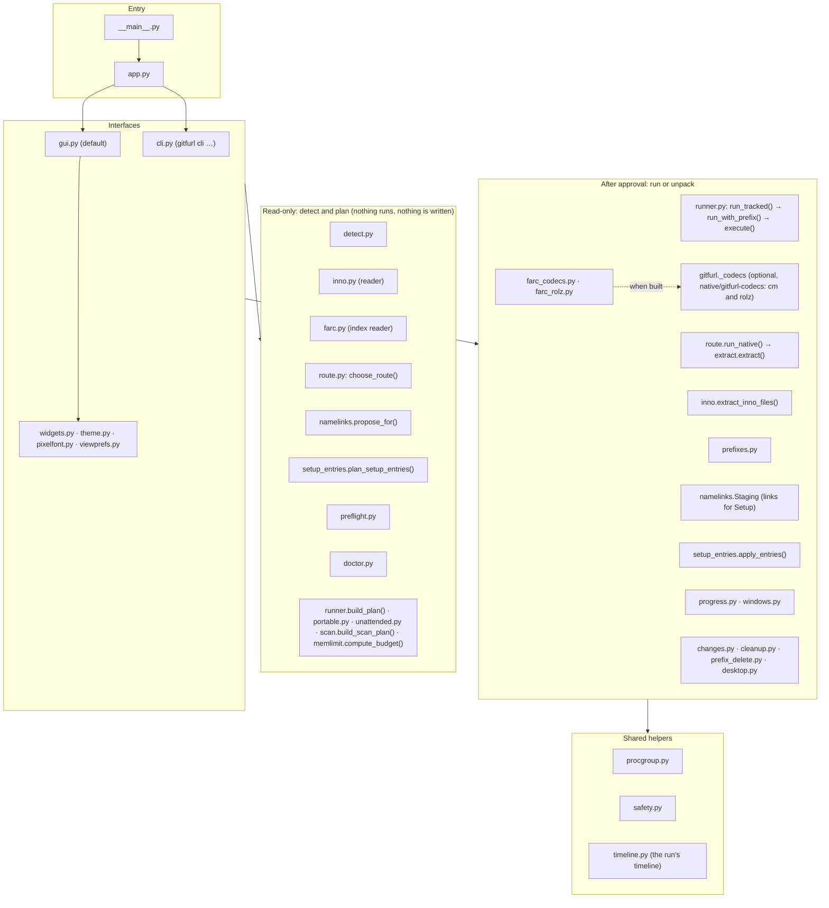
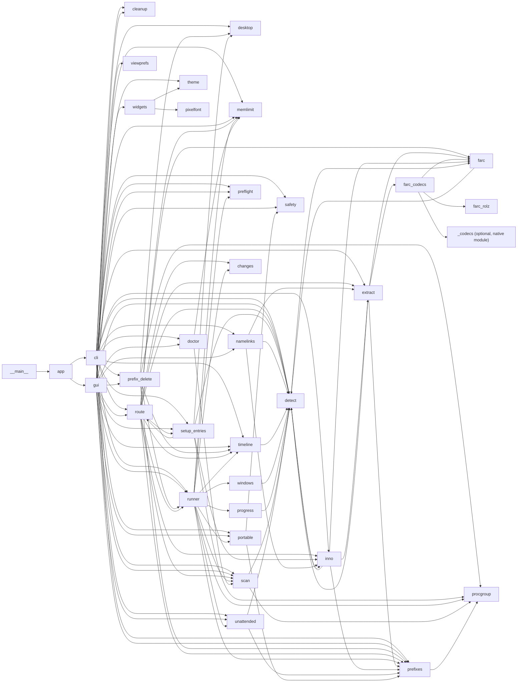
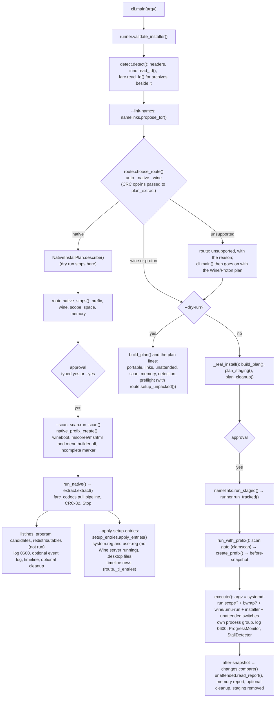
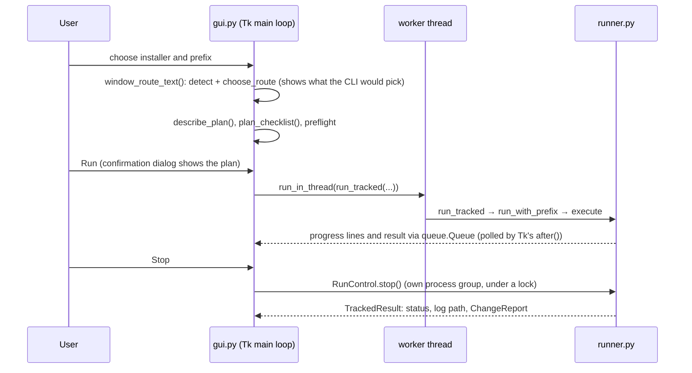
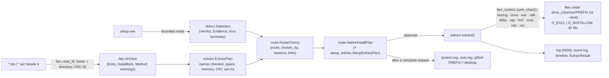
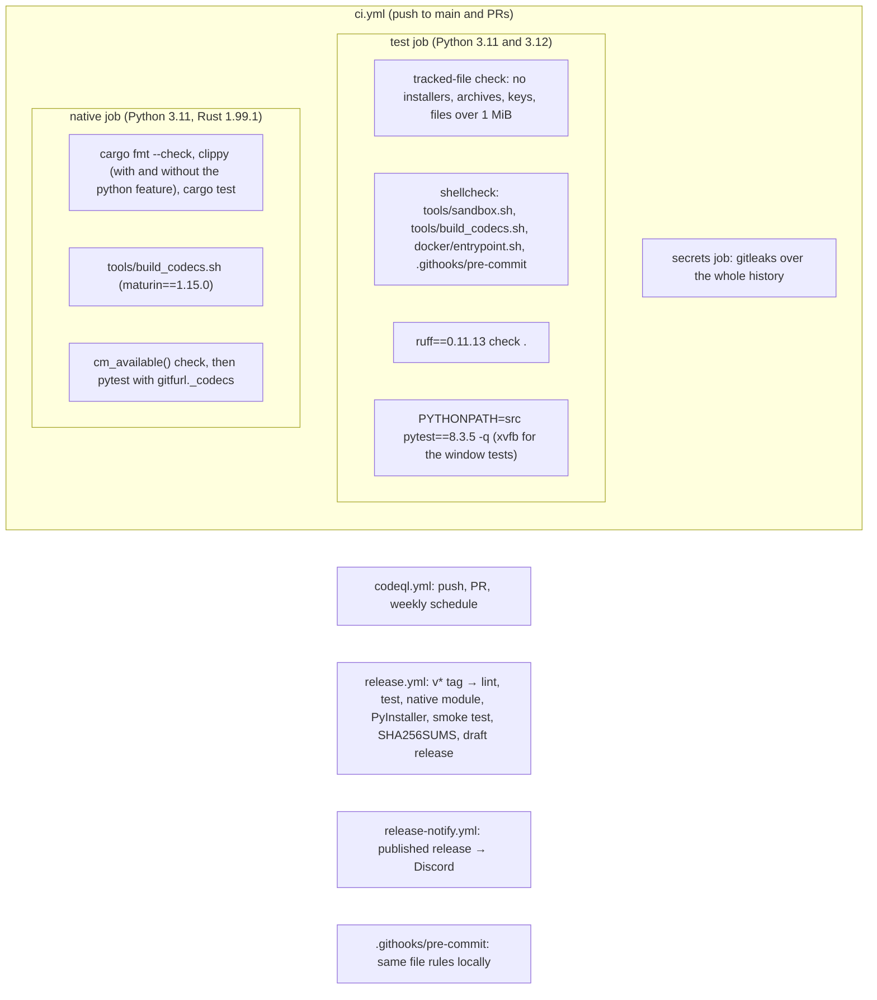

# Code map

A map of the source for people changing it: layers, which module uses which, the main control and data flows, the entry points, and which tests and CI jobs cover what. The per-module details are in [architecture.md](architecture.md); this page is the overview. What happens to an installer, stage by stage, is in [pipeline.md](pipeline.md); every command and option is in [cli.md](cli.md). The diagrams are Mermaid (GitHub draws them).

Checked against `main` at 0a8237ce (2026-11-27). The import graph below was read from the source with Python's `ast` module, so it lists every `from gitfurl… import` in each file, including imports inside functions.

## Layers

- **Entry**: `app.main()` opens the window with no arguments, hands `cli …` to `cli.main()`, prints a two-line usage for `-h` or `--help`, and refuses anything else with status 2.
- **Interfaces**: the window and the command line call the same core. Logic in `gui.py` that can be tested without a display is kept in plain functions (`describe_plan`, `plan_checklist`, `window_route_text`, …).
- **Read-only layer**: reads file headers, archive indexes, the setup's header and `/proc`, and builds plans. It starts no process except the read-only probes in `doctor.py`, `memlimit.availability()` and, for the database date, `scan.database_info()`.
- **Run layer**: anything that starts Wine, `wineboot`, `clamscan`, `bwrap` or `systemd-run`, writes into a prefix, writes the setup's entries, makes a staging folder, or deletes a prefix; also the read-only `xwininfo` and `xprop` probes in `windows.py`, used only for the stall and crash notes. It is reached only after the approval that shows the plan.
- **Native module**: `gitfurl._codecs` is optional. `farc_codecs.py` imports it at the top inside `try`/`except ImportError`; without it the cm stage is refused when the plan is made, and rolz uses the pure-Python `farc_rolz.py`.

## Module dependencies

Arrows point from a module to the modules it imports. Modules with no gitfurl imports: `changes`, `cleanup`, `desktop`, `farc_rolz`, `memlimit`, `pixelfont`, `preflight`, `procgroup`, `safety`, `theme`, `viewprefs`. `cli` and `gui` also import the package itself (`from gitfurl import __version__`).

Notes:
- `detect` ↔ `inno` is a cycle by design: `detect.detect()` calls `inno.read_fd()` on the open file (top-level import), and `inno.py` imports `detect.clean` inside a function, so loading either module first works. `inno` also imports `extract`, `farc` and `prefixes` inside functions.
- `detect` ↔ `farc` is the same kind of cycle: `detect` imports `farc` at the top, and `farc.summarise()` imports `detect.clean` inside the function.
- `inno` imports `extract` to reuse its folder handling (`_Tree`, `_make_dest`, name checks) and the `ExtractPlan` checks.
- `inno._temporary_files()` lists the stored `{tmp}` and `dontcopy` files; `_carried_names()` keeps those the `[Code]` also names bare or with `{tmp}`. `beside_files()` skips them and `summarise()` explains them once.
- `route` and `setup_entries` import each other inside functions only (`route.run_native()` calls `setup_entries.apply_entries`; `setup_entries` uses `route.written_files`), so loading either module first works.
- `route` imports `runner` only for `logs_root()`; the Wine fallback is run by `cli.py` through `runner`. The native route starts no process except `wineboot` (and `clamscan` with `--scan`).
- Most imports in `cli`, `gui`, `route`, `runner` and `prefix_delete` are inside functions, so `gitfurl cli doctor` does not load `extract`, `farc_codecs` or `farc_rolz` (checked by importing `cli`).

## Entry points

| What | Where | Notes |
|---|---|---|
| `gitfurl` (console script) | `app.main()` | from `pyproject.toml` `[project.scripts]` |
| `python -m gitfurl` | `__main__.py` → `app.main()` | |
| The window | `gui.main(start="library", prefix=None, driver=None)` | `driver` is the test hook `tests/gui_stop_driver.py`, `tests/gui_native_driver.py` and `tests/gui_delete_driver.py` use |
| `gitfurl cli doctor` | `doctor.run_doctor()`, `format_report()` | read-only probes with a timeout |
| `gitfurl cli install` | `cli.main()` → `choose_route()` → `_native_install()` or `_real_install()` (the Wine route's dry run is printed in `main()`) | see the flow below and [pipeline.md](pipeline.md) |
| `gitfurl cli extract` | `cli._extract_command()` → `extract.plan_extract()`, `extract.extract()` (through `route.run_native()` when a CRC opt-in is on, for the log and timeline) | FreeArc archives beside the installer, into an existing prefix |
| `gitfurl cli extract-inno` | `cli._extract_inno_command()` → `inno.plan_inno_extract()`, `inno.extract_inno_files()` | files Inno Setup stores for `{app}` |
| `gitfurl cli prefix create` / `list` | `cli._prefix_command()` → `runner.runtime_env()`, `prefixes.create_prefix()`, `list_prefixes()` | Wine or Proton (`umu-run`) |
| `gitfurl cli prefix delete` | `cli._prefix_delete_command()` → `prefix_delete.plan_delete_prefix()`, `perform_delete_prefix()` | also the library's "Delete..." (`gui.delete_clicked`, on a thread) |
| `gitfurl cli desktop-entry` | `cli._desktop_command()` → `desktop.plan_desktop()`, `check()`, `apply()` | optional menu entry and icon in the user's data folder |
| `gitfurl cli log` | `cli._log_command()` → `timeline.latest()`, `kept()`, `read_text()` | read-only: a prefix's latest timeline, or the list |
| Native module build | `tools/build_codecs.sh` (maturin), or `nix build .#codecs` | puts `gitfurl/_codecs.abi3.so` into `src/` (ignored by git); see [development.md](development.md) |
| Native checksum tool (manual) | `native/gitfurl-codecs/examples/cmcheck.rs` | prints CRC-32s and SHA-256s, writes no decoded data |
| Install script (run by a user) | `install.sh` | downloads the release program and `SHA256SUMS` over HTTPS, checks it, installs it or runs it once; the only network-using file, never called by the app (see the [user guide](user-guide.md#install-script)) |
| Sandbox wrapper (manual) | `tools/sandbox.sh` | bubblewrap, network off, NixOS only; not part of the app |
| Asset generator | `tools/make_assets.py` | `assets/*.svg`, dividers, the facts label colours |
| Release build | `.github/workflows/release.yml` | PyInstaller single file on a `v*` tag, draft release; it builds the native module (Rust 1.99.1, maturin 1.15.0, `cargo test --locked`) and bundles it, and the smoke test requires `native decoders: cm, rolz` |

## Control flow: `gitfurl cli install`

Rules visible in the flow:
- A dry run never falls through to a real run; both routes print the plan and stop.
- Without a terminal and without `--yes`, real actions exit with status 2 and change nothing.
- The process group gitfurl starts is the only thing it stops (`RunControl`, `procgroup.SigintGuard`); Ctrl-C ends with status 130.

## Control flow: the window

When the route is native, `run_clicked` hands over to `run_native_clicked`. It builds the plan with `native_plan_for` (the same stop checks as the command line, `route.native_stops`) and shows one approval. It then runs `route.perform_native` in a thread (scan, prefix creation, unpack), with `NativeControl` as Stop; the progress arrives as `gui.NativeSample`s, and the end text comes from `native_end_text`. The "Run Setup instead" switch and the Setup-only options choose the Wine/Proton flow above.

## Data flow: from the installer to files in the prefix (native route)

For `extract-inno` the source is the setup file itself: `inno.read_setup()` gives the header and entry lists, `plan_inno_extract()` chooses the `{app}` files, and `extract_inno_files()` streams each chunk (stored, zlib, bzip2, LZMA, LZMA2), undoes the x86 call filter and checks SHA-1 or SHA-256.

## The native module

`native/gitfurl-codecs` is a Rust crate (edition 2021) built with maturin into `gitfurl._codecs` (PyO3, stable ABI for Python 3.11 and newer). The Python bindings are behind the crate's `python` feature, so `cargo test` and `cargo clippy` need no Python.

| Path | What |
|---|---|
| `src/lib.rs` | the two decoders (`cm`, `rolz`) and, with the `python` feature, `py.rs` |
| `src/py.rs` | the module: `cm_header`, `cm_decode`, `cm_decode_jobs`, `cm_job_count`, `rolz_block`, `rolz_decode`, `rolz_memory_for`, `CmError`, `RolzError` |
| `src/cm/` | the cm stage: `mod.rs`, `job.rs`, `input.rs`, `rans.rs`, `texture.rs`, `pixel.rs`; tests in `tests.rs`, `job_tests.rs`, encoder in `testkit.rs` |
| `src/rolz/` | the rolz stage, a port of `farc_rolz.py`: `mod.rs`, `container.rs`, `coder.rs`, `lz.rs`, `calls.rs`; tests in `tests.rs`, encoder in `testkit.rs` |
| `python/gitfurl/_codecs.pyi` | the type stub the wheel installs beside the module |
| `examples/cmcheck.rs` | the manual checksum tool |

`farc_codecs.py` uses `cm_header` and `cm_decode_jobs` (in `CmStage`) and `rolz_block` (in `RolzStage`, when `rolz_native()` is true). `cm_available()` is what `extract.plan_extract()` checks before it accepts a cm block.

## Where files go

| Data | Location | Written by |
|---|---|---|
| Prefixes | `prefixes.prefixes_root()` (`$XDG_DATA_HOME/gitfurl/prefixes`) / NAME | `prefixes.create_prefix()`, `route.native_prefix_create()` |
| Logs and event logs (mode 0600) | `runner.logs_root()` (`$XDG_STATE_HOME/gitfurl/logs`) | `runner.execute()`, `route.run_native()` |
| Timelines `<prefix>-<stamp>.timeline.txt` (mode 0600) | `runner.logs_root()`, beside the run's log | `timeline.Timeline.attach()` (from `execute()`, `run_native()`), or `Timeline.save()` when the run made no log |
| Staging folders of links (mode 0700, removed after the run) | `namelinks.staging_root()` / PREFIX-DATE-TIME-PID | `namelinks.Staging.create()`, `remove()` (`--link-names` on the Setup route) |
| Extracted files | `drive_c/Games/NAME` in the prefix (FreeArc: or the folder `--dest` names) | `extract.extract()`, `inno.extract_inno_files()` |
| Setup's registry values (opt-in) | `system.reg`, `user.reg` in the prefix; copies from before the change in `runner.logs_root()` (0600) | `setup_entries.apply_entries()` |
| Setup's menu entries (opt-in, outside the prefix) | `$XDG_DATA_HOME/applications/gitfurl-NAME-*.desktop` (0644) | `setup_entries.apply_entries()` |
| The window's menu entry and icon (opt-in) | `$XDG_DATA_HOME/applications/gitfurl.desktop`, `$XDG_DATA_HOME/icons/hicolor/64x64/apps/gitfurl.png` | `desktop.apply()` |
| The window's view settings | `$XDG_CONFIG_HOME/gitfurl/view.json` (usually `~/.config`; 0600) | `viewprefs.py` |
| Prefix deletion log `<prefix>-<stamp>.delete.log` and timeline (mode 0600) | `runner.logs_root()` | `prefix_delete.perform_delete_prefix()` (it also removes the prefix and the menu entries gitfurl wrote for it) |
| Inno Setup's own log (unattended) | inside the prefix | Setup itself; read by `unattended.read_report()` |
| Nothing else | - | the read-only layer writes nothing |

## Build and test map

| Test file | Covers | Test-only helpers |
|---|---|---|
| `tests/test_gitfurl.py` | `app`, `cli`, `doctor`, `detect`, `prefixes`, `runner`, `preflight`, `procgroup`, `progress`, `changes`, `cleanup`, `gui` plain functions, `route` | `tests/farc_writer.py` |
| `tests/test_route.py` | `route` (choice, native plan and run, `setup_unpacked`), `cli install` on both routes, `extract.unpacked_size` and the Setup route's preflight, `gui.window_route_text` | `tests/farc_writer.py`, `tests/inno_writer.py` |
| `tests/test_farc.py` | `farc` index reader, `detect` with archives | `tests/farc_writer.py` |
| `tests/test_farc_bad_crc.py` | `--accept-bad-index-crc`: `farc` warnings, `extract`, `route`, `timeline` rows, `cli extract` and `install`, `gui.window_route` | `tests/farc_writer.py` |
| `tests/test_farc_keep_bad_crc.py` | `--keep-bad-file-crc`: `extract` (kept files, details, every file failed), `route`, `timeline`, `cli extract` and `install` (cleanup skipped), `gui.crc_switches_reset` | `tests/farc_writer.py` |
| `tests/test_extract.py` | `extract`, `cli extract` | `tests/farc_writer.py` |
| `tests/test_destination.py` | `extract.parse_destination`, `ExtractPlan.dest_problem`, `_make_dest` with nested and linked parents, `cli extract --dest`, `cli install --dest` (unpack, listings, log, timeline, cleanup, Wine route), `{app}` in `setup_entries`, the window's destination functions with a mocked folder dialog | `tests/test_extract.py` (`Base`), `tests/test_setup_entries.py` (`EntriesBase`) |
| `tests/test_codecs.py` | `farc_codecs` (lzma, exe, delta, rep, 4x4, srep, VHASH, SipHash, AES), chains through `extract` | `tests/farc_writer.py` |
| `tests/test_farc_rolz.py` | `farc_rolz` (tables, bit reader, container, tokens and special blocks, the x86 call stage, records, damage, caps) and the rolz stage in `farc_codecs` (method strings, plan, chains from a file, Stop, an extraction) | `tests/rolz_writer.py`, `tests/farc_writer.py` |
| `tests/test_farc_x86.py` | `farc_codecs` x86 stage (blocks, framing, damage, caps, memory), its method strings, chains and an extraction; the specification's vectors when `GITFURL_X86_VECTORS` is set | `tests/farc_writer.py` |
| `tests/test_farc_cm.py` | `farc_codecs` cm stage (method string, chain position, memory, refusal without the native module; with it: jobs, threads, limits, Stop, damage, an extraction); the real vectors when `GITFURL_CM_VECTORS` is set | `tests/cm_writer.py`, `tests/farc_writer.py` |
| `tests/test_farc_rolz_native.py` | the rolz stage's native decoder against `farc_rolz` (every block, record and container `tests/test_farc_rolz.py` builds, its token streams, refused tokens and x86 call cases as records: the same bytes and pieces, or the same refusal text), the choice between them in `RolzStage`, errors from `read` and Stop; the real block when `GITFURL_ROLZ_VECTORS` is set | `tests/test_farc_rolz.py`, `tests/rolz_writer.py` |
| `native/gitfurl-codecs` (`cargo test`) | the cm-stage decoder in Rust: header, models, every match kind and special mode it decodes, refusals, damage, threads; the rolz decoder: the rANS reader (random round trips, several packets, damage), tables, container, records, refusals, random damage without a panic | `src/cm/testkit.rs` (test encoder), `src/rolz/testkit.rs` (rANS encoder, literal records) |
| `tests/test_inno.py` | `inno` reader, `[Code]` scan, preflight, `extract-inno`, `detect` and `cli` lines | `tests/inno_writer.py` |
| `tests/test_unattended.py` | `unattended`, its CLI and window options | - |
| `tests/test_portable.py` | `portable`, `runner` wrapping, window option | - |
| `tests/test_scan.py` | `scan`, the scan gate, the database version (with the `clamconf` fallback), `doctor` lines | - |
| `tests/test_memlimit.py` | `memlimit`, `runner` scope, `doctor`, window option | `tests/test_gui_polish.py` (`run_window`) |
| `tests/test_progress.py` | `progress` (monitor stop), the memory limit's adjuster stop | - |
| `tests/test_crash.py` | `progress.prefix_processes` (crash handler), `windows` (fake `xwininfo`/`xprop`: order, size and map-state filters, the newest and top window), the crash and stall notes in `runner` | `tests/test_gitfurl.py` (`RunEventHelpers`) |
| `tests/test_gui_polish.py` | `theme`, `widgets`, window polish (window parts skipped without `xvfb-run` or tkinter) | - |
| `tests/test_timeline.py` | `timeline` (format, folding, caps, cleaning, the file), rows from a mocked Wine run and a native unpack, `cli log` and `install --timeline` | `tests/test_gitfurl.py` (`RunEventHelpers`), `tests/test_native_run.py` (`NativeBase`), `tests/test_route.py` |
| `tests/test_view.py` | `viewprefs`, the result headline and done row, the Help texts (no window) | - |
| `tests/test_gui_stop.py` | Stop in the real window | `tests/gui_stop_driver.py` (`xvfb-run -a`) |
| `tests/test_namelinks.py` | `namelinks` (mapping, staging folder and its removal), the route with links, `cli install --link-names`, the window's plain functions | `tests/inno_writer.py`, `tests/farc_writer.py` |
| `tests/test_setup_entries.py` | `setup_entries` (constants, Wine's registry format and edits, plan, apply, menu entries), `procgroup.prefix_server_running`, `route.run_native` with the entries and their timeline rows, `cli install --apply-setup-entries` (also with `--timeline`) | `tests/test_route.py` (`Base`), `tests/inno_writer.py` (`WReg`, `WIcon`) |
| `tests/test_native_run.py` | `route.native_stops`, `route.perform_native` (stop checks, Stop during the scan and wineboot, cancel) | `tests/test_route.py` (`Base`, archive builders on `tests/farc_writer.py`) |
| `tests/test_gui_native.py` | the window's native-route plain functions (route switches, stop texts, footer, root refusal, plan and approval, progress, end text, cleanup) | `tests/test_native_run.py` (`NativeBase`) |
| `tests/test_gui_native_xvfb.py` | the native route in the real window: Run and the unpack, Stop, the "Run Setup instead" switch, the setup entries switch in the plan and the approval, declining the approval, the Destination row (Browse with a stand-in folder dialog, a refusal, a nested unpack, the reset); the Timeline card (the plan's rows before the run, the route reason, Stop and the done line) and the library's Last run | `tests/gui_native_driver.py` (`xvfb-run -a`) |
| `tests/test_wineboot.py` | `prefixes.wineboot_env`, `with_wineboot_env`, `wineboot_line`; `--wine-addons` on `install` and `prefix create`; the window's plan line | - |
| `tests/test_wine_menus.py` | `prefixes.merge_dll_overrides`, `without_wine_menus`, `MENU_LINE`; the menu-builder override in `runner.build_plan` (Wine, Proton, portable), `prefixes.plan_create`, `runner.execute`, `prefix create` and `install --create-prefix` (Wine and Proton) and the dry run | - |
| `tests/test_gui_stall.py` | which crash and stall notes the window keeps on screen; the 120 s stall advice | - |
| `tests/test_desktop.py` | `desktop`, `cli desktop-entry` | - |
| `tests/test_install_script.py` | `install.sh` with `sh` (fake program served from a local folder, fake curl and wget, `id` and `uname` shims) | - |
| `tests/test_prefix_delete.py` | `prefix_delete` (refusals, `in_use`, counts, deletion with links, swaps, mounts, menu-entry matching, log and timeline), `cli prefix delete`, the window's plan and result texts | `setup_entries.shortcut_text` for the entries |
| `tests/test_gui_delete_xvfb.py` | the library's "Delete..." in the real window (Cancel and OK) | `tests/gui_delete_driver.py` (`xvfb-run -a`) |

Test-only helpers (not tests themselves):

| Helper | What it builds or drives |
|---|---|
| `tests/farc_writer.py` | FreeArc archives in memory, and test encoders for exe, x86, delta, rep, 4x4 and srep (`ENCODERS`) |
| `tests/inno_writer.py` | Inno Setup setup.exe files in memory (`WFile`, `WRun`, `WIcon`, `WReg`, `Spec`) |
| `tests/rolz_writer.py` | rolz data for the rolz tests |
| `tests/cm_writer.py` | cm-stage streams of stored segments, for the stage's wiring tests |
| `tests/gui_stop_driver.py` | the real Stop handler inside `gui.main()`; its `button`, `pump`, `settle` and `label_texts` helpers are shared by the other drivers |
| `tests/gui_native_driver.py` | the window's native route inside `gui.main()` |
| `tests/gui_delete_driver.py` | the library's "Delete..." inside `gui.main()` |

Local check with the pinned versions: `ruff==0.11.13 check src tests` and `PYTHONPATH=src pytest==8.3.5 -q tests` on Python 3.11 (see [development.md](development.md)). Manual runs with real or synthetic installers go through `tools/sandbox.sh` only; they are recorded in [testing.md](testing.md).

## What this map does not show

- The internal structure of `gui.py` (about 2,510 lines: pages, dialogs and the run loop in one `main()` closure). Its pages are named in the [user guide](user-guide.md); the map shows only its calls into the core.
- Decoder internals of `farc_codecs.py`, `farc_rolz.py` and the native crate, and the record layouts of `inno.py`: they follow the clean-room specifications, which are not in the repository.
- Timing: which calls happen on Tk's thread and which on the worker thread beyond the sequence above.

## FreeArc index CRC opt-in

`cli.py` and the window's Options pass `accept_bad_index_crc` through `choose_route()` to `plan_extract()` and `farc.read_archive()`. The plan keeps the choice for `extract()`'s `read_fd()` recheck. The reader records failed CRC values in `Archive.warnings`; `ExtractPlan.describe()`, `route.run_native()` and `timeline.archive_warning_entries()` show them in the plan, approval, log and timeline. File CRC checks remain in the extraction writer. `detect.detect()` does not take the option, so its evidence lines still say that the index could not be read. `tests/test_farc_bad_crc.py` covers this path with synthetic archives.

`keep_bad_file_crc` (`--keep-bad-file-crc`, the window's "Keep files whose CRC-32 does not match" switch) takes the same path into `ExtractPlan`. `extract._write_all()` then keeps a file whose CRC-32 does not match instead of unlinking it; `ExtractResult` records `crc_kept`, `crc_details` (name, stored, computed, outcome; written in full to the log by `route.run_native()`) and `all_failed` (archives whose every file failed). `ExtractResult.lines()`, `route._tl_unpack_end()` and `timeline.archive_warning_entries()` give the warning, the counts and, with the option off, the suggestion. `gui.WINDOW_WORDS` turns both flags into the switches' names, and `gui.crc_switches_reset()` puts both switches back to off when another installer is chosen. `tests/test_farc_keep_bad_crc.py` covers it.

## The destination (native route)

`--dest` (`cli install`, `cli extract`) and the window's Destination row give a Windows path. `extract.parse_destination()` checks it without reading anything (drive C:, below `C:\`, Windows names, Wine's own folders) and raises `DestinationRefused`, a `ValueError` that is not an `ExtractRefused`, so a bad path stops the command instead of choosing the Wine/Proton route. `plan_extract(dest=...)` and `choose_route(dest=...)` pass it on; `ExtractPlan.with_destination()` sets `dest_parts`, `dest` (`drive_c/<parts>`) and `dest_chosen` without reading the archives again (the window applies it to its cached route choice). `ExtractPlan.target` is the Windows path, and every user of the destination reads `target` or `dest`: `route.listings()` (start lines), `setup_entries.plan_setup_entries()` (`{app}`), `route.run_native()` (log, timeline), the cleanup's protected folders. `ExtractPlan.dest_problem()` (called by `problem()`) checks the prefix as it is now with `lstat` and bounded folder listings; `extract._make_dest()` walks the parts from `drive_c` through fds (`O_NOFOLLOW`), creating missing parents with mode 0755, except a Program Files folder. The window's plain functions are `gui.destination_from_pick()`, `gui.pick_destination()` (the folder dialog is passed in), `gui.destination_last_part()` and `gui.destination_browse_state()`.
