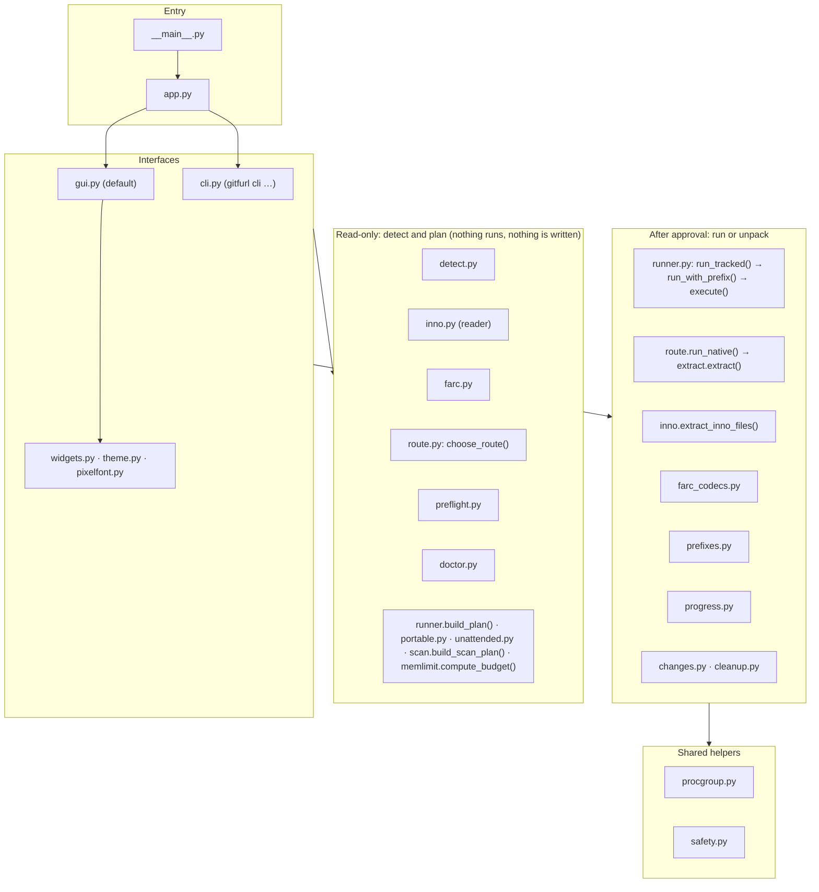
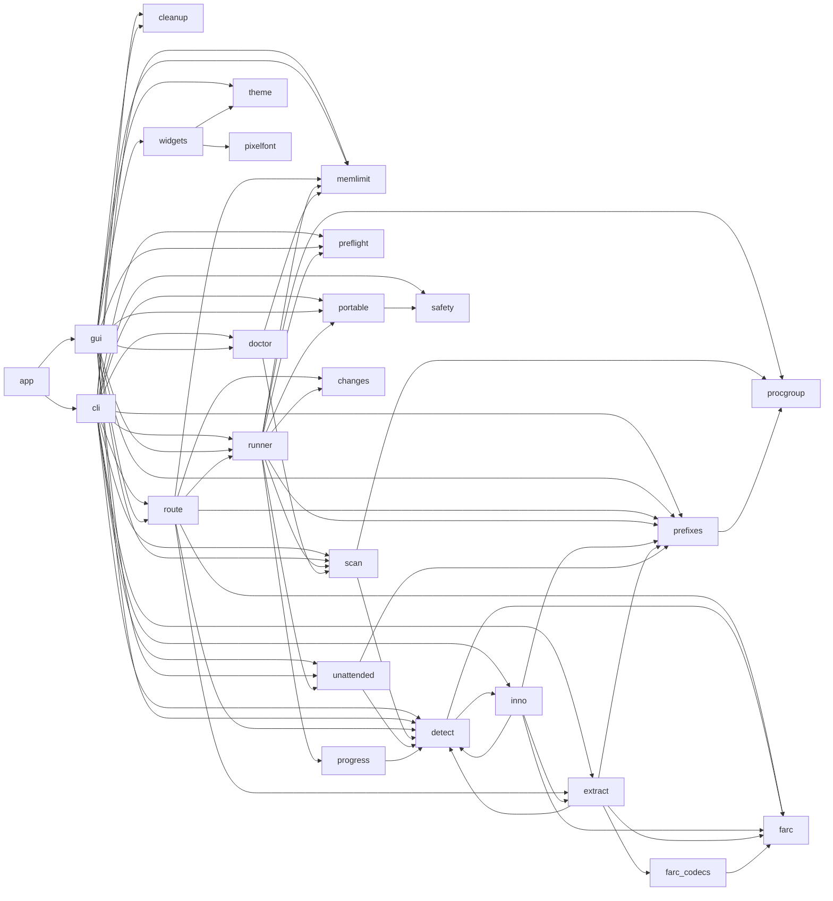
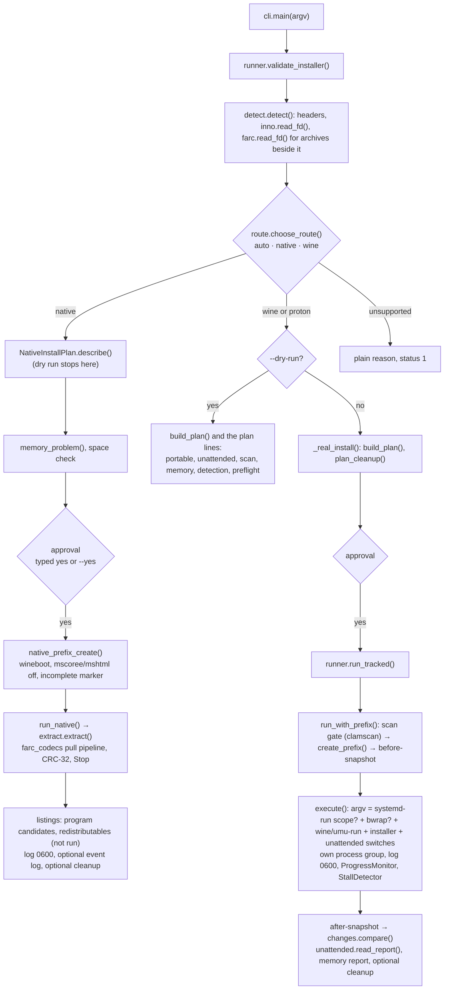
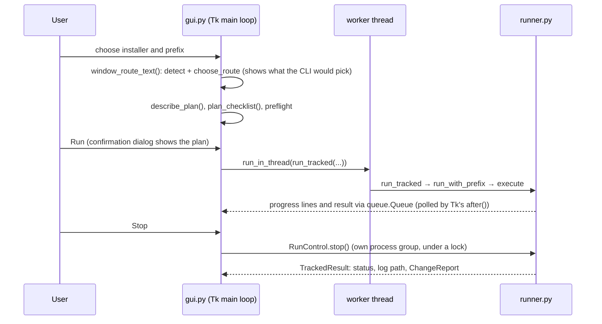
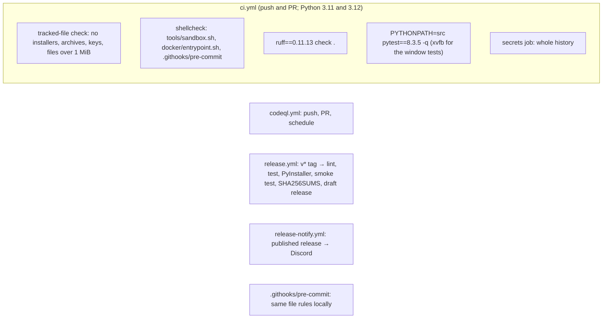

# Code map

A map of the source for people changing it: layers, which module uses which, the main control and data flows, the entry points, and which tests and CI jobs cover what. The per-module details are in [architecture.md](architecture.md); this page is the overview. The diagrams are Mermaid (GitHub draws them).

Checked against `main` at 1183f440 (2026-11-23). The import graph below was read from the source with Python's `ast` module, so it lists every `from gitfurl… import` in each file, including imports inside functions.

## Layers

- **Entry**: `app.main()` opens the window with no arguments, hands `cli …` to `cli.main()`, and refuses anything else with status 2.
- **Interfaces**: the window and the command line call the same core. Logic in `gui.py` that can be tested without a display is kept in plain functions (`describe_plan`, `plan_checklist`, `window_route_text`, …).
- **Read-only layer**: reads file headers, archive indexes and `/proc`, and builds plans. It starts no process except the read-only probes in `doctor.py` and `memlimit.availability()`.
- **Run layer**: anything that starts Wine, `wineboot`, `clamscan`, `bwrap` or `systemd-run`, or writes into a prefix. It is reached only after the approval that shows the plan.

## Module dependencies

Arrows point from a module to the modules it imports. Modules with no gitfurl imports: `changes`, `cleanup`, `farc`, `memlimit`, `pixelfont`, `preflight`, `procgroup`, `safety`, `theme`.

Notes:
- `detect` ↔ `inno` is a cycle by design: `detect.detect()` calls `inno.read_fd()` on the open file (top-level import), and `inno.py` imports `detect.clean` inside a function, so loading either module first works. `inno` also imports `extract` and `prefixes` inside functions.
- `inno` imports `extract` to reuse its folder handling (`_Tree`, `_make_dest`, name checks) and the `ExtractPlan` checks.
- `route` imports `runner` only for `logs_root()`; the Wine fallback is run by `cli.py` through `runner`. The native route starts no process except `wineboot` (and `clamscan` with `--scan`).

## Entry points

| What | Where | Notes |
|---|---|---|
| `gitfurl` (console script) | `app.main()` | from `pyproject.toml` `[project.scripts]` |
| `python -m gitfurl` | `__main__.py` → `app.main()` | |
| The window | `gui.main(start="library", prefix=None, driver=None)` | `driver` is the test hook `tests/gui_stop_driver.py` uses |
| `gitfurl cli doctor` | `doctor.run_doctor()`, `format_report()` | read-only probes with a timeout |
| `gitfurl cli install` | `cli.main()` → `choose_route()` → `_native_install()` or `_real_install()` (dry run printed inline) | see the flow below |
| `gitfurl cli extract` | `cli._extract_command()` → `extract.plan_extract()`, `extract.extract()` | FreeArc archives beside the installer, into an existing prefix |
| `gitfurl cli extract-inno` | `cli._extract_inno_command()` → `inno.plan_inno_extract()`, `inno.extract_inno_files()` | files Inno Setup stores for `{app}` |
| `gitfurl cli prefix create` / `list` | `cli._prefix_command()` → `prefixes.create_prefix()`, `list_prefixes()` | |
| Sandbox wrapper (manual) | `tools/sandbox.sh` | bubblewrap, network off, NixOS only; not part of the app |
| Asset generator | `tools/make_assets.py` | `assets/*.svg`, dividers, the facts label colours |
| Release build | `.github/workflows/release.yml` | PyInstaller single file on a `v*` tag, draft release |

## Control flow: `gitfurl cli install`

Rules visible in the flow:
- A dry run never falls through to a real run; both routes print the plan and stop.
- Without a terminal and without `--yes`, real actions exit with status 2 and change nothing.
- The process group gitfurl starts is the only thing it stops (`RunControl`, `procgroup.SigintGuard`); Ctrl-C ends with status 130.

## Control flow: the window

The window always runs Setup (the Wine/Proton route). When the command line would have chosen the native route, its route line says so; a native route in the window is not built yet.

## Data flow: from the installer to files in the prefix (native route)

For `extract-inno` the source is the setup file itself: `inno.read_setup()` gives the header and entry lists, `plan_inno_extract()` chooses the `{app}` files, and `extract_inno_files()` streams each chunk (stored, zlib, bzip2, LZMA, LZMA2), undoes the x86 call filter and checks SHA-1 or SHA-256.

## Where files go

| Data | Location | Written by |
|---|---|---|
| Prefixes | `prefixes.prefixes_root()` (per user) / NAME | `prefixes.create_prefix()`, `route.native_prefix_create()` |
| Logs and event logs (mode 0600) | `runner.logs_root()` | `runner.execute()`, `route.run_native()` |
| Extracted files | `drive_c/Games/NAME` in the prefix | `extract.extract()`, `inno.extract_inno_files()` |
| Inno Setup's own log (unattended) | inside the prefix | Setup itself; read by `unattended.read_report()` |
| Nothing else | - | the read-only layer writes nothing |

## Build and test map

| Test file | Covers | Test-only helpers |
|---|---|---|
| `tests/test_gitfurl.py` | `app`, `cli`, `doctor`, `detect`, `prefixes`, `runner`, `preflight`, `procgroup`, `progress`, `changes`, `cleanup`, `gui` plain functions, `route` | - |
| `tests/test_route.py` | `route` (choice, native plan and run), `cli install` on both routes, `gui.window_route_text` | `tests/farc_writer.py` |
| `tests/test_farc.py` | `farc` index reader, `detect` with archives | `tests/farc_writer.py` |
| `tests/test_extract.py` | `extract`, `cli extract` | `tests/farc_writer.py` |
| `tests/test_codecs.py` | `farc_codecs` (lzma, exe, delta, rep, 4x4, srep, VHASH, SipHash, AES), chains through `extract` | `tests/farc_writer.py` |
| `tests/test_inno.py` | `inno` reader, `[Code]` scan, preflight, `extract-inno`, `detect` and `cli` lines | `tests/inno_writer.py` |
| `tests/test_unattended.py` | `unattended`, its CLI and window options | - |
| `tests/test_portable.py` | `portable`, `runner` wrapping, window option | - |
| `tests/test_scan.py` | `scan`, the scan gate, `doctor` lines | - |
| `tests/test_memlimit.py` | `memlimit`, `runner` scope, `doctor`, window option | - |
| `tests/test_progress.py` | `progress` (fake `/proc`), stall detector | - |
| `tests/test_gui_polish.py` | `theme`, `widgets`, window polish (window parts skipped without `xvfb-run` or tkinter) | - |
| `tests/test_gui_stop.py` | Stop in the real window | `tests/gui_stop_driver.py` (`xvfb-run -a`) |

Local check with the pinned versions: `ruff==0.11.13 check src tests` and `PYTHONPATH=src pytest==8.3.5 -q tests` on Python 3.11 (see [development.md](development.md)). Manual runs with real or synthetic installers go through `tools/sandbox.sh` only; they are recorded in [testing.md](testing.md).

## What this map does not show

- The internal structure of `gui.py` (1,340 lines: pages, dialogs and the run loop in one `main()` closure). Its pages are named in the [user guide](user-guide.md); the map shows only its calls into the core.
- Decoder internals of `farc_codecs.py` and the record layouts of `inno.py`: they follow the clean-room specifications, which are not in the repository.
- Timing: which calls happen on Tk's thread and which on the worker thread beyond the sequence above.
