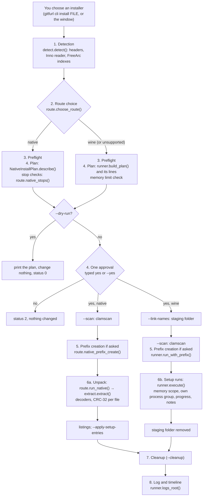

# The installer pipeline

What happens from choosing an installer to the end of a run, on both routes, stage by stage. Each stage says what it reads, what it may write, what can stop the run, and where the code is. The module details are in [architecture.md](architecture.md), the module graph in [code-map.md](code-map.md), every option in [cli.md](cli.md), and what each option means for you in the [user guide](user-guide.md).

Checked against `main` at 0a8237ce (2026-11-27; the source is the same as at 9142afa7). The function names are from `src/gitfurl/`. The window runs the same stages through the same functions (see [code-map.md](code-map.md#control-flow-the-window)); this page follows `gitfurl cli install`.

## 1. Detection

- **Reads:** the installer's first bytes (`MZ` or the FreeArc signature `ArC` 0x01), the Inno Setup offset table and header blocks through `inno.read_fd()` on the same open file (or `<stem>-0.bin` when setup.exe has no loader), the first 32 MiB for an Inno Setup ID string when the header cannot be read, and the first 4 bytes of up to 16 large files beside it. For each FreeArc file it reads the archive's own index with `farc.read_fd()`, CRC-32 checked. Every read is bounded.
- **May write:** nothing. It starts nothing.
- **Can stop the run:** no. `runner.validate_installer()` runs first and refuses a path that does not exist or is not a regular file (status 1). A file that then cannot be opened (for example no read permission) gives `readable = False`, and the route is "unsupported" (see below).
- **Code:** `cli.main()` → `runner.validate_installer()`, `detect.detect()` (once; the result is passed on). The Inno reader is `inno.py`, the index reader `farc.py`. With `--link-names`, `namelinks.propose_for()` reads the setup data and the folder's names for a mapping.
- **Note:** detection reads indexes without the CRC opt-in. With `--accept-bad-index-crc`, the plan's detection lines can still say that an index could not be read, while the route below reads it with a warning.

## 2. The route choice

`route.choose_route(installer, prefix_name, det, requested, setup_options=..., links=..., accept_bad_index_crc=..., keep_bad_file_crc=...)` picks `native`, `wine` or `unsupported`, with reasons. It writes nothing and runs nothing.

- **Reads:** the Detection, the folder's entries (`extract.find_archives()`: at most 10,000 entries, at most 64 archives), each archive's index again (`extract.plan_extract()`), and for an Inno Setup installer the names its setup script uses (`route.script_names()`).
- **May write:** nothing.
- **Can stop the run:** with `--route native`, any reason the native route is not possible raises an error (status 1, nothing run). An invalid prefix name also stops here.

How the automatic choice (`--route auto`, the default) decides, in the order of the code:

1. The file could not be read: **unsupported**. `cli.main()` branches only on `native`, so an unsupported choice goes on to the Wine/Proton plan, with "route: unsupported" and the reason in it (seen in a dry run of a file without read permission, 2026-11-27).
2. You gave an option that only a Setup run uses (`--portable`, `--unattended`, `--wine-debug`, `--show-changes`, `--runtime proton`; the list is `cli._native_unused()`): **wine**.
3. The installer is neither Inno Setup ("likely") nor itself a FreeArc archive: **wine**.
4. No FreeArc archive beside it: **wine**.
5. `plan_extract()` refuses (an index that does not read cleanly, a method gitfurl does not handle, an unsafe or clashing name, the cm stage without the native module): **wine**, with the reason.
6. The archives are not linked to the installer (`route.link_check()`): the setup script does not name every one, and they do not share one base name that is the installer's own or part of its folder's name: **wine**, with the reason and "to unpack them anyway, use --route native".
7. Otherwise: **native**. The reasons name the archives, the methods and how they are linked, and end with "Setup is not run".

What changes the choice:

| Option | Effect on the choice |
|---|---|
| `--route wine` | always **wine**, "chosen by you"; nothing above is checked |
| `--route native` | steps 3 to 5 become errors instead of the Wine route; step 2 and step 6 do not apply (an unlinked set is unpacked, "you chose this route although ..."); the Setup-only options are listed as not applying |
| `--link-names` | when `propose_for()` finds a mapping, the mapped archives count as named by the script in step 6, so the choice can become **native** ("with the names linked (other-01.bin stands for fg-01.bin, ...)") |
| `--accept-bad-index-crc` | step 5 reads an index or footer with a bad CRC, with a warning, instead of refusing it |
| `--keep-bad-file-crc` | does not change the choice; it is kept in the plan for the unpack |

The window makes the same choice through `gui.window_route()`; its "Run Setup instead" switch is `--route wine`. More in the user guide: [How gitfurl picks the route](user-guide.md#how-gitfurl-picks-the-route).

## 3. Preflight and doctor

- **Reads:** free space where the prefix will live (the nearest existing folder), the size of the files in the installer's folder (at most 20,000 entries, 3 seconds), `MemAvailable` and the number of CPU threads. On the Setup route it also adds what the archives beside the installer unpack to, from their indexes, when the route judges them linked (`route.setup_unpacked()`).
- **May write:** nothing.
- **Can stop the run:** no. `preflight.measure()` is advisory: its warnings end with "You can still go ahead." The native route's own space and memory checks are in stage 4.
- **Code:** `preflight.measure()`, `Preflight.describe()`.

`gitfurl cli doctor` is a separate, read-only command; the install does not call it. It runs bounded version probes (`wine`, `bwrap`, `umu-run`, `innoextract`, `clamscan`, each with a 5 s timeout), checks tkinter and whether the memory limit can be used, and reports the machine's memory and CPU threads. Code: `doctor.run_doctor()`, `format_report()`.

## 4. The plan and the one approval

Both routes print one plan and ask once. A dry run prints the plan and stops with status 0; it never falls through to a real run.

**Native route** (`cli._native_install()`):
- **Reads:** `/proc/meminfo`, free space and inodes (`statvfs`), the prefix folder, `wine` on PATH (only when the prefix is to be created), the memory limit's availability (only then), the ClamAV database date (`clamscan --version`, a bounded probe; skipped in a dry run), and with `--apply-setup-entries` the setup's `[Registry]` and `[Icons]` entries and the prefix's `system.reg` header (`setup_entries.plan_setup_entries()`).
- **The plan:** `NativeInstallPlan.describe()`: the route line, what Setup's steps are skipped, then numbered steps (scan, prefix creation, unpack, listings, setup entries, cleanup), the memory line, the options that do not apply, and "One approval covers every step above."
- **Can stop the run** (`route.native_stops()`, in this order): the prefix is missing and `--create-prefix` was not given (status 1); `wine` is not on PATH for the prefix creation (1); the memory limit cannot be used for `wineboot` (2); not enough free space or inodes, measured with room for a new prefix (1); the decoders' memory for one data block does not fit in `MemAvailable` minus the memory kept free for the rest of the system (2; `--no-memory-limit` skips this check). Also: running as root, no `--prefix` on a real run, a `--progress-interval` of 0 or less, `--allow-scan-hit` without `--scan`, and an unsafe `--cleanup` folder.

**Wine/Proton route** (`cli._real_install()`, or the dry run in `cli.main()`):
- **Reads:** `wine` or `umu-run` on PATH, `bwrap` for `--portable`, the prefix folder, the memory limit's availability (files only: PATH, the user manager's socket, cgroup files, `/proc/meminfo`; systemd itself is asked when the run starts), the ClamAV database date (a bounded `clamscan --version`; not in a dry run).
- **The plan:** the command (`InstallPlan.preview()`), the prefix and whether it will be created, the wineboot line, the menu-builder line, the portable lines or the warning that a prefix is not a sandbox, the link-staging lines, the unattended lines, the memory limit's lines, the detection and route, the preflight, the scan, and the cleanup.
- **Can stop the run:** running as root, no `--prefix`, `--portable` with a runtime other than wine or without what bwrap needs, `--link-names` with `--portable`, `--unattended` for an installer that is not Inno Setup, the runtime not on PATH, a missing prefix without `--create-prefix`, a bad `--wine-debug`, `--progress-interval` or `--stall-after`, an unsafe `--cleanup` folder (all status 1), and a memory limit that cannot be used (status 2).

**The approval:** `cli._confirm()` asks you to type `yes`. `--yes` approves without asking. With no terminal and no `--yes`, nothing changes and the status is 2. The timeline gets "You approved the plan" or "Approved with --yes" (`timeline.approval_entry()`).

## 5. Prefix creation

Only when the prefix is missing and you asked for it (`--create-prefix`, or `gitfurl cli prefix create`). Code: `prefixes.create_prefix()`, called by `route.native_prefix_create()` (native) and `runner.run_with_prefix()` (Wine/Proton).

- **Reads:** your environment, minus inherited `WINE*` settings (`prefixes.child_env()`).
- **May write:** a new folder `prefixes_root()/NAME` (mode 0700; the path must not exist), an empty `gitfurl-incomplete` marker in it before `wineboot` starts, and whatever `wine wineboot --init` writes there. The marker is removed only when `wineboot` exits with status 0.
- **Environment, for that command only:** `WINEPREFIX`, and `WINEDLLOVERRIDES` with `winemenubuilder.exe=d` (Wine's menu builder off, for every Wine process gitfurl starts) and, for the wine runtime, `mscoree,mshtml=` (no Mono or Gecko dialogs) unless `--wine-addons`; for example `mscoree,mshtml=;winemenubuilder.exe=d`. The native route always uses the quiet value (`route.NATIVE_WINEBOOT_ENV`). With `--runtime proton` the command is `umu-run wineboot --init` with `PROTONPATH` and `GAMEID=umu-0`, and only the menu builder is turned off.
- **Can stop the run:** a path that already exists, `wineboot` exiting with a non-zero status, a timeout (300 s), Ctrl-C or Stop. The installer is then not started and nothing is unpacked; the folder is kept with its marker, and gitfurl will not use it.
- **Memory limit:** unless `--no-memory-limit`, `wineboot` runs in a systemd user scope with fixed limits (`memlimit.prepare(..., label="wineboot")`).
- **Process group:** `wineboot` runs in its own process group (`prefixes.run_in_group()`), so a timeout, Ctrl-C or Stop ends it and its helpers.

## 6a. The native route: the unpack

Code: `cli._native_steps()` → (scan) → `route.native_prefix_create()` → `route.run_native()` → `extract.extract()`. The window runs the same order in `route.perform_native()` on a worker thread. Setup is not run. The user guide has the full list of checks: [Native extraction (FreeArc)](user-guide.md#native-extraction-freearc).

- **Reads:** every archive again, opened with `O_NOFOLLOW`; each index is read again and must match the plan, or the unpack is refused ("changed after the plan was made").
- **May write:** a new folder `drive_c/Games/PREFIX` (`C:\Games\PREFIX`, or the new folder `--dest` names on drive C:, with any missing folders above it) and the files in it, each created with `O_CREAT | O_EXCL | O_NOFOLLOW` relative to its folder's descriptor, so nothing is overwritten and nothing outside it is written. File times come from the archive. The log and, with `--detailed-log`, the event log (both 0600).
- **Can stop the run before anything is written** (`ExtractRefused`, status 1): the prefix is missing, incomplete or has no `drive_c`, the destination exists, not enough space, an archive cannot be opened or has changed. Stop or Ctrl-C before the destination exists also ends it with nothing written.
- **Once the destination exists** every problem is reported in the result and files already written are kept: Stop or Ctrl-C (between 1 MiB chunks; status 130), damaged data, a data block that ends early, not enough memory, a write error (status 1).

**Decoders.** `farc_codecs.open_chain()` builds a pull pipeline for each data block, decoded right to left, with every buffer capped before the block is read (`stage_plan()`, `chain_memory()`). The stages are `storing`, `lzma`, `exe`, `x86`, `delta`, `rep`, `4x4` (with `lzma` inside) and `srep` in Python; `rolz` in the native module `gitfurl._codecs` when it is built (`farc_codecs.rolz_native()`), else in `farc_rolz.py`; and the cm stage only in the native module (`farc_codecs.cm_available()`; without it the plan refuses the archive). The rolz and cm stages read the stored block themselves, so each must be the chain's last method. The plan's memory line is the most one data block's decoders may hold at once.

**CRC checks.** Each file's CRC-32 is computed as it is written and compared with the index (`extract._write_all()`). By default a file that does not match is removed again and listed, and the run ends with status 1. The two opt-ins, both off by default and for this run only:
- `--accept-bad-index-crc`: `farc` reads an index or footer descriptor whose CRC-32 fails, with a warning in the plan, the approval, the log and the timeline (`Archive.warnings`). Lengths, offsets and names are still checked, and each file's CRC is still checked.
- `--keep-bad-file-crc`: a file whose CRC-32 does not match is kept and listed with its stored and computed values (`ExtractResult.crc_kept`, `crc_details`). Its size must still match, a decoder that finds damaged data still stops the unpack, and nothing is overwritten. The run counts as complete (status 0), but a cleanup is skipped. The plan starts with a warning.

More: [Two CRC opt-ins, for an installer you trust](user-guide.md#two-crc-opt-ins-for-an-installer-you-trust).

**Setup entries** (`--apply-setup-entries`, `setup_entries.apply_entries()`). Only after a complete unpack (`ExtractResult.ok`, which a kept CRC mismatch does not change) and only when Stop was not asked for.
- **Reads:** the prefix's architecture and user folder again (they must match the plan), whether a Wine server for the prefix runs (`procgroup.prefix_server_running()`; it waits up to 30 s).
- **May write:** the listed values into `system.reg` (HKLM, and HKCR as `HKLM\Software\Classes`) and `user.reg` (HKCU), after a copy of each file goes into the log folder (0600), through a temporary file and a rename; one menu entry per program under `{app}`, `$XDG_DATA_HOME/applications/gitfurl-PREFIX-NAME.desktop` (0644). No Wine program runs.
- **Can stop it:** a running Wine server, a prefix that is not what the plan assumed, or no registry files: then no value is written, and the reason is a line in the end text, the log and the timeline. A file at a menu entry's path that gitfurl did not write is left. The unpack's status is not changed by any of these.
- More: [Setup entries on the native route](user-guide.md#setup-entries-on-the-native-route).

**Program candidates.** After a complete unpack, `route.listings()` lists the `.exe` files that look like programs (`changes.find_game_executables()`, a guess from names and sizes) with the line to start one, and the redistributable installers found (`route.is_redist()`). Nothing is run.

## 6b. The Wine/Proton route: Setup runs

Code: `namelinks.run_staged()` → `runner.run_tracked()` → `run_with_prefix()` → `execute()`. Setup does all of its own steps.

`run_with_prefix()` checks, in this order, before anything is created: `--portable` can be used (`portable.check_portable_supported()`), the prefix is not marked incomplete, the memory limit can be used, and the ClamAV scan (`_scan_gate()`). Then it creates the prefix if asked (stage 5), takes the "before" snapshot for `--show-changes` or `--find-exe`, and calls `execute()`.

- **Reads:** while Setup runs, `/proc` for the prefix's processes, how far they have read into the large files beside the installer, and their CPU time (`progress.ProgressMonitor`); the prefix's size; with stall advice or a crash, the run's windows through `xwininfo` and `xprop` (`windows.py`, read-only; not in a portable run).
- **May write:** whatever Setup writes into the prefix (Setup is not a sandbox: it can reach files you can reach), the log, the event log, the timeline. gitfurl itself writes nothing into the prefix here.
- **Can stop the run:** a scan match (unless `--allow-scan-hit`) or a scan error (never overridden); a memory limit that cannot be set up (status 2); Stop or Ctrl-C (status 130); the memory limit's hard limit (systemd ends the run, and the end text says so).

The parts of a run:
- **Command:** `argv = [systemd-run scope] + [bwrap ...] + wine|umu-run installer [unattended switches]`. The child environment is yours minus inherited `WINE*`, plus `WINEPREFIX`, the runtime's variables, `WINEDLLOVERRIDES` with the menu builder off, and `WINEDEBUG` with `--wine-debug`. Values are never written to the log.
- **Memory limit** (on unless `--no-memory-limit`): a systemd user scope with `MemoryHigh`, `MemoryMax` and `OOMPolicy=stop`, outermost in the argv; the soft limit is adjusted every 5 s while the run goes on (`memlimit.MemoryScope`). More: [Memory limit](user-guide.md#memory-limit).
- **Process group:** Setup starts in its own session (`start_new_session=True`). Stop or Ctrl-C sends TERM to that group only, KILL after 10 s, and with the wine runtime (not portable) then runs `wineserver -k` for this prefix (`runner.RunControl`). Nothing is stopped by name.
- **Progress:** with `--progress`, `[progress]` output every `--progress-interval` seconds (default 10): payload read, rate, estimate, and the processes in gitfurl's own process group with their CPU and memory (`activity.wine_lines()`). The monitor runs on every command-line run anyway, because it is also how a crash is seen.
- **Crash note:** when Wine's crash handler (`winedbg.exe`) appears in the prefix during the run, one `[note] crash: ...` line, a log line and a timeline row. A crash handler that was already running before the run is not counted.
- **Stall note:** with `--stall-after SECONDS` (the window uses 120 s), a `[note] possibly stalled: ...` line when no payload is read, the prefix's processes use under 3% CPU and the log does not grow for that long, naming the newest window when it can. It never stops anything.
- **Scan** (`--scan`): `clamscan --no-summary --stdout` on the installer and the regular files beside it, in its own process group, with a timeout (`--scan-timeout`, default 600 s). gitfurl never updates the database. More: [ClamAV scan](user-guide.md#clamav-scan).
- **Portable** (`--portable`, wine runtime only): Setup runs in bwrap with only the prefix writable and no network. More: [Portable install](user-guide.md#portable-install).
- **Unattended** (`--unattended`, Inno Setup only): Setup gets `/SP- /VERYSILENT /SUPPRESSMSGBOXES /NORESTART /DIR=C:\Games\PREFIX /LOG=C:\gitfurl-setup-<stamp>.log`, and `unattended.read_report()` reads that log afterwards. More: [Unattended install](user-guide.md#unattended-install-inno-setup).
- **Name links** (`--link-names` with a mapping): before Setup starts, `namelinks.Staging.create()` makes `$XDG_STATE_HOME/gitfurl/staging/PREFIX-DATE-TIME-PID` (0700) with a symbolic link for every file and folder beside the installer and one for each expected name; Setup is started from there. After the run, whatever its outcome, `Staging.remove()` removes the links it made and the folder. Your files are not renamed. More: [Archives under another name](user-guide.md#archives-under-another-name).
- **After the run:** the "after" snapshot and `changes.compare()` for `--show-changes` and `--find-exe`, Inno's log report, the memory report, and the exit status line.

## 7. Cleanup

Off unless `--cleanup installer` or `--cleanup folder`. Code: `cleanup.plan_cleanup()` (before the approval; the plan lists every file) and `perform_cleanup()`.

- **Reads:** the installer's folder (at most 200 entries; links are listed, not followed).
- **May write:** deletes the installer, or every file in its folder and then the empty folders.
- **When it runs:** only after exit status 0 on the Wine route, and only after a complete unpack on the native route. It is skipped after Stop, after an error, and on the native route when a file was kept with `--keep-bad-file-crc`.
- **Refused in the plan:** anything under a system folder (`/usr`, `/etc`, `/nix`, ...), and in `folder` mode your home folder or a folder above it, a general folder such as `~/Downloads`, a mount point, or a folder that holds the prefix, the prefixes folder or the log folder.

More: [Cleanup](user-guide.md#cleanup).

## 8. The log and the timeline

- **Where:** `runner.logs_root()`, usually `~/.local/state/gitfurl/logs` (`$XDG_STATE_HOME/gitfurl/logs`), folder mode 0700.
- **Log:** `<prefix>-<stamp>.log`, mode 0600, created with `O_EXCL`. Wine route: the command, the working folder, the prefix, the scan summary, Setup's output, the exit status or the cancel notes, crash, unattended and memory lines (`runner.execute()`). Native route: the route, the installer, the archives, the destination, warnings, every CRC-32 mismatch with stored and computed values, the end lines and the setup entries (`route.run_native()`). Never your environment values.
- **Event log:** with `--detailed-log`, `<prefix>-<stamp>.events.jsonl` (0600), one JSON object per line.
- **Timeline:** `<prefix>-<stamp>.timeline.txt` (0600), always written for an approved run that did something: the plan's rows (detection, route and reasons, CRC warnings, prefix, what is skipped), the approval, each step, and the outcome (`timeline.Timeline`; rows come from `cli`, `route` and `runner`). Rows are written as they become final, so a crash leaves what was written. A run that stopped before anything changed (for example at the scan) writes none. `--timeline` also prints the rows as they come; `gitfurl cli log PREFIX` prints the latest one later.
- **Exit status:** 0 success; 1 an error, a non-zero Setup status or a CRC-32 mismatch (by default); 2 not approved, or the memory limit or the decoders' memory check; 130 stopped.

More: [Logs](user-guide.md#logs) and [Timeline](user-guide.md#timeline).
