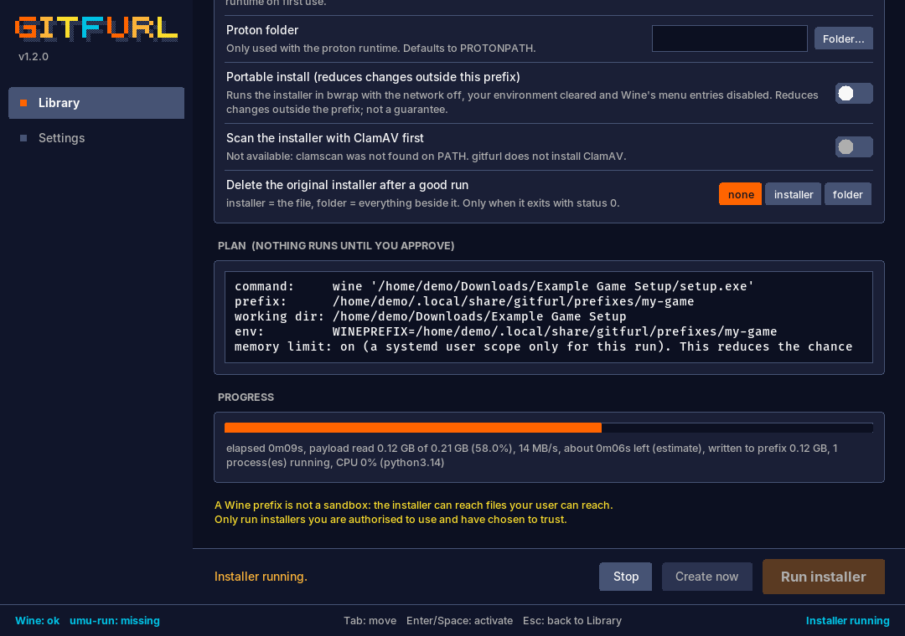

# gitfurl user guide

gitfurl helps you run a Windows installer you already have on Linux, through Wine, in a separate Wine environment ("prefix") that it creates for that purpose. Compatibility with any given installer is unverified. This guide says what works, what has been tested, and what to do when something goes wrong.

## What gitfurl does and does not do
- It runs an installer file that **you chose**, from your own disk.
- It does not search for, download or bundle installers or games, and it does not remove copy protection, bypass activation or apply cracks. If an installer offers such options, gitfurl does not select them for you.
- It makes no network requests of its own, sends no telemetry and uploads nothing.
- You must be authorised to use the software you run. gitfurl makes no claim that any use is lawful.

## What it is for

Running a Windows installer under Wine by hand works, until it does not. These are the problems gitfurl is for:

- **You do not want it to use your main Wine prefix.** Run `wine setup.exe` with no setup and it uses `~/.wine`. Gitfurl makes a separate prefix for each thing you install and never uses `~/.wine` as the prefix. (Wine's menu builder is off, so Wine adds no menu entries or file types to your desktop; see "Menu entries and file types". The installer itself can still write elsewhere, for example `~/.cache/wine`; the optional changes report shows some of that.)
- **You want to see what will happen before it happens.** Gitfurl shows the exact command, prefix, folder and environment variable first, and nothing runs until you approve.
- **Big installers look frozen.** Some installers sit for a long time with a bar that does not move. Gitfurl watches how far the installer has read into the large files beside it and shows a percentage, a rate and a rough time left, without relying on the installer's own display.
- **You want to know what it changed.** An optional report lists new files and registry keys in the prefix, and changes in a few places outside it (menu entries, autostart, your home folder's top level).
- **You want a log you can read.** Each run gets a log. An optional JSON event log and Wine debug output are there when you need more.
- **You want to tidy up afterwards.** An optional, guarded step deletes the original installer after a run that exits cleanly. It is off by default.
- **You want to try Proton instead of Wine.** One setting switches the runtime, through umu-run, with a Proton folder you already have.
- **You want a stricter box.** The repository includes a bubblewrap wrapper that runs an installer with no network and an empty home folder. It is a manual script, tested on NixOS only, and it opens no window.

## Screenshots
These were made on 2026-11-27 from the code after 1.4.0 (with the menu bar and the run timeline), under a virtual display, in a demo home folder (`/home/demo`) with empty example prefixes. No installer, no Wine and no other process was run: the screenshot script replaced the tool checks, the memory-limit check and the run itself with stand-ins, and the "installer" is a small file that only starts like a Windows program.

*Before a run: the checklist, the chosen installer and the options. Nothing runs until you approve the plan.*

*During a run. The bar and the progress line were set by the screenshot script to show what a run looks like; they are not readings of a real process. In the Timeline card, the first four rows (route, prefix, nothing unpacked, your approval) are gitfurl's own, from the plan; the last three (Setup started, a window opened, the progress row) were added by the script in the run's own wording.*

*Settings: the platform line, the Wine and bubblewrap versions and the missing umu-run were all set by the screenshot script.*

## Before you start
You need:
- Linux with Python 3.11 or newer.
- Wine (`wine --version` should work). Wine 11 was used for the testing described below.
- tkinter for the graphical app (Debian and Ubuntu: `python3-tk`; Fedora: `python3-tkinter`; Arch: `tk`). The command line does not need it.
- Optional: bubblewrap (`bwrap`), if you want to run an installer in a stricter sandbox yourself (see "Safer runs").

With Nix, `nix develop` gives you Python with tkinter, and `nix develop .#wine` adds Wine.

## Start the app
    python -m gitfurl

(Once installed with `pip install .`, the command is `gitfurl`.) The window has a sidebar with **Library** and **Settings**.

**Menu entry (optional).** `gitfurl cli desktop-entry` adds gitfurl to your desktop's application menu. It shows the plan first and asks before it changes anything (`--dry-run` only shows it):
- `~/.local/share/applications/gitfurl.desktop` (or under `$XDG_DATA_HOME`). It starts the window with the built program itself, else the `gitfurl` found on PATH, else `python -m gitfurl` run from the folder that holds gitfurl (so a source checkout works too), by absolute path. The plan shows the exact `Exec` line;
- a copy of the window's icon in `~/.local/share/icons/hicolor/64x64/apps/gitfurl.png`;
- the folders for them that do not exist yet (the plan lists each one).

Nothing else is changed and no program is started; the menu may take a moment, or a new login, to show it. `gitfurl cli desktop-entry --remove` removes both files, and gitfurl's own temporary files if an interrupted run left any; it leaves the folders. gitfurl replaces or removes only files it wrote itself: the entry carries the line `X-Gitfurl-Generated=true`, and the icon must be gitfurl's icon or sit beside gitfurl's entry. A link in place of the entry or the icon is refused; folders on the way (for example a linked `~/.local/share/applications`) are used as they are. If a step fails, gitfurl says what it had already done. If you move or reinstall gitfurl, run it again so the entry points at the new place. It refuses to run as root.

### Library
The Library lists your prefixes. A prefix is a folder where Wine keeps its own fake Windows drive and registry. gitfurl keeps its prefixes in `~/.local/share/gitfurl/prefixes/` (or under `$XDG_DATA_HOME`) and **never uses `~/.wine`**.
- **+ New prefix** adds a name to the list. The folder is created only when you create it or run an installer.
- Click a prefix, or move to it with Up/Down and press Enter, to open it.
- "ready" means the folder exists. "not created yet" means it does not.
- **Delete...** on a ready prefix (or File > Delete prefix... for the prefix you have open) deletes it after an approval; see "Deleting a prefix".

### The window, keys and footer
The window can be resized (smallest size about 900 x 620); the content follows its width and the pages scroll with the mouse wheel. The bar along the bottom shows, from left to right: whether Wine and umu-run were found ("ok" or "missing"), the keys that work on this page, and what gitfurl is doing ("Idle", "Creating prefix", "Installer running", "Unpacking" (the native route), "Deleting prefix" or "Stopping...").

Keys: **Tab** and **Shift+Tab** move through everything you can use, in the order it appears on screen, and the page scrolls to keep the focused item visible. The focused item gets an orange outline (white on the orange buttons): a coloured line, not colour alone. **Enter** or **Space** activates it (open a prefix, press a button, flip a switch, choose an option). In the Library, **Up** and **Down** move between prefixes. **Esc** goes from a prefix's page back to the Library, except while an installer is running: then the page with the Stop button stays in view, as it does for the sidebar. While a run is going, Run and Create are off because their buttons are disabled; that is the only guard against a second start. These keys are for the keyboard; gitfurl does not provide screen-reader support (the toolkit it uses, Tk, cannot).

If Wine is not found, an amber box on the Library and on a prefix's page says so and has a **Check again** button.

### Menu and view settings
A menu bar at the top has **File** (Choose installer..., Ctrl+O; New prefix..., Ctrl+N; Delete prefix... (the prefix you have open); Settings, Ctrl+,; Quit, Ctrl+Q), **View** (smaller, normal or larger text, also Ctrl+-, Ctrl+0 and Ctrl+=; Reduce motion; Remember window size) and **Help** (Keys, F1; About). The same view settings are in the **Window** card in Settings. Reduce motion makes the page move at once when you turn the mouse wheel instead of gliding. Remember window size starts gitfurl with the size it had when you closed it; where the window opens is up to your desktop. The view settings are kept in `$XDG_CONFIG_HOME/gitfurl/view.json` (usually `~/.config/gitfurl/view.json`, mode 0600), which holds only these settings and is written only when you change one or close the window with Remember window size on.

The window uses your desktop's own title bar. On niri, X11 programs get a title bar with only a close button, and niri does not act on a program's own maximize or minimize; Help > Keys lists niri's default keys for those instead (Mod+F maximizes the column, Mod+Shift+F is full screen; niri has no minimize).

### Running an installer
Open a prefix, then:
1. **Installer:** type or browse to the installer file (`setup.exe`). The **Checklist** at the top of the page shows what Run needs, each with a tick or a cross and a sentence: an installer file chosen, Wine (or umu-run for proton) found, or "not needed" when the native route unpacks the archives itself, and the prefix existing or set to be created. **Run installer**, **Create now** and **Stop** sit in a bar at the bottom of the page that stays in view; when Run is off, the bar says why in words.
2. Read the **Plan**. It shows the exact command, the prefix, the working folder and the environment variable gitfurl will set. Nothing has run yet.
3. Choose options (below).
4. Click **Run installer**. A dialog repeats the plan and the warning. Nothing starts until you confirm.
5. On the Wine/Proton route, the installer's own window opens; use it as you normally would. On the native route, Setup is not run: the footer says "Unpacking" and the status shows the progress.
6. When it ends, gitfurl shows the result: a headline in bold (for example "Unpacked (Setup was not run).") and the details below it, with the exit status and where the log is. The progress line says the run has ended. After an unpack, the checklist marks it done ("Done: the files are in ...") and Run stays off, because gitfurl only unpacks into a new folder: to unpack the same installer again, choose another prefix.

If the prefix does not exist and "Create the prefix if it does not exist" is on (the default), gitfurl creates it first. If creating it fails, the installer is not run.

### Options (all off unless stated)
- **Create the prefix if it does not exist** (on by default).
- **Limit memory (reduces the chance of running out)** (on by default). See "Memory limit" below. If it cannot be used on this machine, the checklist says why and Run stays off until you turn the option off.
- **Install without the installer's windows (Inno Setup only).** Off by default. See "Unattended install" below.
- **Link the archives under the names the setup expects.** Off by default. See "Archives under another name" below.
- **Show what the installer changed on my system.** After the run, a window lists new, changed and removed files in the prefix, new registry keys, and changes in a few places outside the prefix (menu entries, autostart, `~/.local/bin`, `~/Desktop`, the top level of your home folder). It lists names only, never contents. It is best effort: it cannot see changes elsewhere on your disk.
- **Add the setup's registry entries and shortcuts (native route).** Off by default. On the native route only: after a complete unpack, gitfurl also writes the registry values and menu entries the setup declares, where it can do so exactly, without running Wine. See "Setup entries on the native route" below.
- **Detailed log.** Also writes a JSON-lines event log next to the normal log (see "Logs").
- **Find the installed program.** After the run, gitfurl guesses which new `.exe` is the installed program (largest first, ignoring uninstallers, redistributables, crash handlers and Windows folders) and prints a command you can run yourself. It guesses from names and sizes only. It does not run the program, add it to any launcher, or look anything up online.
- **Runtime:** `wine` (default) or `proton`. Proton runs through `umu-run` and needs a Proton folder you already have, given with `--proton-path` or the `PROTONPATH` variable. gitfurl never downloads one. `umu-run` itself downloads the Steam Linux Runtime the first time it runs if it is not already on the machine; the confirmation dialog says so. This was tested only as far as starting an installer in a sandbox.
- **Portable install (reduces changes outside this prefix).** Off by default. Normal install is the default and runs the installer as today. Portable runs the installer inside bubblewrap (`bwrap`) so that, as far as bwrap isolates it, the writable places are the dedicated prefix, a temporary home and `/tmp` that vanish afterwards, the run's log file and `/dev/dri`. The network is off, the environment is filtered to a short allowlist, your home folder, the session and system D-Bus sockets are hidden, and Wine's menu and file-association builder is disabled, so entries in desktop menus, file-type handlers and `~/.cache/wine` are reduced, not guaranteed absent. See "Portable install" below. It is disabled when `bwrap` is not found or the runtime is `proton`, and then it says why.
- **Scan the installer with ClamAV first.** Off by default. See "ClamAV scan" below. It is disabled, with the reason shown, when `clamscan` is not on PATH.
- **Delete the original installer after a good run:** `none` (default), `installer` (just the file) or `folder` (**everything in the installer's folder**, including other files and sub-folders). See "Cleanup".

### Progress
While an installer runs, the Progress card shows how far the installer has read into the large files beside it (its payload), the read rate, an estimated time left, and how much has been written into the prefix. This does not depend on the installer's own progress display, which can be poor.
Limits: it assumes the large files next to the installer are its payload. The estimate is rough and appears only after about 1% has been read. If the installer reads its files in another way, the numbers can be wrong or stay at zero. It reads no file contents. To tell the prefix's processes from other Wine programs it also checks, for your own processes only, for the entry `WINEPREFIX=<this prefix>` in their environment and keeps only the match, the program name and CPU time (see SECURITY.md). The progress line also lists how many processes are running, their CPU use and helper program names, and says when it looks quiet.

### Timeline
Under Progress, the Timeline card lists what each step of the run did and why, one line each, newest at the bottom. It follows the newest line unless you scroll up. Before a run it shows the rows the plan starts with (the route and its reasons, the prefix, what is skipped); after you approve, the run adds its own. For example, a native unpack:

    10:25:04  Route: native (gitfurl unpacks the archives itself; gitfurl chose it) — an Inno Setup installer; its payload is 2 FreeArc archives ...; gitfurl can unpack them itself
    10:25:04  Prefix game: existing — used as it is, nothing in it is removed (...)
    10:25:04  Setup is not run — skipped: Setup's own files, shortcuts, registry entries, ...
    10:25:04  You approved the plan — you answered Yes to the plan in the window; nothing ran before this
    10:25:04  Opened game-01.bin: 2 files in 1 data block — its index was read again and matches the plan
    10:25:04  Data block 1 of 1 in game-01.bin: lzma — 2 files; decoded by gitfurl's own decoders
    10:25:05  Unpacking: 100 %, 48.0 KB of 48.0 KB — 60.9 MB/s
    10:25:05  5 files written (48.0 KB), each one CRC-32 checked — every CRC-32 matched the archive's index
    10:25:05  Unpacked (Setup was not run). — Extraction finished: ...

The prefix creation and Setup starting lines also say that Wine's menu builder is off. On the Setup route it lists the prefix creation, Setup starting, its progress (one line that updates), each window that opens, quiet periods, a crash, Stop and the exit status. **Copy** puts the lines on the clipboard; **Open full log** shows the end of the run's log. **Hide** folds the card. In the Library, a prefix with a saved timeline has **Last run**, which opens its latest timeline read-only.

The timeline is saved next to the log as `<prefix>-<stamp>.timeline.txt` (readable only by you), line by line as the run goes, so a crash leaves what was written. A line that is still changing (progress) is written when it stops changing. It is saved only after you approve, and only when the run did something (a run stopped by the scan before anything was created writes none). At most 2,000 lines are kept, each text is cut at 300 characters, and window titles and file names show only their printable characters. Command line: `gitfurl cli log PREFIX` prints a prefix's latest timeline, `gitfurl cli log --all` lists every one kept, and `install --timeline` prints the lines as they come.

### Checks before a run
The dry run and the approval step show a read-only preflight. Everything is advisory: it never blocks a run and never changes anything.
- **Measured:** free space on the disk that will hold the prefix, the total size of the files in the installer's folder (symlinks are not followed; if counting stops early the value is shown as "at least"), memory available, CPU threads.
- **Read from the archives (Setup runs):** when FreeArc archives that belong to the installer are beside it (the same link test as for the route: the setup script names them, or their names match; unrelated archives in the same folder are not counted) and gitfurl can read their own indexes, the preflight says what they unpack to (the sizes of the files they hold; a method gitfurl cannot decode does not matter for this). That is a lower bound for the install, and gitfurl warns when free space is smaller. If only some archives can be read, or the folder holds too many entries to look at in full, the size is shown as "at least". On the native route the plan checks free space itself and stops the run when the files do not fit.
- **Estimate:** the installed size beyond that. Without readable archives gitfurl cannot know how much space an install needs, so it says "unknown" and does not multiply the installer's size. It then warns only when free space is smaller than the files in the installer's folder (an estimate: the install may not fit). It also warns when under 2 GB of memory is available (an estimate). You can still go ahead.

### What gitfurl guesses about the installer
Before you approve a run, the preview shows what the installer looks like from its own data: for Inno Setup, the setup's header blocks and entry lists (see below), with the Inno Setup ID string as the fallback ("likely"), and for FreeArc, the archives' indexes (see below). This reads files only: nothing is run or extracted. The route line under it says which route the run takes and why (see "How gitfurl picks the route"). The window picks the route the same way as `gitfurl cli install` without `--route`. Its switch "Run Setup instead (Wine/Proton route)" (off by default) asks for the Wine/Proton route, and portable install, unattended install, the Proton runtime and "Show what the installer changed" are Setup-only options that also choose it. (`doctor` separately checks, with a bounded version probe, whether an external Inno Setup reader is installed.) A guess can be wrong or missing, and it says nothing about whether the installer will work.

**Inno Setup.** For a Windows program, gitfurl reads the setup's own data with its own reader: the offset table, the format ID and the header blocks (their CRC-32 values are checked). When that works, the preview shows:
- the data format (for example 6.7.0), the app name and version, the default folder, the privileges it asks for and the compression;
- what Inno itself writes: files stored in setup.exe and their size, external files (copied from your disk at install time), downloads (gitfurl never downloads), folders, shortcuts, INI values, registry entries, components and tasks;
- the `[Run]` entries a silent install would run, in order, with whether each waits, runs hidden or is opened by the shell, and which of them look like redistributables (Visual C++, DirectX, .NET and similar). gitfurl's own extraction skips those and never runs them; Setup itself, run under Wine, still would. A post-install entry that is unchecked by default is shown as "probably not run" (unverified);
- the files the setup names beside itself (`{src}\...` in external `[Files]` entries, and in the string constants of the setup's compiled `[Code]`), each marked present or missing. A symbolic link counts as present when it leads to a file (Wine follows it; gitfurl only checks the file type and opens nothing). Names in subfolders (`{src}\data\x.bin`, with `\` or `/`) are looked up up to two folder levels down; deeper ones are listed as "not checked" and give no warning. A missing one gives a warning: a silent run is likely to stop on the script's own error window. The `[Code]` is never run; its strings are found by a pattern scan, so names the script builds at run time (for example `'data-' + IntToStr(i) + '.bin'`), obfuscated strings and names read from other files are not seen;
- whether Setup asks for a password and how many files are encrypted;
- files Setup carries itself for its temporary folder (stored `{tmp}` files, and `dontcopy` files its script can extract). When the script names such a file both beside the installer (`{src}\records.inf`) and on its own (`records.inf`), it is not counted as missing, and the plan says once that it comes with the setup itself. A `{src}` name alone, or an external `[Files]` entry, still needs the file beside the installer. gitfurl's own extraction reads the archive indexes and the Inno file table directly and does not need `records.inf` or `arc.ini`;
- where the data is, when it is not all inside setup.exe: with disk spanning the file data is in slice files beside the installer (`setup-1.bin`, `setup-2.bin` and so on, or `setup-1a.bin`, `setup-1b.bin` when a disk holds several), and a setup built without Inno's loader keeps its setup data in `setup-0.bin` beside the installer ("setup data in setup-0.bin beside the installer") and its file data in slice files even without spanning. The names follow the installer's own file name (`MyGame.exe` reads `MyGame-0.bin`, `MyGame-1.bin`), letter case ignored. The slice files the setup names are listed and marked present or missing (by name only, nothing is opened for the preview); a missing one gives a warning.

Formats from Inno Setup 5.5.0 to 7.1.1 (Unicode) are read. Setups made with 5.5.9, 6.3.3, 6.7.4 and 7.1.1, and one modified 5.5.0 setup, were checked; for the other formats the preview adds "unverified". Reading `setup-0.bin` and slice files was checked with setups made with 6.3.3, 6.7.4 and 7.1.1; for other formats the preview says "unverified". If the setup data cannot be read (the ANSI edition of Inno Setup 5, a development or unofficial format, a fully encrypted setup, damage, more than 300,000 entries in its lists, a header block over 128 MiB), the preview still says "likely" when the ID string is found, and gives the reason. The header blocks are decoded for the preview (up to 128 MiB and 64 MiB); the file data inside is never decoded for it. The `[Code]` scan looks at no more than 1,000,000 possible strings and says so when it stops there.

**FreeArc.** When the installer, or a large file beside it, starts with the FreeArc signature, gitfurl reads that archive's own index (its list of files) and checks the index's CRC-32 values. If the index reads cleanly, the preview says "likely" and shows, for each archive:
- how many files and folders it lists, and their total size;
- how many data blocks it has, and how many use each method gitfurl decodes, by name (`storing`, `lzma`, or a chain of `storing`, `lzma`, `exe`, `x86`, `delta`, `rep`, `4x4`, `srep`, `cm` and `rolz` such as `rep+exe+delta+4x4`, `srep+lzma`, `srep+cm` or `srep+x86+delta+rolz`), and how many use "a method gitfurl does not handle" (such methods are never named);
- the size of the program in front of the archive, if it is a self-extracting file;
- whether the archive is locked;
- how many stored names would not be safe to extract (for example `..`, an absolute path or a drive letter), with up to three examples. `/` and `\` both count as folder separators.

If the index cannot be read (a damaged or cut-off file, an encrypted index, an index method gitfurl does not handle, or counts and sizes over gitfurl's limits), the preview says "possible" and gives the reason. Names from an archive are shown with unprintable characters replaced by `?`.

This is read-only. Only the index is read; the data blocks are not decoded and nothing is extracted. Whether gitfurl unpacks the archives itself is decided by the route (see "How gitfurl picks the route"). At most 16 large files beside the installer are opened, each once: the index is read from the same open file whose signature was checked. Names longer than 4096 bytes, and file lists whose joined folder-and-name paths would exceed 128 MiB of text, are refused rather than read. The index of the installer itself may take up to 256 MiB; for a file beside the installer the cap is 16 MiB (bytes read and decoded, and joined path text), so a folder of damaged or hostile files cannot hold up the plan for long. This was checked against archives made in the sandbox with a FreeArc-compatible tool, not yet against archives written by the original FreeArc.

### Stopping a run
While an installer runs, the **Stop** button (and **Ctrl-C** on the command line) stops it. A confirmation explains what happens, with "No" as the default.
1. gitfurl sends a polite stop (SIGTERM) to the programs of the run it started, and only those: the installer is started in its own process group and nothing is ever found by name.
2. It waits 10 seconds, then forces (SIGKILL) whatever is left in that same group.
3. With Wine (not Proton), it then asks this prefix's own Wine server to exit (`wineserver -k` for that one prefix). That also ends anything you started by hand in the same prefix.

A second **Ctrl-C** while a stop is in progress skips the 10-second wait and force-kills what is left. Ctrl-C is otherwise held back while a stop runs, including while `wineserver -k` runs (up to 30 seconds), so gitfurl can take up to about 45 seconds to return after a stop. A run counts as cancelled only if the stop took effect: before the installer started, or by signalling a group that still had a running program. If the installer had already exited when you pressed Stop, it is reported as finished with its own exit status and nothing is signalled. If `wineserver` cannot be found or exits with an error, the notes say so.

Stopping while the prefix is still being created (before the installer starts): `wineboot` runs in its own process group. In the window, Stop (on either route) ends that group, then, with Wine, asks the prefix's Wine server to exit (with Proton, gitfurl does not run a host `wineserver -k` against the Proton prefix, as for the installer's Stop); the installer is not started and the run is shown as cancelled. On the command line, Ctrl-C does the same and gitfurl exits with status 130, printing what it did. Either way the prefix folder is kept and marked incomplete, so gitfurl will not use it; delete it yourself before using that name again. The window's **Create now** button (a prefix on its own) shows Stop too, with its own confirmation; a stopped creation is shown in amber as "Stopped", with the folder kept and marked incomplete in the same way (with Proton, Proton's own Wine server and container may keep running). The prefix list shows such a folder as "incomplete", and neither route runs in it.

The run is shown as **cancelled**, not as a success or a failure. On the command line the exit status is 130 and the event log has a `cancelled` event. The log is kept. The original installer is never deleted after a cancelled run.

What may remain, because nothing is deleted: files that were already copied into the prefix, registry changes, files written elsewhere on this machine (for example in your home folder), and any program that moved itself out of the run's process group. A group stop cannot reach such a program, so complete process-tree termination is **not guaranteed**: check with `ps` if something looks left over. For Proton, stopping through `umu-run` is **unverified**: it needs umu's runtime, which could not be set up offline, so whether the runtime's own container always ends with the group is untested.

### Settings
Shows Wine and bubblewrap versions and the platform, the safety note, and the **Window** card with the view settings (see "Menu and view settings").

## Command line (optional)
The graphical app is the default. The command line is opt-in and uses the same code and the same approvals:

    gitfurl cli doctor
    gitfurl cli install /path/to/setup.exe --dry-run --prefix NAME
    gitfurl cli prefix create NAME [--runtime wine|proton] [--proton-path DIR] [--wine-addons] [--yes]
    gitfurl cli prefix list
    gitfurl cli prefix delete NAME [--dry-run] [--yes]
    gitfurl cli install /path/to/setup.exe --prefix NAME [options]
    gitfurl cli extract /path/to/setup.exe --prefix NAME [--dry-run] [--yes]
    gitfurl cli extract-inno /path/to/setup.exe --prefix NAME [--dry-run] [--yes]
    gitfurl cli desktop-entry [--remove] [--dry-run] [--yes]
    gitfurl cli log PREFIX            # the prefix's latest timeline; --all lists them

`prefix create` boots a new prefix with the runtime you name (default `wine`); create a prefix with the runtime its installs will use. With `--runtime proton` it runs `umu-run wineboot --init` with your Proton folder (`--proton-path DIR` or `PROTONPATH`), and the plan says that umu-run downloads the Steam Linux Runtime on its first run unless it is already present. `--wine-addons` applies to the Wine runtime only.

Options for `install`:

| Option | Meaning |
|---|---|
| `--dry-run` | Show the plan and change nothing. |
| `--prefix NAME` | The prefix to use (needed for a real run). |
| `--create-prefix` | Create the prefix first if it is missing. |
| `--wine-addons` | When gitfurl creates the prefix (Wine runtime), let Wine show its Mono and Gecko install dialogs. Off by default: `wineboot` runs with `WINEDLLOVERRIDES=mscoree,mshtml=` for that command only, so it needs no answer and Wine downloads nothing; the prefix then has no Mono (.NET) or Gecko (Internet Explorer parts), which most installers do not need. Also for `gitfurl cli prefix create`. In the window: the switch "Let Wine offer Mono and Gecko when it creates a prefix" (off by default), for Run and Create now. Not used for Proton, and not on the native route. Wine's menu builder stays off either way (see "Menu entries and file types"). |
| `--yes` | Approve without the typed `yes` prompt. Without a terminal and without this, nothing runs. |
| `--progress` | Print progress lines while the installer runs. `--progress-interval SECONDS` sets how often (default 10). |
| `--detailed-log` | Also write the JSON event log. |
| `--timeline` | Also print the run's timeline lines as they come (see "Timeline"). The timeline is saved either way. |
| `--stall-after SECONDS` | Off unless given (the window always uses 120 s). It does not change the route: on the native route it does not apply, and the plan says so. Print an advisory note when nothing moves for that long, once per quiet period (after the run moves again, a new quiet period gets a new note): no growth in how far the installer has read into its payload files, the prefix's processes together use less than 3% of one CPU core (Wine's own background processes use about 1–2% while nothing else happens), and no growth of the log. It never stops or signals anything. Slow phases (a hash check, one huge file) can look like this, so choose a long time such as 600. The note also lists the titles of the windows the prefix's programs have open, when `xwininfo` and `xprop` are on PATH and there is a display (see "Crashes and stuck windows" below), and names the newest of them (or, when all were already open at gitfurl's first look, the one on top). |
| `--wine-debug CHANNELS` | Set `WINEDEBUG` for the run, for more output in the log (for example `err+all`). |
| `--show-changes` | List what the installer changed afterwards. |
| `--portable` | Portable install: run the installer in bwrap (see "Portable install"). Off by default. `--dry-run` prints the full bwrap argument list. Needs `bwrap` on PATH and the wine runtime; without them it stops and does not fall back to a normal install. |
| `--route auto\|native\|wine` | Which route the run takes (see "How gitfurl picks the route"). Default `auto`: gitfurl picks and says why. `native` refuses, with the reason and nothing run, when the native route is not possible. `wine` always runs Setup. With `auto`, any option that only a Setup run uses (`--unattended`, `--portable`, `--wine-debug`, `--show-changes`, `--runtime proton`) chooses the Wine route. |
| `--apply-setup-entries` | Native route only; off unless given. After a complete unpack, also write the registry values and menu entries the setup itself declares that gitfurl can apply exactly (see "Setup entries on the native route"). On the Wine/Proton route it does not apply (Setup writes its own), and gitfurl says so. |
| `--unattended` | Wine route only. Inno Setup installers only: run without the installer's wizard and windows (see "Unattended install"). Off by default. Refused, with nothing run, when no Inno Setup ID is found. |
| `--no-memory-limit` | Run without the memory limit (see "Memory limit"). The limit is on by default; if it cannot be used, a run stops with status 2 and the reason, and nothing is run, until you add this option. |
| `--find-exe` | Guess which new program was installed (local only). |
| `--scan` | Scan the installer and the files beside it with the `clamscan` on PATH before anything runs (see "ClamAV scan"). Off by default. A match or a scan error stops the run; a scan error can not be overridden. `--dry-run` prints the scan command. |
| `--allow-scan-hit` | With `--scan`: run even if ClamAV matched a signature. Refused without `--scan`. A scan error is never overridden, also not a match in a scan that had an error. |
| `--scan-timeout SECONDS` | With `--scan`: stop the scan after this long (default 600; a finite number above 0); a timeout stops the run. |
| `--runtime wine\|proton` | Runtime to use (default `wine`). `--proton-path DIR` or `PROTONPATH` names the Proton folder. |
| `--cleanup installer\|folder` | Delete the installer (file or folder) after exit status 0. |

Exit status: 0 on success, 1 on an error or a non-zero installer status, 2 when not approved, 130 when stopped.

## Deleting a prefix
`gitfurl cli prefix delete NAME` (or **Delete...** in the library) deletes a prefix in gitfurl's own prefixes folder (a folder there that looks like a Wine prefix; no other mark is needed), with the menu entries gitfurl wrote for it. It shows the plan first: the folder, its size and how many files and folders it holds (counted without following links), and every menu entry it removes. `--dry-run` prints the plan and deletes nothing; without `--yes` it asks you to type `yes`. In the window the approval says that this cannot be undone, and **Cancel** is the default button; afterwards the library is refreshed and says what was removed. It refuses to run as root.

- **What is deleted.** Only `~/.local/share/gitfurl/prefixes/NAME` (under `$XDG_DATA_HOME`), and only when it is a folder that looks like a Wine prefix (it has `drive_c` or `system.reg`). Links inside it are removed as links: what they point to (for example the folder behind `dosdevices/z:`) is kept. Anything mounted inside it, including a bind mount of the same file system, makes gitfurl refuse (it reads the mount table, `/proc/self/mountinfo`, at the plan and again just before deleting).
- **Menu entries.** A file in `$XDG_DATA_HOME/applications` is removed only when its name is `gitfurl-NAME-*.desktop`, it is a regular file (not a link), it carries gitfurl's marker line `X-Gitfurl-Generated=true`, and its `Exec` line starts with `env WINEPREFIX=` and this prefix's exact path followed by a space. So deleting `game` keeps the entries of a prefix `game-two`. Every file with a matching name that is kept is listed with the reason. gitfurl's own entry for the window (`gitfurl.desktop`) is never touched.
- **When it refuses.** A name gitfurl would not use, a path with a link anywhere in it, a prefix that does not exist or is not a folder, a folder that does not look like a Wine prefix (delete it yourself if you are sure), a Wine server for the prefix that is still running, a process that runs with this prefix's `WINEPREFIX`, works in it or holds a file in it open, a run in progress in the same window, anything mounted inside the prefix, and a mount table that cannot be read. Nothing is deleted then.
- **Just before deleting** every check is made again, and the folder must be the same one (same device and inode). The tree is deleted through folder descriptors without following links. If anything changes on the way (a folder replaced by a link, something added), gitfurl stops, says what it removed and what is left, and keeps the rest.
- **Afterwards** a log `<prefix>-<stamp>.delete.log` and a timeline go to the log folder (mode 0600); `gitfurl cli log NAME` prints the timeline. Your `~/.wine`, other prefixes and the installer are never touched.

## How gitfurl picks the route
`gitfurl cli install` reads the installer's headers and the indexes of the FreeArc archives beside it (read-only) and picks one of two routes. The dry run and the approval show the choice as `route: native (chosen by gitfurl)`, `route: wine (chosen by gitfurl)` or, with `--route`, `(chosen by you)`, followed by the reasons.

- **Native** when the installer is Inno Setup (or is itself a FreeArc archive), every FreeArc archive beside it reads cleanly, uses only `storing`, `lzma`, `exe`, `x86`, `delta`, `rep`, `4x4` (with `lzma` inside), `srep`, `rolz` and the cm stage (with gitfurl's native module), and holds only names gitfurl can write safely, and, for the automatic choice, two more things hold:
  - the archives are linked to the installer. They are linked when the setup script names every one of them: as the source of an external `[Files]` entry (`{src}\...`) or as a string in its compiled `[Code]` (the same read-only scan as the archive-name preflight), where a named `data-01.bin` also covers the numbered files after it (`data-02.bin`, ...) that are present. Names the script builds while it runs are not seen, so otherwise gitfurl falls back to a name check: every archive has the same base name (the name without its extension and a set number such as `-01`), and that base name is the installer's own name or part of the name of the installer's folder. For example `setup.exe` with `game-01.bin` and `game-02.bin` in a folder called `Game [game]` is linked; an unrelated `data.arc` in a download folder is not, unless the script names it. The plan says which way they were linked, or how many of the archives the script names and which it does not. Neither check proves that Setup unpacks every archive. `--route native` skips the check, and the plan then says the archives were not linked;
  - you did not give an option that only a Setup run uses (`--unattended`, `--portable`, `--wine-debug`, `--show-changes`, `--runtime proton`). With `--route native` such options are listed in the plan as not applying.

  Setup is then not run. The plan says, word for word: "Setup is not run. Skipped: Setup's own files (for example its uninstaller and small extra files it holds itself), shortcuts, registry entries, redistributables it would run, and every step of its script. The archives are unpacked with their own folder layout into C:\Games\PREFIX; the script may have placed files elsewhere, picked only some archives, or done more after unpacking. If the program needs any of that, run again with --route wine into a new prefix."
- **Wine/Proton** otherwise, with the reason: the installer is neither Inno Setup nor a FreeArc archive; no FreeArc archives are beside it (Setup holds its files itself; the native route does not unpack them, though `gitfurl cli extract-inno` can write its `{app}` files); an archive cannot be unpacked by gitfurl (its checksums do not match, it uses a method gitfurl does not handle, or a name is unsafe or clashes); the archives are not linked to the installer by name (the plan then says that `--route native` exists); or you asked for an option that only a Setup run uses. For an Inno Setup installer with archives the plan adds: "Setup unpacks its own archives with its own code; gitfurl cannot help with that part." Wizard or unattended stays your choice (`--unattended`).

Why Setup is not run "only for its Windows parts" on the native route: the unpacking is the setup script's own code, and no switch turns it off. Hiding the archives makes such a script show its own error window and wait; stopping Setup partway leaves an unknown state. So either Setup does everything (Wine) or gitfurl does the unpack and nothing of Setup runs (native).

**The native install, step by step** (all steps are in the plan, and one approval covers them):
1. With `--scan`: the ClamAV scan of the installer and the files beside it. A match or a scan error stops the run before anything is created.
2. With `--create-prefix` and a missing prefix: the prefix is created with `WINEDLLOVERRIDES='mscoree,mshtml=;winemenubuilder.exe=d' wine wineboot --init`, under the memory limit unless `--no-memory-limit`. The override, set for that command only and shown in the plan, turns off Wine's Mono and Gecko install dialogs, so this step needs no answer, and keeps Wine's menu builder off (see "Menu entries and file types"); the new prefix then has no Mono or Gecko (the unpack does not need them; a program that does can get them later from Wine). An empty `gitfurl-incomplete` file is written in the new prefix before wineboot starts and removed when wineboot exits with status 0. While it is there (creating the prefix stopped, timed out or failed) gitfurl will not unpack into that prefix; use a new prefix name. Before the approval, the free space on the nearest existing folder above the prefix is compared with the files to write plus 768 MiB for the prefix itself, so a run that cannot fit stops before the prefix is created. This is the only Wine step.
3. gitfurl unpacks the archives into `C:\Games\PREFIX` with all the checks of "Native extraction (FreeArc)" below. `--progress` prints `[progress] native unpack: X of Y (P%), rate, ETA` lines. The local log (mode 0600) starts with `route: native`; `--detailed-log` adds an event log with `start`, `progress` and `exit` or `cancelled` events.
4. Program candidates in the new folder (a guess from names and sizes, with the line to start one in the prefix) and redistributable installers found there are listed. Nothing is run. Run a redistributable yourself with `gitfurl cli install FILE --prefix PREFIX` if the program needs it.
5. With `--apply-setup-entries`: only after a complete unpack, the setup's own registry values and menu entries that the plan lists (see "Setup entries on the native route").
6. With `--cleanup`: only after a complete unpack (every file written and every CRC-32 matching).

Exit status: 0 when the unpack completed, 130 when stopped (Ctrl-C), 1 on an error or a CRC-32 mismatch, 2 when not approved or when the decoders' memory does not fit (below). A Ctrl-C after the unpack itself has finished (while the listings are made) also gives 130: the unpack's result is still printed and logged, with an `interrupted after the unpack` line (event `interrupted`), and nothing is deleted. The memory limit's systemd scope does not apply to the unpack itself (it runs inside gitfurl; the decoders' memory is capped per data block and shown in the plan). Instead, before the approval, that cap is compared with `MemAvailable` minus the memory kept free for the rest of the system (the larger of 1 GiB and 10% of `MemTotal`); if it does not fit, the run stops with status 2 and nothing is written, and the dry run says "a real run would stop now". `--no-memory-limit` skips this check. The dry run lists every reason a real run would stop (for example wine not found when the prefix is to be created, a memory-limit problem, too little space, too little free memory). With `--route native`, options that only apply to Setup are listed in the plan as not applying.

In the window, the native route works the same way. The window picks the route the same way as `gitfurl cli install` without `--route`. Its switch "Run Setup instead (Wine/Proton route)" (off by default) asks for the Wine/Proton route, and portable install, unattended install, the Proton runtime and "Show what the installer changed" are Setup-only options that also choose it. The checklist then says Wine is not needed unless the prefix is still to be created. Run shows one approval with the whole plan (every step, what is skipped, the checks); a reason the run would stop is shown instead of the approval, and nothing is started. Stop ends the ClamAV scan, the prefix creation (its own process group, then this prefix's `wineserver -k`) or the unpack; files already written are kept and nothing is deleted. A ClamAV match asks a second time, as on the Wine route. The end text has the unpack's result, the program candidates and the local log. gitfurl refuses to run as root in the whole window (both routes and Create now). Cleanup runs only after a complete unpack that you did not stop.

## Archives under another name
Off by default: `gitfurl cli install --link-names`, or the window's switch "Link the archives under the names the setup expects".

Sometimes the setup script expects archives beside it under one name (the plan says, for example, `file beside the installer: fg-01.bin: missing; named by [Code] string`), and the folder holds the same archives under another name (`other-01.bin`, `other-02.bin`). Setup then cannot find them, and the route check says the archives are not linked to the installer.

With the option on, gitfurl proposes a mapping only when it is clear:
- the missing names form one numbered series (same base, numbers 1 to N), and
- the folder holds exactly one other numbered series of FreeArc archives (archives the script already names do not count) with the same numbers.

Then number maps to number (`other-01.bin` stands for `fg-01.bin`). In every other case there is no mapping, and the plan says why (for example "the folder holds more than one numbered series of FreeArc archives"). A name that is in the folder is never mapped. A missing file with no counterpart, such as an `.inf` the script names, stays listed as missing; gitfurl makes nothing up for it.

What happens with a mapping:
- **Setup route.** Before Setup starts, gitfurl makes a new folder under its state folder (`$XDG_STATE_HOME/gitfurl/staging/PREFIX-DATE-TIME-PID`, usually `~/.local/state/gitfurl/staging`, mode 0700). It holds symbolic links only: one for every file and folder beside the installer, by its own name, and one for each expected name, pointing at the mapped archive. Setup is started from that folder (the installer path and the working folder are inside it). The plan and the approval list every link as `name -> target`. After the run, whatever its outcome (also a failure, Stop or Ctrl-C), gitfurl removes the links it made (each only if it is still that link, with that target) and deletes the folder. If something else is in it (Setup may have written a file there), that is left, the folder is kept, and the end text says so. Your files are not renamed, moved or written by gitfurl; Setup itself can still write wherever your user can, as without the option. Not combined with portable install (the sandbox does not see the staging folder).
- **Route check.** The mapped archives count as named by the setup script, so the automatic choice can be native when everything else allows it ("the setup script names every archive, with the names linked (other-01.bin stands for fg-01.bin, ...)").
- **Native route.** No staging folder is made: gitfurl reads the archives under their own names, and the plan says which archive stands for which expected name.

Not tested under Wine: whether Setup finds its archives through the links (Wine follows symbolic links, but this was not tried with a real Setup).

## Setup entries on the native route
On the native route Setup is not run, so its registry entries and shortcuts are not made. With `--apply-setup-entries` (or the window's switch) gitfurl reads them from the setup's header and applies the ones it can apply exactly. Nothing runs under Wine for this.

- **Which entries.** Only entries without a condition, or whose components or tasks are the defaults (as gitfurl reads them). Skipped: a Check function, `BeforeInstall` or `AfterInstall`, a language condition when the setup has more than one language, a Windows version limit, roots other than HKLM, HKCU, HKCR (only in an administrative install) and HKA (when the setup's privileges settle it), and any constant outside this table: `{app}` (the native folder, `C:\Games\PREFIX`), `{win}`, `{sys}`, `{syswow64}`, `{sd}`, `{cmd}`, `{fonts}`, `{pf}`, `{pf32}`, `{pf64}`, `{commonpf...}`, `{cf...}`, `{commonappdata}`, `{commondocs}`, `{userappdata}`, `{localappdata}`, `{userdocs}`, `{userpf}`, `{autopf}`, `{autoappdata}`, and `{break}` in multi-string values. `{code:...}`, `{reg:...}`, `{param:...}`, `{cm:...}`, `{%...}`, `{tmp}`, `{src}`, `{olddata}` and the rest are skipped.
- **Registry.** Values go into the prefix's own files: `system.reg` for HKLM and HKCR (`HKLM\Software\Classes`), `user.reg` for HKCU. On a 64-bit prefix, a 32-bit setup's `HKLM\Software` keys go under `Wow6432Node`, as Windows does. Types: string, expandsz, multisz, dword, qword, binary and none (the key only). gitfurl refuses while a Wine server for the prefix runs (it waits up to 30 seconds for one to end), copies each file into the log folder first (mode 0600), adds or replaces only the listed values (every other line stays as it was), and writes through a temporary file and a rename. A prefix without `system.reg` and `user.reg` gets no values (a prefix gitfurl creates has them). For a prefix that is still to be created, the plan assumes a 64-bit prefix and your user name, and nothing is written to the registry if the new prefix differs. Deletion flags (`deletekey`, `deletevalue`) and uninstall flags are listed, not applied.
- **Menu entries.** Each program under `{app}` that the unpack writes gets one entry, `$XDG_DATA_HOME/applications/gitfurl-PREFIX-NAME.desktop` (mode 0644), that starts it with `env WINEPREFIX=PREFIX wine "C:\Games\PREFIX\..."`. Desktop, start menu and group shortcuts to the same program become one entry. Entries with a condition (for example `Tasks: desktopicon`) are skipped. A file there that gitfurl did not write is never replaced. These files are outside the prefix; deleting the prefix with gitfurl (see "Deleting a prefix") removes them too. This switch is the only way a setup's shortcuts become menu entries: Wine's own menu builder is off (see "Menu entries and file types").
- **What you see.** The plan and the approval list every value, every file and every skipped entry with its reason. The end text and the local log list what was written and where the copies of the registry files are. The run's timeline adds a line for the registry values written into each file, one for the menu entries written, and one per entry that was not applied, with its reason (the first 20; a last line counts the rest, which the log lists), or one line saying they were not added after a Stop or an incomplete unpack. A dry run writes nothing. `[Run]` entries (redistributables) are still only listed, never run.

## Menu entries and file types
Left to itself, Wine's menu builder (`winemenubuilder.exe`) writes into your `$XDG_DATA_HOME` (usually `~/.local/share`) whenever a prefix is created or a program makes a shortcut: `applications/wine-extension-*.desktop` files that open file types such as `.chm` or `.vbs` with `wine start` in that prefix, Start-menu entries, and files in `mime/`, `icons/` and `desktop-directories/`. Your desktop then offers Wine for those file types, and the entries still point at the prefix after you delete it.

Gitfurl turns it off for every Wine process it starts in its prefixes: `wineboot` when it creates a prefix (`gitfurl cli prefix create`, `install --create-prefix`, the native route, the window's Create now) and Setup itself on the Wine and the Proton route, portable or not. It adds `winemenubuilder.exe=d` to `WINEDLLOVERRIDES` once, after what is already there, with Wine's `;` separator; for example wineboot gets `mscoree,mshtml=;winemenubuilder.exe=d` (Wine's Mono and Gecko dialogs are a separate setting, see `--wine-addons`). The plan, the approval, the dry run and the timeline say so: "Wine's menu builder is off, so Wine adds no menu entries or file types to your desktop".

- A setup's own shortcuts are not turned into menu entries by Wine either. The only way gitfurl adds them is the opt-in switch on the native route (`--apply-setup-entries`, see "Setup entries on the native route").
- A program you start later yourself, also through a menu entry gitfurl wrote, runs with your own Wine settings, so its menu builder is on unless you set `WINEDLLOVERRIDES=winemenubuilder.exe=d` yourself.
- Files that earlier gitfurl versions let Wine write are not removed. They are `wine-extension-*.desktop` files and Wine menu entries whose `Exec=` line names a gitfurl prefix (`~/.local/share/gitfurl/prefixes/...`); delete them yourself if you want them gone.

## Logs
- The log is in `~/.local/state/gitfurl/logs/` (or under `$XDG_STATE_HOME`), one file per run, readable only by you. It holds the command, the prefix, Wine's output and the exit status. It never holds your environment variables.
- It can contain your user name and local paths. Remove them before sharing a log.
- Beside it, `<name>.timeline.txt` is the run's timeline (see "Timeline"): plain lines, mode 0600, always written for an approved run that did something.
- With **Detailed log**, `<name>.events.jsonl` has one JSON object per line: start (command, prefix, names of environment variables set), progress samples, exit status and duration. It holds no environment values. The progress monitor runs on every Setup run from the command line and the app, because it is also how a crash is noticed. It adds a `processes` event (how many programs run in the prefix, and the names other than Wine's own background ones) and a `memory` event (`MemAvailable` from `/proc/meminfo`) with each sample, one `possibly_stalled` event each time the advisory fires (once per quiet period; with `windows`, the window titles, or null when they could not be read, and `newest_window` and `newest_window_s`, the newest window that opened after the run's first look at its windows and how many seconds into the run it opened, or null when there is none, and `top_window`, the window on top when none opened later, or null), and one `crash_handler` event if Wine's crash handler started during the run (with the program names and window titles). The last event (`exit` or `cancelled`) holds three separate facts: `started` (the installer process was created), `extraction_observed` and `exit_status`. `observation_measured` is false only when the monitor did not run (a caller of gitfurl's Python functions that asks for no progress, stall or notes); `extraction_observed` then stays false because nothing was measured. The event log has no size cap: a long run with a short progress interval adds one line per sample, so delete old logs yourself. Program names in it and in the progress line come from the installer; the progress line shows only their printable characters. A program counts as "in the prefix" when its environment has this prefix's `WINEPREFIX`; whether that can be read for programs inside a portable (bwrap) run has not been checked.

**Crashes and stuck windows.** While Setup runs under Wine, gitfurl watches for Wine's crash handler (`winedbg.exe`) in the prefix; Wine starts it when a Windows program crashes, and it shows a "Program Error" window. When it appears, gitfurl prints one note (`[note] crash: ...` on the command line, the progress line in the app), writes a line in the log, and the end text gets a `Crash:` line with how far into the run it was seen (checked at each progress sample, so up to one interval late). A crash handler that was already running in the prefix before the run is not counted; the log says so. With the stall advisory, and on a crash, the note also lists the titles of the windows the prefix's programs have open: an error window that waits for an answer often explains a stall. With the stall advisory on, gitfurl also looks at the run's windows at each progress sample (one `xwininfo` call, and `xprop` only for windows it has not seen before), so the stall note can name the newest window, with when it opened, when it appeared after the run's first windows: that is the one most likely to be waiting (for example the installer's own error message). When every window was already open at the first look (a dialog the installer shows straight away, such as Inno Setup's language choice), the note names the window on top instead. Windows smaller than 8 pixels either way, and windows that are not shown (not mapped), are not listed: Inno Setup's hidden loader and application windows are such windows. When only one window is listed, the note just names it. In the window, the stall advisory is always on for Setup runs (120 s), and a crash or stall note stays in the status text, in amber, until the run ends; the approval says so. The titles are read with `xwininfo -root -tree` and `xprop _NET_WM_PID` (each with a short timeout, at most 3 s together) when both are on PATH and a display is set; otherwise nothing is listed. In a portable (bwrap) run the windows cannot be matched to the run's programs, so none are listed. All of this is advice: gitfurl never clicks, closes or types into a window, and never stops the run for it. Window titles come from the installer; only their printable characters are shown.

**What "observed activity" means.** `extraction_observed` is a heuristic and the end text calls it "observed activity", never "extracted". It is true only if the monitor saw the prefix grow by at least 1 MiB and a program read at least 1 MiB into the files beside the installer. It can miss a short burst between two samples, and it can be true for an installer that reads and writes but fails. It does not show that anything was extracted or installed. The exit status is the installer's own; as before, 0 does not prove the install is complete.
- Logs stay on your machine. gitfurl uploads nothing.

## Cleanup
Deleting the original installer is off by default. `folder` mode **deletes everything in the installer's folder**, not just the installer. When on:
- It happens only if the installer exits with status 0. A status of 0 does **not** prove the installation finished correctly, so keep the files until you have checked the result.
- The dialog lists exactly what will be deleted before you approve.
- Symlinks are removed as links and never followed.
- It refuses your home folder, general-purpose folders directly under it (`Downloads`, `Desktop`, `Documents`, `Music`, `Pictures`, `Videos`, `Public`, `Templates`, `Games`, `Projects`), the filesystem root, mount points, system folders (`/usr`, `/nix`, `/var` and similar), folders holding gitfurl's own data, and folders with more than 200 entries. Put an installer in its own folder to use `folder` mode; `installer` mode works anywhere that is not a system folder.

## Portable install
Two modes per run. **Normal install** (default) is the installer's usual behaviour inside the dedicated prefix. **Portable install** wraps the same Wine command in `bwrap`:
- Writable: the dedicated prefix, a temporary home folder and a temporary `/tmp` (both in memory; they vanish when the run ends), the run's log file (gitfurl opens it outside and the installer's output goes into it) and the GPU device `/dev/dri`.
- Environment: the sandbox starts with an empty environment. Only `PATH`, `LANG`, `LC_*`, `LANGUAGE`, `TZ`, the display variables, the temporary home and XDG folders and the plan's own variables (`WINEPREFIX`, `WINEDLLOVERRIDES`, and `WINEDEBUG` if you set it) are set, so tokens, keys and agent sockets in your environment are not passed to the installer.
- Input: in the command line the installer shares your terminal; it runs in a session of its own (`--new-session`), which stops it from typing into your terminal.
- Network off. An installer that needs the network, for example to download its files, will fail.
- Your home folder is replaced by an empty temporary one, and `HOME` and the XDG folders point into it. The session and system D-Bus sockets are hidden.
- The installer's folder is mounted read-only, **all of it**, so keep the installer in a folder of its own. The rest of the file system is mounted read-only, so the installer can still read it.
- Wine's `winemenubuilder.exe` is disabled (`WINEDLLOVERRIDES=winemenubuilder.exe=d`, shown in the plan), as in every run (see "Menu entries and file types"). Without it Wine does not create menu entries or file associations.
- The X11 or Wayland socket (and your `XAUTHORITY` file, or `~/.Xauthority`, read-only, so the cookie can be read inside) is allowed so the installer window can show. A hostile installer can use that connection. Audio is not provided and GPU access is limited to `/dev/dri`; other devices are not available.
- If the prefix has to be created first, that step (`wineboot --init`) runs outside bwrap.
- Stop signals bwrap's own process group, not the installer's: the sandboxed programs run in a session of their own (`--new-session`), and `--die-with-parent` plus the private PID namespace end them when bwrap ends. It was checked with real bwrap and a dummy `sleep`, and once with a real Wine installer in `tools/sandbox.sh`, not with every installer. `wineserver -k` is not run, since the sandboxed Wine server lives in a private `/tmp`.
- If you turn on the changes report, it covers the checked places only and says nothing about places gitfurl did not check.
- Not supported with the `proton` runtime, as root, or when wine itself is installed under your home folder (hidden inside the sandbox).

This reduces what an installer changes outside its prefix, as far as bwrap isolates it. It is **not a guarantee** and not a security boundary: a Wine prefix and bwrap do not contain a hostile installer, and some other host sockets and files remain reachable. **The prefix is kept** after the run, and whatever the installer put there (startup entries in the registry, replaced DLLs, links under `drive_c/users`) runs again, outside any sandbox, whenever you run something in that prefix later. Delete the prefix if you do not trust the installer. Whether an install keeps everything inside the prefix has not been checked against a complete real install. gitfurl's own check that the run has ended cannot see programs inside the sandbox; it relies on bwrap ending them.

## ClamAV scan
Optional and off by default (`--scan`, or "Scan the installer with ClamAV first" in the app).
- **What it runs.** The `clamscan` program already on your PATH, nothing else: `clamscan --no-summary --stdout FILE...`, with the absolute path of the installer and of each regular file directly in its folder. Subfolders, symbolic links and other entries that are not regular files (such as named pipes) are not scanned. gitfurl passes no option that changes files: never `--remove`, `--move` or `--copy`, and gitfurl itself writes nothing into the installer's folder (`clamscan` may still write its own temporary files). A folder with more than 1,000 entries, or a file or folder name containing a line break or another line-separator character, is refused before the scan. The command is shown in the plan, the dry run and the approval, and the scan runs only after you approve. It runs in its own process group with a timeout (600 s by default); a timeout, Stop or Ctrl-C ends that group only.
- **The database is yours.** gitfurl never runs `freshclam`, never downloads signatures and never installs ClamAV. Keep the database current yourself (for example with `freshclam` or your distribution's service). The approval and `gitfurl cli doctor` show the database date from `clamscan --version` (a short version check, as for Wine). Some ClamAV builds (1.5.4 here) print only the engine for that check; gitfurl then asks `clamconf` (ClamAV's own configuration report, read-only) for the database folder and runs `clamscan --database=FOLDER --version` once more, and says the folder came from clamconf. Both warn when it is older than 7 days. The dry run does not run that check.
- **A match stops the run.** Nothing is run or created. The message names the matched files and signatures. ClamAV often flags game installers falsely, because packers and self-extractors look like malware to signatures. To run it anyway: `--allow-scan-hit` on the command line, or answer Yes to a second dialog in the app (its default is No).
- **An error also stops the run, and can not be overridden.** `clamscan` missing, no database, a timeout, an exit status other than 0 or 1, or output gitfurl cannot read: the run stops with the reason. A match in a scan where some files could not be scanned or their result could not be read is also an error, not a match you can override; the message names the matched files and signatures. gitfurl never falls back to running the installer unscanned.
- **What a clean result means.** "No known signature matched (ClamAV, database dated ...)". It does **not** mean the installer is safe or free of malware: it only means that none of the signatures in your database matched. The result is written to the run's log.
- **Big files.** `clamscan` scans at most 100 MB of each file by default (its `--max-filesize`, maximum 2 GB), and its manual does not say what it reports for a larger file. gitfurl does not change that limit. Instead the plan and the result name every file larger than 100 MB, and a clean result then reads "no known signature matched in the parts ClamAV scanned". The data files beside a game installer are often far larger, so for those the scan says little. `clamscan` has other default limits as well, which gitfurl also leaves unchanged and does not report: for example `--max-scansize` (the most data scanned per file, including what is unpacked from it; 400 MB by default) and limits on how deep and how many files it unpacks inside archives (`--max-recursion`, `--max-files`). gitfurl only names files larger than 100 MB; a file below that can still have been scanned only in part.

## Unattended install (Inno Setup)
Off by default (`--unattended`, or the window option "Install without the installer's windows (Inno Setup only)"). It is offered only when the read-only check found an Inno Setup ID in the installer ("likely"); for any other installer it is refused and nothing runs.

gitfurl then starts the installer with Inno Setup's own documented switches instead of showing its wizard:

    wine setup.exe /SP- /VERYSILENT /SUPPRESSMSGBOXES /NORESTART /DIR=C:\Games\PREFIX /LOG=C:\gitfurl-setup-TIME.log

- No wizard and no installer windows. Every choice the wizard would ask (components, tasks, the language) takes the setup script's default; message boxes take their default answer.
- The files go to `C:\Games\PREFIX`, that is `drive_c/Games/PREFIX` inside the prefix.
- The installer still does all the work: its own code unpacks its own files, in the prefix, under Wine. gitfurl does not open or extract anything. Progress, Stop, the memory limit and portable install work as for any run.
- After the run gitfurl reads the log Inno Setup wrote (`drive_c/gitfurl-setup-TIME.log`, only its last 4 MiB). The end text gives the meaning of Inno Setup's exit status, whether the log has Inno Setup's "Installation process succeeded." line, how many files it lists, up to five error lines from it, and whether the install folder exists. The log stays in the prefix. That line covers only Setup's own file list: Inno Setup writes it before steps the setup script runs afterwards (on some installers that is where the whole payload is unpacked), so gitfurl never reports it as "the installation succeeded". A run you stopped is reported as "The run was cancelled, so Setup did not finish.", also when the log already has the line.
- **What was seen** with Inno Setup scripts written for the test (see `docs/testing.md`): a page the script adds itself is skipped and keeps its default value; `[Run]` entries run, also those marked `postinstall` (unless the script marks them `skipifsilent`).
- **Limits:** a setup script can show its own windows, ask its own questions, or ignore these switches; that is only known when it runs. A script that shows a plain message box (not one Setup can suppress) opens that window and waits for a click: the run then waits until you answer it or press Stop. `--stall-after` (or watching the progress line) helps notice that. A script that needs an answer other than its default cannot be steered. Tested with Inno Setup 7.1.1 installers built for the test, not with third-party installers.
- **Creating the prefix:** when gitfurl creates the prefix with the Wine runtime, `wineboot` runs with `WINEDLLOVERRIDES=mscoree,mshtml=` for that command only, so Wine's dialog offering to download Wine Mono does not appear and the run does not wait on it. With `--wine-addons` the dialog can appear; without a network (for example in a portable install or the test sandbox) nothing answers it and the run waits.

## Native extraction (FreeArc)
`gitfurl cli install` and the window's **Run** use it on the native route (see "How gitfurl picks the route"); `gitfurl cli extract` is the files-only command into an existing prefix, and is command line only:

    gitfurl cli extract setup.exe --prefix NAME --dry-run
    gitfurl cli extract setup.exe --prefix NAME

By default, a bad index or footer CRC stops the native reader. To read it anyway, add `--accept-bad-index-crc` to `cli extract` or `cli install`. In the window, use Options → "Read archives with a bad index or footer CRC (native route)". It starts off and is not saved between app sessions. This only relaxes those CRC comparisons. Lengths, offsets, counts, names and decoding checks still apply. The footer scan still prefers the last CRC-valid descriptor; if none exists, it uses the last descriptor whose complete fields parse, and refuses if its blocks cannot be read.

The plan and approval show each failed CRC with its stored and computed values. The log and timeline keep the same warning. Each file is still checked against its own CRC after decoding. A file that fails is removed and the run reports an error. `cli extract` writes a local log and timeline (mode 0600) when it accepts a failed index or footer CRC. A dry run or declined approval writes neither.

gitfurl reads the FreeArc archives beside the installer (and the installer itself, if it is one) with its own reader and writes their files to `C:\Games\NAME`, that is `drive_c/Games/NAME` inside the prefix. **The installer is not run:** no registry entries, no redistributables, no shortcuts and none of its own steps, so the result may not work. The end text says "files extracted", never "installed".

- **What it handles:** data blocks whose method is `storing`, `lzma` (dictionary up to 1 GiB), `exe` (the x86 branch filter, no parameters), `x86` (the x86 code filter, which FreeArc names `dispack070` or `dispack`: instructions split into separate streams of opcodes, addresses and immediates; block size up to 1 GiB), `delta` (binary tables; block size up to 1 GiB), `rep` (long repeats; window up to 1 GiB), `4x4` with `lzma` inside (the data cut into pieces that were compressed separately; shown as `4x4`) or `srep` (long-range matches, the external program many installers register in their `arc.ini`; also under the names `srep64`, `srep_new` and `srep_old`) or `rolz` (an external method some installers register in their `arc.ini`: an LZ with reduced-offset matches, an x86 call stage and long-range copies, in records of its own container; only as the last method of a chain, with no parameters; window up to 512 MiB; decoded by gitfurl's optional native module when it is built, which is much faster (about 57 MB/s of output against 0.8 MB/s on the test machine), else in Python with the same result), alone or chained with `+` (at most 8 methods), for example `rep+exe+delta+lzma`, `rep+exe+delta+4x4`, `x86+lzma`, `srep+lzma` or `srep+x86+delta+rolz`. Anything else, including encryption, `4x4` around any method other than `lzma`, and `srep` with the `index=` option (its match lists are in a file outside the archive), is refused before anything is written, with the words "a method gitfurl does not handle" or a short reason that does not quote the archive.
- **The cm stage:** a context-mixing compressor that some installers register as an external program, shown as `cm` (gitfurl never shows the archive's own text for it). It is decoded by gitfurl's optional native module (`gitfurl._codecs`, see [development.md](development.md)); without the module, an archive that uses it is refused when the plan is made, with "the cm stage needs gitfurl's native decoder module, which is not installed". It must be the last method of a chain (it reads the stored data itself), for example alone or as `srep+cm`. Its data is in independent jobs of up to 512 MiB; one job is decoded at a time, and about 520 MiB of memory is counted per job in the plan. Every segment is checked when it ends, and damaged data stops the extraction with an error. A few of its forms are refused because gitfurl has not seen them in use: the single-job form, image settings other than the default, a byte-position match and some special modes.
- **srep in more detail:** all four srep stream formats (the `o`, `f` and plain modes) and all of its block checksums (md5, sha1, sha512, VMAC, SipHash, or none) are read, with or without the one-byte header FreeArc may put first. Blocks up to 8 MiB are accepted (srep's own default), or up to the `b` size the method names, at most 64 MiB. Between blocks srep needs earlier output, matches that are still to be copied, or (for the plain mode when another method comes before it) its whole input: gitfurl keeps these in memory, up to twice the size of the data block's files (at least 16 MiB, at most 1 GiB; 1 GiB when srep's output goes to another method, whose size is not known). The plan says how much; a stream that needs more is refused with an error, which can happen for very large blocks.
- **The plan** (shown before you approve, and by `--dry-run`) lists the archives, the number of files, the total size, the free space check, the memory needed to decode one data block (the caps of its methods' buffers added together: the lzma dictionary (also inside 4x4), the part of the rep window that can be used, the delta block, the exe buffer, one x86 code block before and after decoding, srep's block buffers and the memory it keeps between blocks, the cm stage's jobs, and for rolz about 2.6 times its largest window plus 112 MiB), and the destination. Approval works as for a run: type `yes`, or pass `--yes`; with no terminal and no `--yes` nothing is written (exit status 2).
- **Refused before anything is written:** no FreeArc archive found; an archive gitfurl cannot read; a method gitfurl does not handle; a name that is not a safe relative path (`..`, absolute, a drive letter, a control character); a name Windows cannot use as itself (ending in a dot or a space, containing one of `<>:"|?*`, or a device name such as `CON`, `NUL`, `COM1` or `LPT1`, with or without an extension); two files, or a file and a folder, whose names would be the same with letter case ignored (as Windows does); a name used both as a file and as a folder; a name too long for Linux; more than 1,000,000 folders; too little free space (each file counted in whole blocks of the file system, plus one block per folder) or, where the file system counts them, too few free inodes; a destination folder that already exists; a prefix that does not exist (create it first with `gitfurl cli prefix create NAME`). Each archive is read again just before writing; if it changed since the plan, nothing is written. In the rare case that creating the destination itself fails after `Games` (or the destination) was made, for example because another program created it at the same moment, the message lists those empty folders; they are kept.
- **Folders that differ only in letter case** (for example `Data` and `data`, in one archive or in several) are one folder, as on Windows: the first spelling is used, and the plan says so.
- **While writing:** the destination is a new folder; every file is created new and never overwrites anything; folders and files are opened without following links, relative to the destination, so nothing is written outside it. Each file's CRC-32 is checked; a file that does not match is removed again and listed (if it cannot be removed, it is named as damaged and still there). File times are set from the archive, through the open file. At most 64 folders are held open at a time, so many folders or very deep paths do not run into the open-file limit.
- **Stopping:** Ctrl-C ends the extraction between 1 MiB chunks (also while an srep block's checksum is computed), also in the middle of a file; that file is kept as it is and named as incomplete. Files already written stay; nothing is deleted except files removed for a CRC-32 mismatch. Exit status 130. Any other problem once the destination exists (for example too little memory for a decoder, or damaged data in a block) is reported the same way, with what was written kept.
- **Limits:** each archive's own folder layout is used; the installer's script may place files elsewhere, rename them or need its own steps. A self-extracting `.exe` whose archive starts after a program is not found. Several archives go into the same folder. A block whose data is damaged, or whose data asks for more than the caps above (a rep match reaching further back than the window its method states, a delta block larger than its method's block size or running more than a few bytes past the end of the block's files, an x86 code block larger than its method's block size or than the block's files, or whose streams do not match its instructions, more rep matches or delta tables in one block than gitfurl handles, more than 64 empty delta blocks in a row, rep data whose block headers and match tables come to more than 4 MiB plus 16 bytes per byte of output, a 4x4 piece larger than 2 GiB or whose lzma stream does not give exactly its stated size and end with its end marker, an srep block larger than the cap above, a failed srep block checksum, or srep data that would give more than the block's files hold or needs more memory than the plan shows, rolz data with a window larger than the plan allows, a stream that is not used up exactly or a file CRC-32 of its own that does not match), ends the extraction with an error; files already written are kept. The extraction runs in gitfurl's own process, so the memory limit and portable install do not apply to it. Tested with archives built by the tests and with archives made in the sandbox with seb3773/freearc-c (srep 3.93a built from its public source for the srep archives), not with archives written by the original FreeArc or third-party installers. The x86 filter is pure Python too: about 19 MB/s of output with Python 3.11 and 15 MB/s with Python 3.14 on the test machine (a compiled 32-bit program, measured on 2026-11-27 while the machine was busy), so 1 GiB of code takes about a minute. rolz is pure Python and slow: 0.82 MB/s of output on the test machine (Python 3.14, 2026-11-27), so a 154 MB block takes about 3 minutes and one of 512 MiB about 11. srep decoding is pure Python: SipHash checksums are slow (about 4 MiB/s on the test machine), and so are srep blocks made almost entirely of short matches (about 1 s for an 8 MiB block of 8-byte matches on the test machine). In the window it runs through **Run** on the native route; the window has no files-only command like `gitfurl cli extract`.

## Native extraction (Inno Setup's own files)
Command line only, and only when you ask for it:

    gitfurl cli extract-inno setup.exe --prefix NAME --dry-run
    gitfurl cli extract-inno setup.exe --prefix NAME

gitfurl reads the files Inno Setup itself holds, inside setup.exe or in its slice files, and writes the ones meant for the program folder (`{app}`) to `C:\Games\NAME`, that is `drive_c/Games/NAME` inside the prefix, which is used as `{app}`. **The installer is not run:** no registry entries, shortcuts, INI values, redistributables, `[Run]` entries or `[Code]` steps. Many installers keep their real payload in other files that their script unpacks (for example archives beside setup.exe); this command does not touch those, and refuses when setup.exe holds nothing for `{app}`.

- **What it handles:** file data stored, or compressed with zlib, bzip2, LZMA or LZMA2 (dictionary up to 1 GiB), solid or one chunk per file, with Inno's x86 call filter undone. The data can be inside setup.exe, or in slice files beside it (disk spanning, and setups built without Inno's loader, whose setup data is in `setup-0.bin`); a chunk may run on from one slice file into the next.
- **Slice files:** only the installer's own folder is searched (never `..\DISK2` or another folder, and nothing is asked for), by the name Setup itself would use, letter case ignored (an exact name wins; when only names that differ in letter case are there and more than one matches, gitfurl refuses rather than guesses). Before anything is written each slice file the chosen files need is opened (a symbolic link is refused), and its header must have the signature of the setup's format and a size equal to the file's real size; every chunk must start with its marker inside its first slice file and end in exactly the last slice file its location names. The plan lists the slice files it will read. They are checked again just before writing; a slice file that changes or goes bad during the run ends the extraction with an error, like other damaged data. A slice file swapped with another of the same size passes these checks and is caught by the file's checksum (the file is then removed again). Tested only with setups built by the tests.
- **Which files:** the choice a silent install makes by default, as far as gitfurl can tell without running the script: the first setup type and the components in it, the tasks that are checked by default, and the first language. Entries that depend on a `[Code]` check function, or on a condition gitfurl does not understand, are skipped and listed. When two chosen entries write the same file, the later one is kept (as Setup would overwrite), unless it only writes a missing file.
- **Skipped and listed:** temporary helpers (`{tmp}`), files outside `{app}`, files Setup does not copy, files Setup deletes after the install, external and downloaded files, Setup's uninstaller, and anything that looks like a redistributable.
- **Decoded and thrown away:** in a solid chunk, the files before a chosen one must be decoded to reach it. When that is more than the files written, the plan shows how much is decoded in all. A chunk whose file offsets would need more than 2,000 times its compressed size decoded, beyond what its files hold together, is refused as damaged.
- **Refused before anything is written:** a missing, short or wrong slice file (wrong signature, or a size field that does not match the file), or a chunk that does not fit its slice files; a setup whose layout is not one Inno's compiler writes (for example slice files without disk spanning but more than one slice); a password-protected setup (even when its files are not encrypted); encrypted files; a compression method gitfurl does not handle; a name that is not a safe relative path or that Windows cannot use; a name that is both a file and a folder; an LZMA dictionary over 1 GiB; two files that overlap in one chunk; nothing to write; and the same prefix and free-space checks as the FreeArc extraction (the destination must not exist yet).
- **While writing:** as for FreeArc, every file is created new inside the new destination folder, relative to that folder, without following links. Each file's SHA-1 (Inno 5 and 6.3) or SHA-256 (6.4 and later) is checked; a file that does not match is removed again and listed. Ctrl-C ends the extraction between files or 1 MiB chunks; the file being written is removed again, files already written and checked stay. Exit status 130 when stopped, 1 on an error or a checksum mismatch.

## Memory limit
On by default, for the wine and proton runtimes and for a portable install. It reduces the chance that the system runs out of memory; it does not guarantee that the installer succeeds. Above the soft limit the installer is slowed down; at the hard limit the kernel stops a process of this run and systemd then ends the whole run (`OOMPolicy=stop`). Swap is not limited, and programs already running outside the scope are not limited.

**Visible change:** if this machine has no user systemd manager, or the memory controller is not delegated to it, gitfurl refuses to run until you turn the limit off (`--no-memory-limit`, or the option in the window). It never runs without the limit silently.

**Tested so far:** stand-ins and test programs in a real scope, and Wine with one installer built for the test, run in the sandbox inside a scope with these limits (see `docs/testing.md`). That run showed what "swap is not limited" means in practice: with the installer holding 1,500 MiB under a 1 GiB hard limit, the run was slowed down (about 9,000 times at the soft limit), its memory stayed at the limit, 1.66 GB went to swap, and the install finished. It was not stopped. Not tested: Proton under the limit, gitfurl's own scope wrapping a Wine run (the sandbox hides the user systemd manager, so the scope was started from outside it), and an out-of-memory stop of a Wine run.

How it works: the run's command (`wine`, `umu-run` or `bwrap`) is started through your own systemd user manager, in a scope unit of its own, with no root:

    systemd-run --user --scope --quiet --unit=gitfurl-PREFIX-TIME-PID.scope --expand-environment=no -p MemoryHigh=BYTES -p MemoryMax=BYTES -p OOMPolicy=stop -- <the command>

- **Budget.** gitfurl reads `MemTotal` and `MemAvailable` from `/proc/meminfo` when the run starts. It keeps `max(1 GiB, 10% of MemTotal)` free for the rest of the system. The hard limit (`MemoryMax`) is `MemAvailable` minus that reserve; the soft limit (`MemoryHigh`) is 90% of the hard limit. If the hard limit would be under 1 GiB, gitfurl refuses to start, shows the numbers and says how much memory to free. The dry run, the plan and the approval show every value.
- **While it runs.** Every 5 seconds gitfurl reads `MemAvailable`. If it falls below the reserve (other programs need memory), the run's soft limit is lowered by the shortfall, counted from what the run uses now, but never below 1 GiB (or the start value if that is smaller). When memory is free again it is raised back, never above its start value. Changes under 64 MiB are skipped. This uses only `systemctl --user set-property --runtime <that unit> MemoryHigh=<bytes>` on the one unit gitfurl created; no other unit is changed, nothing is killed by name, and the hard limit is never raised. Each change is a note and, with the detailed log, a `memory_limit_change` event.
- **Swap** is not limited. The hard limit counts memory, not swap, so a run over the soft limit can move pages to swap and slow down instead of being stopped. With swap capped at 0 a test program held at its soft limit stalled for minutes (seen once on the maintainer's machine).
- **After the run** gitfurl reads that scope's own `memory.events` and the unit's result. If the out-of-memory killer ran in it, the end text says that the run hit its hard limit, that the kernel stopped a process of this run and systemd then ended the whole run, and that you can retry with `--no-memory-limit` or with the option off in the window (the hard limit is fixed from the memory available at the start). systemd removes a scope that ended normally at once, usually before gitfurl can read its `memory.events`; a scope ended by the out-of-memory killer stays as failed with `Result=oom-kill` (`OOMPolicy=stop`, which gitfurl sets explicitly). So when the scope is already gone and was not seen failed, the end text says that no out-of-memory stop was recorded, and why. If the scope is still there but `memory.events` could not be read, it says that the check could not be done. If the run ended with a non-zero status and its output has a `systemd-run` error line ("Failed to ..."), the end text says that systemd-run may have failed and the installer may not have run. It also says how often the installer was slowed down at the soft limit (the `high` count, as last read). A failed unit is then cleared with `systemctl --user reset-failed <that unit>`.
- **Stop and Ctrl-C** are unchanged: with `--scope`, systemd-run runs the command itself in the foreground, so it keeps the same process and process group. Programs the run starts stay in the scope, including Wine's server, which starts a session of its own.
- **Prefix creation:** when `install --create-prefix` (or the window's "Create the prefix if it does not exist") makes the prefix, `wineboot` runs in its own scope with the same limits, without the adjustment. `gitfurl cli prefix create` and the window's **Create now** button are not wrapped.
- **Needs:** `systemd-run` and `systemctl`, a running user systemd manager, the cgroup v2 hierarchy, and the memory controller delegated to your user manager (on the machine it was checked on, `user@1000.service` had `DelegateControllers=cpu memory pids`; other systems were not checked). `gitfurl cli doctor` reports whether it is available. If not, gitfurl does not run without it silently: the plan says "memory limit: NOT available" and why.
- **Limits:** a Wine program started by a Wine server or service that was already running outside this scope (for example left over from an earlier run in the same prefix) is not limited by it. The values are fixed at the start apart from the soft limit; they do not follow memory you free later beyond the start value. It has been checked on one machine (systemd 262) with a test program, not with Wine, Proton or an installer.

## Safer runs
A Wine prefix is **not** a sandbox. The installer can read and write anything your user can. Variables starting with `WINE` in your shell are not passed on, so the plan shows what is set. For an installer you do not fully trust:
- use a separate user account or a virtual machine, or
- use the sandbox wrapper in `tools/sandbox.sh`, which uses bubblewrap with the network off, an empty home folder and the installer folder mounted read-only. It is a manual script, tested on NixOS only, and it opens no window: use it to check that an installer starts. With `SANDBOX_ETC=1` it also shows a few read-only `/etc` files and `/sys`, so its "empty home" is weaker then. See `docs/development.md`.
Never run an installer, or gitfurl, as root. Gitfurl refuses to.

## What has been tested
- The code is covered by tests that use mocks. They need no Wine and no installer.
- In a no-network bubblewrap sandbox, two real installers were **started** under Wine 11 and stayed running with their windows open for 120 seconds, and one was started under Proton (GE-Proton) through umu-launcher. Each run was stopped after that time.
- **Not tested:** a complete installation, running an installed game, or any compatibility claim. Treat gitfurl as unverified for any particular installer.

## Troubleshooting
- **"The graphical interface needs tkinter"** Install your distribution's tkinter package, or use `gitfurl cli`.
- **"wine not found on PATH"** Install Wine, then check `gitfurl cli doctor`.
- **A `.exe` does nothing, or Wine prints "no driver could be loaded"** There is no display. Run it inside a graphical session.
- **Run installer is greyed out** Choose an installer file and a valid prefix name (letters, digits, `-` and `_`, up to 64 characters).
- **"prefix path already exists"** gitfurl will not touch an existing folder when creating a prefix. Pick another name, or remove the folder yourself.
- **Progress stays at 0%** The installer may keep its payload somewhere else or read it differently. The run is unaffected.
- **The installer exited with a non-zero status** The number does not say why. Read the log; `--wine-debug err+all` adds detail.

## Reporting a problem
Open an issue and use the bug form. Do not attach installers, game files, keys or archives. Remove your user name and paths from logs first. Security problems go through a private advisory, not an issue (see `SECURITY.md`).
