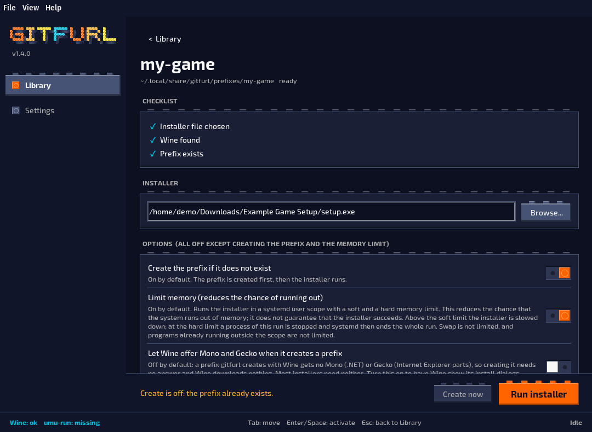
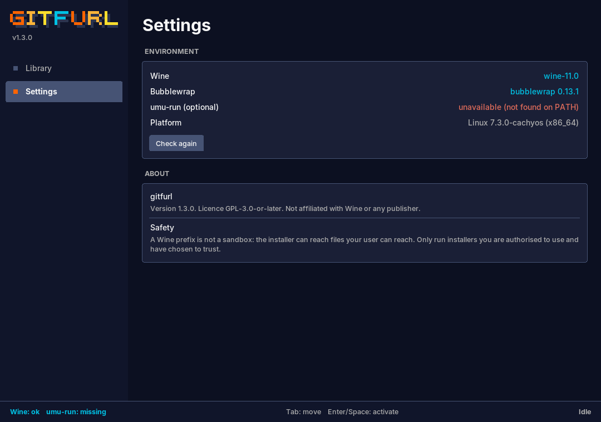

# gitfurl user guide

gitfurl helps you run a Windows installer you already have on Linux, through Wine, in a separate Wine environment ("prefix") that it creates for that purpose. Compatibility with any given installer is unverified. This guide says what works, what has been tested, and what to do when something goes wrong.

## What gitfurl does and does not do
- It runs an installer file that **you chose**, from your own disk.
- It does not search for, download or bundle installers or games, and it does not remove copy protection, bypass activation or apply cracks. If an installer offers such options, gitfurl does not select them for you.
- It makes no network requests of its own, sends no telemetry and uploads nothing.
- You must be authorised to use the software you run. gitfurl makes no claim that any use is lawful.

## What it is for

Running a Windows installer under Wine by hand works, until it does not. These are the problems gitfurl is for:

- **You do not want it to use your main Wine prefix.** Run `wine setup.exe` with no setup and it uses `~/.wine`. Gitfurl makes a separate prefix for each thing you install and never uses `~/.wine` as the prefix. (Wine and the installer can still write elsewhere, for example `~/.cache/wine` and menu entries; the optional changes report shows some of that.)
- **You want to see what will happen before it happens.** Gitfurl shows the exact command, prefix, folder and environment variable first, and nothing runs until you approve.
- **Big installers look frozen.** Some installers sit for a long time with a bar that does not move. Gitfurl watches how far the installer has read into the large files beside it and shows a percentage, a rate and a rough time left, without relying on the installer's own display.
- **You want to know what it changed.** An optional report lists new files and registry keys in the prefix, and changes in a few places outside it (menu entries, autostart, your home folder's top level).
- **You want a log you can read.** Each run gets a log. An optional JSON event log and Wine debug output are there when you need more.
- **You want to tidy up afterwards.** An optional, guarded step deletes the original installer after a run that exits cleanly. It is off by default.
- **You want to try Proton instead of Wine.** One setting switches the runtime, through umu-run, with a Proton folder you already have.
- **You want a stricter box.** The repository includes a bubblewrap wrapper that runs an installer with no network and an empty home folder. It is a manual script, tested on NixOS only, and it opens no window.

## Screenshots
These were made with gitfurl 1.3.0 under a virtual display, in a demo home folder (`/home/demo`) with empty example prefixes. No real installer and no real Wine were run: a small stand-in script took Wine's place.

*Before a run: the checklist, the chosen installer and the options. Nothing runs until you approve the plan.*

*During a run. The numbers are real readings from `/proc`, but of the stand-in, which slowly read 0.21 GB of example files (sparse files of zeros) and wrote the same amount into the prefix. That is why the process shown is `python3.14`.*

*Settings, made on the maintainer's machine: the bubblewrap version and the platform line are real, the Wine version is the stand-in's.*

## Before you start
You need:
- Linux with Python 3.11 or newer.
- Wine (`wine --version` should work). Wine 11 was used for the testing described below.
- tkinter for the graphical app (Debian and Ubuntu: `python3-tk`; Fedora: `python3-tkinter`; Arch: `tk`). The command line does not need it.
- Optional: bubblewrap (`bwrap`), if you want to run an installer in a stricter sandbox yourself (see "Safer runs").

With Nix, `nix develop` gives you Python with tkinter, and `nix develop .#wine` adds Wine.

## Start the app
    python -m gitfurl

(Once installed with `pip install .`, the command is `gitfurl`.) The window has a sidebar with **Library** and **Settings**.

### Library
The Library lists your prefixes. A prefix is a folder where Wine keeps its own fake Windows drive and registry. gitfurl keeps its prefixes in `~/.local/share/gitfurl/prefixes/` (or under `$XDG_DATA_HOME`) and **never uses `~/.wine`**.
- **+ New prefix** adds a name to the list. The folder is created only when you create it or run an installer.
- Click a prefix, or move to it with Up/Down and press Enter, to open it.
- "ready" means the folder exists. "not created yet" means it does not.

### The window, keys and footer
The window can be resized (smallest size about 900 x 620); the content follows its width and the pages scroll with the mouse wheel. The bar along the bottom shows, from left to right: whether Wine and umu-run were found ("ok" or "missing"), the keys that work on this page, and what gitfurl is doing ("Idle", "Creating prefix", "Installer running" or "Stopping...").

Keys: **Tab** and **Shift+Tab** move through everything you can use, in the order it appears on screen, and the page scrolls to keep the focused item visible. The focused item gets an orange outline (white on the orange buttons): a coloured line, not colour alone. **Enter** or **Space** activates it (open a prefix, press a button, flip a switch, choose an option). In the Library, **Up** and **Down** move between prefixes. **Esc** goes from a prefix's page back to the Library, except while an installer is running: then the page with the Stop button stays in view, as it does for the sidebar. While a run is going, Run and Create are off because their buttons are disabled; that is the only guard against a second start. These keys are for the keyboard; gitfurl does not provide screen-reader support (the toolkit it uses, Tk, cannot).

If Wine is not found, an amber box on the Library and on a prefix's page says so and has a **Check again** button.

### Running an installer
Open a prefix, then:
1. **Installer:** type or browse to the installer file (`setup.exe`). The **Checklist** at the top of the page shows what Run needs, each with a tick or a cross and a sentence: an installer file chosen, Wine (or umu-run for proton) found, and the prefix existing or set to be created. **Run installer**, **Create now** and **Stop** sit in a bar at the bottom of the page that stays in view; when Run is off, the bar says why in words.
2. Read the **Plan**. It shows the exact command, the prefix, the working folder and the environment variable gitfurl will set. Nothing has run yet.
3. Choose options (below).
4. Click **Run installer**. A dialog repeats the plan and the warning. Nothing starts until you confirm.
5. The installer's own window opens. Use it as you normally would.
6. When it ends, gitfurl shows the exit status and where the log is.

If the prefix does not exist and "Create the prefix if it does not exist" is on (the default), gitfurl creates it first. If creating it fails, the installer is not run.

### Options (all off unless stated)
- **Create the prefix if it does not exist** (on by default).
- **Limit memory (reduces the chance of running out)** (on by default). See "Memory limit" below. If it cannot be used on this machine, the checklist says why and Run stays off until you turn the option off.
- **Install without the installer's windows (Inno Setup only).** Off by default. See "Unattended install" below.
- **Show what the installer changed on my system.** After the run, a window lists new, changed and removed files in the prefix, new registry keys, and changes in a few places outside the prefix (menu entries, autostart, `~/.local/bin`, `~/Desktop`, the top level of your home folder). It lists names only, never contents. It is best effort: it cannot see changes elsewhere on your disk.
- **Detailed log.** Also writes a JSON-lines event log next to the normal log (see "Logs").
- **Find the installed program.** After the run, gitfurl guesses which new `.exe` is the installed program (largest first, ignoring uninstallers, redistributables, crash handlers and Windows folders) and prints a command you can run yourself. It guesses from names and sizes only. It does not run the program, add it to any launcher, or look anything up online.
- **Runtime:** `wine` (default) or `proton`. Proton runs through `umu-run` and needs a Proton folder you already have, given with `--proton-path` or the `PROTONPATH` variable. gitfurl never downloads one. `umu-run` itself downloads the Steam Linux Runtime the first time it runs if it is not already on the machine; the confirmation dialog says so. This was tested only as far as starting an installer in a sandbox.
- **Portable install (reduces changes outside this prefix).** Off by default. Normal install is the default and runs the installer as today. Portable runs the installer inside bubblewrap (`bwrap`) so that, as far as bwrap isolates it, the writable places are the dedicated prefix, a temporary home and `/tmp` that vanish afterwards, the run's log file and `/dev/dri`. The network is off, the environment is filtered to a short allowlist, your home folder, the session and system D-Bus sockets are hidden, and Wine's menu and file-association builder is disabled, so entries in desktop menus, file-type handlers and `~/.cache/wine` are reduced, not guaranteed absent. See "Portable install" below. It is disabled when `bwrap` is not found or the runtime is `proton`, and then it says why.
- **Scan the installer with ClamAV first.** Off by default. See "ClamAV scan" below. It is disabled, with the reason shown, when `clamscan` is not on PATH.
- **Delete the original installer after a good run:** `none` (default), `installer` (just the file) or `folder` (**everything in the installer's folder**, including other files and sub-folders). See "Cleanup".

### Progress
While an installer runs, the Progress card shows how far the installer has read into the large files beside it (its payload), the read rate, an estimated time left, and how much has been written into the prefix. This does not depend on the installer's own progress display, which can be poor.
Limits: it assumes the large files next to the installer are its payload. The estimate is rough and appears only after about 1% has been read. If the installer reads its files in another way, the numbers can be wrong or stay at zero. It reads no file contents. To tell the prefix's processes from other Wine programs it also checks, for your own processes only, for the entry `WINEPREFIX=<this prefix>` in their environment and keeps only the match, the program name and CPU time (see SECURITY.md). The progress line also lists how many processes are running, their CPU use and helper program names, and says when it looks quiet.

### Checks before a run
The dry run and the approval step show a read-only preflight. Everything is advisory: it never blocks a run and never changes anything.
- **Measured:** free space on the disk that will hold the prefix, the total size of the files in the installer's folder (symlinks are not followed; if counting stops early the value is shown as "at least"), memory available, CPU threads.
- **Estimate:** the installed size. gitfurl cannot know how much space an install needs, so it says "unknown" and does not multiply the installer's size. It warns only when free space is smaller than the files in the installer's folder (an estimate: the install may not fit) and when under 2 GB of memory is available (an estimate). You can still go ahead.

### What gitfurl guesses about the installer
Before you approve a run, the preview shows what the installer looks like from a few bytes of its files: an Inno Setup ID string ("likely"), and FreeArc archives (see below). This reads files only: nothing is run or extracted. The route line under it says which route the run takes and why (see "How gitfurl picks the route"). The window always runs Setup for now; when the command line would have used the native route, its route line says so. (`doctor` separately checks, with a bounded version probe, whether an external Inno Setup reader is installed.) A guess can be wrong or missing, and it says nothing about whether the installer will work.

**FreeArc.** When the installer, or a large file beside it, starts with the FreeArc signature, gitfurl reads that archive's own index (its list of files) and checks the index's CRC-32 values. If the index reads cleanly, the preview says "likely" and shows, for each archive:
- how many files and folders it lists, and their total size;
- how many data blocks it has, and how many use each method gitfurl decodes, by name (`storing`, `lzma`, or a chain of `storing`, `lzma`, `exe`, `delta` and `rep` such as `rep+exe+delta+lzma`), and how many use "a method gitfurl does not handle" (such methods are never named);
- the size of the program in front of the archive, if it is a self-extracting file;
- whether the archive is locked;
- how many stored names would not be safe to extract (for example `..`, an absolute path or a drive letter), with up to three examples. `/` and `\` both count as folder separators.

If the index cannot be read (a damaged or cut-off file, an encrypted index, an index method gitfurl does not handle, or counts and sizes over gitfurl's limits), the preview says "possible" and gives the reason. Names from an archive are shown with unprintable characters replaced by `?`.

This is read-only. Only the index is read; the data blocks are not decoded and nothing is extracted. Whether gitfurl unpacks the archives itself is decided by the route (see "How gitfurl picks the route"). At most 16 large files beside the installer are opened, each once: the index is read from the same open file whose signature was checked. Names longer than 4096 bytes, and file lists whose joined folder-and-name paths would exceed 128 MiB of text, are refused rather than read. The index of the installer itself may take up to 256 MiB; for a file beside the installer the cap is 16 MiB (bytes read and decoded, and joined path text), so a folder of damaged or hostile files cannot hold up the plan for long. This was checked against archives made in the sandbox with a FreeArc-compatible tool, not yet against archives written by the original FreeArc.

### Stopping a run
While an installer runs, the **Stop** button (and **Ctrl-C** on the command line) stops it. A confirmation explains what happens, with "No" as the default.
1. gitfurl sends a polite stop (SIGTERM) to the programs of the run it started, and only those: the installer is started in its own process group and nothing is ever found by name.
2. It waits 10 seconds, then forces (SIGKILL) whatever is left in that same group.
3. With Wine (not Proton), it then asks this prefix's own Wine server to exit (`wineserver -k` for that one prefix). That also ends anything you started by hand in the same prefix.

A second **Ctrl-C** while a stop is in progress skips the 10-second wait and force-kills what is left. Ctrl-C is otherwise held back while a stop runs, including while `wineserver -k` runs (up to 30 seconds), so gitfurl can take up to about 45 seconds to return after a stop. A run counts as cancelled only if the stop took effect: before the installer started, or by signalling a group that still had a running program. If the installer had already exited when you pressed Stop, it is reported as finished with its own exit status and nothing is signalled. If `wineserver` cannot be found or exits with an error, the notes say so.

Stopping while the prefix is still being created (before the installer starts): in the graphical app, Stop does not interrupt that step; it finishes, and then the installer is not started and the run is shown as cancelled. On the command line, Ctrl-C ends gitfurl at once with status 130, and Wine's own processes for that prefix (`wineboot` and its helpers) may be left running; this step is not run in its own process group and gitfurl does not stop it.

The run is shown as **cancelled**, not as a success or a failure. On the command line the exit status is 130 and the event log has a `cancelled` event. The log is kept. The original installer is never deleted after a cancelled run.

What may remain, because nothing is deleted: files that were already copied into the prefix, registry changes, files written elsewhere on this machine (for example in your home folder), and any program that moved itself out of the run's process group. A group stop cannot reach such a program, so complete process-tree termination is **not guaranteed**: check with `ps` if something looks left over. For Proton, stopping through `umu-run` is **unverified**: it needs umu's runtime, which could not be set up offline, so whether the runtime's own container always ends with the group is untested.

### Settings
Shows Wine and bubblewrap versions and the platform, and the safety note.

## Command line (optional)
The graphical app is the default. The command line is opt-in and uses the same code and the same approvals:

    gitfurl cli doctor
    gitfurl cli install /path/to/setup.exe --dry-run --prefix NAME
    gitfurl cli prefix create NAME
    gitfurl cli prefix list
    gitfurl cli install /path/to/setup.exe --prefix NAME [options]

Options for `install`:

| Option | Meaning |
|---|---|
| `--dry-run` | Show the plan and change nothing. |
| `--prefix NAME` | The prefix to use (needed for a real run). |
| `--create-prefix` | Create the prefix first if it is missing. |
| `--yes` | Approve without the typed `yes` prompt. Without a terminal and without this, nothing runs. |
| `--progress` | Print progress lines while the installer runs. `--progress-interval SECONDS` sets how often (default 10). |
| `--detailed-log` | Also write the JSON event log. |
| `--stall-after SECONDS` | Off unless given. Print one advisory note if nothing moves for that long: no growth in how far the installer has read into its payload files, no CPU use by the prefix's processes, and no growth of the log. It never stops or signals anything. Slow phases (a hash check, one huge file) can look like this, so choose a long time such as 600. Also turns on the progress monitor (the `/proc` reads described above). |
| `--wine-debug CHANNELS` | Set `WINEDEBUG` for the run, for more output in the log (for example `err+all`). |
| `--show-changes` | List what the installer changed afterwards. |
| `--portable` | Portable install: run the installer in bwrap (see "Portable install"). Off by default. `--dry-run` prints the full bwrap argument list. Needs `bwrap` on PATH and the wine runtime; without them it stops and does not fall back to a normal install. |
| `--route auto\|native\|wine` | Which route the run takes (see "How gitfurl picks the route"). Default `auto`: gitfurl picks and says why. `native` refuses, with the reason and nothing run, when the native route is not possible. `wine` always runs Setup. With `auto`, any option that only a Setup run uses (`--unattended`, `--portable`, `--wine-debug`, `--show-changes`, `--stall-after`, `--runtime proton`) chooses the Wine route. |
| `--unattended` | Wine route only. Inno Setup installers only: run without the installer's wizard and windows (see "Unattended install"). Off by default. Refused, with nothing run, when no Inno Setup ID is found. |
| `--no-memory-limit` | Run without the memory limit (see "Memory limit"). The limit is on by default; if it cannot be used, a run stops with status 2 and the reason, and nothing is run, until you add this option. |
| `--find-exe` | Guess which new program was installed (local only). |
| `--scan` | Scan the installer and the files beside it with the `clamscan` on PATH before anything runs (see "ClamAV scan"). Off by default. A match or a scan error stops the run; a scan error can not be overridden. `--dry-run` prints the scan command. |
| `--allow-scan-hit` | With `--scan`: run even if ClamAV matched a signature. Refused without `--scan`. A scan error is never overridden, also not a match in a scan that had an error. |
| `--scan-timeout SECONDS` | With `--scan`: stop the scan after this long (default 600; a finite number above 0); a timeout stops the run. |
| `--runtime wine\|proton` | Runtime to use (default `wine`). `--proton-path DIR` or `PROTONPATH` names the Proton folder. |
| `--cleanup installer\|folder` | Delete the installer (file or folder) after exit status 0. |

Exit status: 0 on success, 1 on an error or a non-zero installer status, 2 when not approved, 130 when stopped.

## How gitfurl picks the route
`gitfurl cli install` reads the installer's headers and the indexes of the FreeArc archives beside it (read-only) and picks one of two routes. The dry run and the approval show the choice as `route: native (chosen by gitfurl)`, `route: wine (chosen by gitfurl)` or, with `--route`, `(chosen by you)`, followed by the reasons.

- **Native** when the installer is Inno Setup (or is itself a FreeArc archive), every FreeArc archive beside it reads cleanly, uses only `storing`, `lzma`, `exe`, `delta` and `rep`, and holds only names gitfurl can write safely, and, for the automatic choice, two more things hold:
  - the archives are linked to the installer by name. gitfurl cannot yet read which archives the setup script uses, so it asks that every archive has the same base name (the name without its extension and a set number such as `-01`), and that this base name is the installer's own name or part of the name of the installer's folder. For example `setup.exe` with `game-01.bin` and `game-02.bin` in a folder called `Game [game]` is linked; an unrelated `data.arc` in a download folder is not. This is a naming check only: the archives can still be ones Setup does not use. `--route native` skips it;
  - you did not give an option that only a Setup run uses (`--unattended`, `--portable`, `--wine-debug`, `--show-changes`, `--stall-after`, `--runtime proton`). With `--route native` such options are listed in the plan as not applying.

  Setup is then not run. The plan says, word for word: "Setup is not run. Skipped: Setup's own files (for example its uninstaller and small extra files it holds itself), shortcuts, registry entries, redistributables it would run, and every step of its script. The archives are unpacked with their own folder layout into C:\Games\PREFIX; the script may have placed files elsewhere, picked only some archives, or done more after unpacking. If the program needs any of that, run again with --route wine into a new prefix."
- **Wine/Proton** otherwise, with the reason: the installer is neither Inno Setup nor a FreeArc archive; no FreeArc archives are beside it (Setup holds its files itself, and gitfurl cannot read Inno Setup's own file data); an archive cannot be unpacked by gitfurl (its checksums do not match, it uses a method gitfurl does not handle, or a name is unsafe or clashes); the archives are not linked to the installer by name (the plan then says that `--route native` exists); or you asked for an option that only a Setup run uses. For an Inno Setup installer with archives the plan adds: "Setup unpacks its own archives with its own code; gitfurl cannot help with that part." Wizard or unattended stays your choice (`--unattended`).

Why Setup is not run "only for its Windows parts" on the native route: the unpacking is the setup script's own code, and no switch turns it off. Hiding the archives makes such a script show its own error window and wait; stopping Setup partway leaves an unknown state. So either Setup does everything (Wine) or gitfurl does the unpack and nothing of Setup runs (native).

**The native install, step by step** (all steps are in the plan, and one approval covers them):
1. With `--scan`: the ClamAV scan of the installer and the files beside it. A match or a scan error stops the run before anything is created.
2. With `--create-prefix` and a missing prefix: the prefix is created with `WINEDLLOVERRIDES=mscoree,mshtml= wine wineboot --init`, under the memory limit unless `--no-memory-limit`. The override, set for that command only and shown in the plan, turns off Wine's Mono and Gecko install dialogs, so this step needs no answer; the new prefix then has no Mono or Gecko (the unpack does not need them; a program that does can get them later from Wine). An empty `gitfurl-incomplete` file is written in the new prefix before wineboot starts and removed when wineboot exits with status 0. While it is there (creating the prefix stopped, timed out or failed) gitfurl will not unpack into that prefix; use a new prefix name. Before the approval, the free space on the nearest existing folder above the prefix is compared with the files to write plus 768 MiB for the prefix itself, so a run that cannot fit stops before the prefix is created. This is the only Wine step.
3. gitfurl unpacks the archives into `C:\Games\PREFIX` with all the checks of "Native extraction (FreeArc)" below. `--progress` prints `[progress] native unpack: X of Y (P%), rate, ETA` lines. The local log (mode 0600) starts with `route: native`; `--detailed-log` adds an event log with `start`, `progress` and `exit` or `cancelled` events.
4. Program candidates in the new folder (a guess from names and sizes, with the line to start one in the prefix) and redistributable installers found there are listed. Nothing is run. Run a redistributable yourself with `gitfurl cli install FILE --prefix PREFIX` if the program needs it.
5. With `--cleanup`: only after a complete unpack (every file written and every CRC-32 matching).

Exit status: 0 when the unpack completed, 130 when stopped (Ctrl-C), 1 on an error or a CRC-32 mismatch, 2 when not approved or when the decoders' memory does not fit (below). A Ctrl-C after the unpack itself has finished (while the listings are made) also gives 130: the unpack's result is still printed and logged, with an `interrupted after the unpack` line (event `interrupted`), and nothing is deleted. The memory limit's systemd scope does not apply to the unpack itself (it runs inside gitfurl; the decoders' memory is capped per data block and shown in the plan). Instead, before the approval, that cap is compared with `MemAvailable` minus the memory kept free for the rest of the system (the larger of 1 GiB and 10% of `MemTotal`); if it does not fit, the run stops with status 2 and nothing is written, and the dry run says "a real run would stop now". `--no-memory-limit` skips this check. The dry run lists every reason a real run would stop (for example wine not found when the prefix is to be created, a memory-limit problem, too little space, too little free memory). With `--route native`, options that only apply to Setup are listed in the plan as not applying. The window has no native route yet.

## Logs
- The log is in `~/.local/state/gitfurl/logs/` (or under `$XDG_STATE_HOME`), one file per run, readable only by you. It holds the command, the prefix, Wine's output and the exit status. It never holds your environment variables.
- It can contain your user name and local paths. Remove them before sharing a log.
- With **Detailed log**, `<name>.events.jsonl` has one JSON object per line: start (command, prefix, names of environment variables set), progress samples, exit status and duration. It holds no environment values. With the progress monitor running (`--progress`, `--stall-after`, or the app) it also has a `processes` event (how many programs run in the prefix, and the names other than Wine's own background ones) and a `memory` event (`MemAvailable` from `/proc/meminfo`) with each sample, and one `possibly_stalled` event if the advisory fired. The last event (`exit` or `cancelled`) holds three separate facts: `started` (the installer process was created), `extraction_observed` and `exit_status`. Without the monitor, `observation_measured` is false and `extraction_observed` stays false because nothing was measured. The event log has no size cap: a long run with a short progress interval adds one line per sample, so delete old logs yourself. Program names in it and in the progress line come from the installer; the progress line shows only their printable characters. A program counts as "in the prefix" when its environment has this prefix's `WINEPREFIX`; whether that can be read for programs inside a portable (bwrap) run has not been checked.

**What "observed activity" means.** `extraction_observed` is a heuristic and the end text calls it "observed activity", never "extracted". It is true only if the monitor saw the prefix grow by at least 1 MiB and a program read at least 1 MiB into the files beside the installer. It can miss a short burst between two samples, and it can be true for an installer that reads and writes but fails. It does not show that anything was extracted or installed. The exit status is the installer's own; as before, 0 does not prove the install is complete.
- Logs stay on your machine. gitfurl uploads nothing.

## Cleanup
Deleting the original installer is off by default. `folder` mode **deletes everything in the installer's folder**, not just the installer. When on:
- It happens only if the installer exits with status 0. A status of 0 does **not** prove the installation finished correctly, so keep the files until you have checked the result.
- The dialog lists exactly what will be deleted before you approve.
- Symlinks are removed as links and never followed.
- It refuses your home folder, general-purpose folders directly under it (`Downloads`, `Desktop`, `Documents`, `Music`, `Pictures`, `Videos`, `Public`, `Templates`, `Games`, `Projects`), the filesystem root, mount points, system folders (`/usr`, `/nix`, `/var` and similar), folders holding gitfurl's own data, and folders with more than 200 entries. Put an installer in its own folder to use `folder` mode; `installer` mode works anywhere that is not a system folder.

## Portable install
Two modes per run. **Normal install** (default) is the installer's usual behaviour inside the dedicated prefix. **Portable install** wraps the same Wine command in `bwrap`:
- Writable: the dedicated prefix, a temporary home folder and a temporary `/tmp` (both in memory; they vanish when the run ends), the run's log file (gitfurl opens it outside and the installer's output goes into it) and the GPU device `/dev/dri`.
- Environment: the sandbox starts with an empty environment. Only `PATH`, `LANG`, `LC_*`, `LANGUAGE`, `TZ`, the display variables, the temporary home and XDG folders and the plan's own variables (`WINEPREFIX`, `WINEDLLOVERRIDES`, and `WINEDEBUG` if you set it) are set, so tokens, keys and agent sockets in your environment are not passed to the installer.
- Input: in the command line the installer shares your terminal; it runs in a session of its own (`--new-session`), which stops it from typing into your terminal.
- Network off. An installer that needs the network, for example to download its files, will fail.
- Your home folder is replaced by an empty temporary one, and `HOME` and the XDG folders point into it. The session and system D-Bus sockets are hidden.
- The installer's folder is mounted read-only, **all of it**, so keep the installer in a folder of its own. The rest of the file system is mounted read-only, so the installer can still read it.
- Wine's `winemenubuilder.exe` is disabled (`WINEDLLOVERRIDES=winemenubuilder.exe=d`, shown in the plan). Without it Wine does not create menu entries or file associations.
- The X11 or Wayland socket (and your `XAUTHORITY` file, or `~/.Xauthority`, read-only, so the cookie can be read inside) is allowed so the installer window can show. A hostile installer can use that connection. Audio is not provided and GPU access is limited to `/dev/dri`; other devices are not available.
- If the prefix has to be created first, that step (`wineboot --init`) runs outside bwrap.
- Stop signals bwrap's own process group, not the installer's: the sandboxed programs run in a session of their own (`--new-session`), and `--die-with-parent` plus the private PID namespace end them when bwrap ends. It was checked with real bwrap and a dummy `sleep`, and once with a real Wine installer in `tools/sandbox.sh`, not with every installer. `wineserver -k` is not run, since the sandboxed Wine server lives in a private `/tmp`.
- If you turn on the changes report, it covers the checked places only and says nothing about places gitfurl did not check.
- Not supported with the `proton` runtime, as root, or when wine itself is installed under your home folder (hidden inside the sandbox).

This reduces what an installer changes outside its prefix, as far as bwrap isolates it. It is **not a guarantee** and not a security boundary: a Wine prefix and bwrap do not contain a hostile installer, and some other host sockets and files remain reachable. **The prefix is kept** after the run, and whatever the installer put there (startup entries in the registry, replaced DLLs, links under `drive_c/users`) runs again, outside any sandbox, whenever you run something in that prefix later. Delete the prefix if you do not trust the installer. Whether an install keeps everything inside the prefix has not been checked against a complete real install. gitfurl's own check that the run has ended cannot see programs inside the sandbox; it relies on bwrap ending them.

## ClamAV scan
Optional and off by default (`--scan`, or "Scan the installer with ClamAV first" in the app).
- **What it runs.** The `clamscan` program already on your PATH, nothing else: `clamscan --no-summary --stdout FILE...`, with the absolute path of the installer and of each regular file directly in its folder. Subfolders, symbolic links and other entries that are not regular files (such as named pipes) are not scanned. gitfurl passes no option that changes files: never `--remove`, `--move` or `--copy`, and gitfurl itself writes nothing into the installer's folder (`clamscan` may still write its own temporary files). A folder with more than 1,000 entries, or a file or folder name containing a line break or another line-separator character, is refused before the scan. The command is shown in the plan, the dry run and the approval, and the scan runs only after you approve. It runs in its own process group with a timeout (600 s by default); a timeout, Stop or Ctrl-C ends that group only.
- **The database is yours.** gitfurl never runs `freshclam`, never downloads signatures and never installs ClamAV. Keep the database current yourself (for example with `freshclam` or your distribution's service). The approval and `gitfurl cli doctor` show the database date from `clamscan --version` (a short version check, as for Wine) and warn when it is older than 7 days. The dry run does not run that check.
- **A match stops the run.** Nothing is run or created. The message names the matched files and signatures. ClamAV often flags game installers falsely, because packers and self-extractors look like malware to signatures. To run it anyway: `--allow-scan-hit` on the command line, or answer Yes to a second dialog in the app (its default is No).
- **An error also stops the run, and can not be overridden.** `clamscan` missing, no database, a timeout, an exit status other than 0 or 1, or output gitfurl cannot read: the run stops with the reason. A match in a scan where some files could not be scanned or their result could not be read is also an error, not a match you can override; the message names the matched files and signatures. gitfurl never falls back to running the installer unscanned.
- **What a clean result means.** "No known signature matched (ClamAV, database dated ...)". It does **not** mean the installer is safe or free of malware: it only means that none of the signatures in your database matched. The result is written to the run's log.
- **Big files.** `clamscan` scans at most 100 MB of each file by default (its `--max-filesize`, maximum 2 GB), and its manual does not say what it reports for a larger file. gitfurl does not change that limit. Instead the plan and the result name every file larger than 100 MB, and a clean result then reads "no known signature matched in the parts ClamAV scanned". The data files beside a game installer are often far larger, so for those the scan says little. `clamscan` has other default limits as well, which gitfurl also leaves unchanged and does not report: for example `--max-scansize` (the most data scanned per file, including what is unpacked from it; 400 MB by default) and limits on how deep and how many files it unpacks inside archives (`--max-recursion`, `--max-files`). gitfurl only names files larger than 100 MB; a file below that can still have been scanned only in part.

## Unattended install (Inno Setup)
Off by default (`--unattended`, or the window option "Install without the installer's windows (Inno Setup only)"). It is offered only when the read-only check found an Inno Setup ID in the installer ("likely"); for any other installer it is refused and nothing runs.

gitfurl then starts the installer with Inno Setup's own documented switches instead of showing its wizard:

    wine setup.exe /SP- /VERYSILENT /SUPPRESSMSGBOXES /NORESTART /DIR=C:\Games\PREFIX /LOG=C:\gitfurl-setup-TIME.log

- No wizard and no installer windows. Every choice the wizard would ask (components, tasks, the language) takes the setup script's default; message boxes take their default answer.
- The files go to `C:\Games\PREFIX`, that is `drive_c/Games/PREFIX` inside the prefix.
- The installer still does all the work: its own code unpacks its own files, in the prefix, under Wine. gitfurl does not open or extract anything. Progress, Stop, the memory limit and portable install work as for any run.
- After the run gitfurl reads the log Inno Setup wrote (`drive_c/gitfurl-setup-TIME.log`, only its last 4 MiB). The end text gives the meaning of Inno Setup's exit status, whether the log has Inno Setup's "Installation process succeeded." line, how many files it lists, up to five error lines from it, and whether the install folder exists. The log stays in the prefix. That line covers only Setup's own file list: Inno Setup writes it before steps the setup script runs afterwards (on some installers that is where the whole payload is unpacked), so gitfurl never reports it as "the installation succeeded". A run you stopped is reported as "The run was cancelled, so Setup did not finish.", also when the log already has the line.
- **What was seen** with Inno Setup scripts written for the test (see `docs/testing.md`): a page the script adds itself is skipped and keeps its default value; `[Run]` entries run, also those marked `postinstall` (unless the script marks them `skipifsilent`).
- **Limits:** a setup script can show its own windows, ask its own questions, or ignore these switches; that is only known when it runs. A script that shows a plain message box (not one Setup can suppress) opens that window and waits for a click: the run then waits until you answer it or press Stop. `--stall-after` (or watching the progress line) helps notice that. A script that needs an answer other than its default cannot be steered. Tested with Inno Setup 7.1.1 installers built for the test, not with third-party installers.
- **Creating the prefix:** when gitfurl creates the prefix (`--create-prefix`, or the window's "Create the prefix if it does not exist"), Wine may first show its own dialog offering to download Wine Mono. That is Wine's window, not the installer's, and it appears with or without this option. Without a network (for example in a portable install or the test sandbox) nothing answers it and the run waits; create the prefix first, or answer the dialog.

## Native extraction (FreeArc)
Command line only. `gitfurl cli install` uses it on the native route (see "How gitfurl picks the route"); `gitfurl cli extract` is the files-only command into an existing prefix:

    gitfurl cli extract setup.exe --prefix NAME --dry-run
    gitfurl cli extract setup.exe --prefix NAME

gitfurl reads the FreeArc archives beside the installer (and the installer itself, if it is one) with its own reader and writes their files to `C:\Games\NAME`, that is `drive_c/Games/NAME` inside the prefix. **The installer is not run:** no registry entries, no redistributables, no shortcuts and none of its own steps, so the result may not work. The end text says "files extracted", never "installed".

- **What it handles:** data blocks whose method is `storing`, `lzma` (dictionary up to 1 GiB), `exe` (the x86 branch filter, no parameters), `delta` (binary tables; block size up to 1 GiB) or `rep` (long repeats; window up to 1 GiB), alone or chained with `+` (at most 8 methods), for example `rep+exe+delta+lzma`. Anything else, including encryption, is refused before anything is written, with the words "a method gitfurl does not handle".
- **The plan** (shown before you approve, and by `--dry-run`) lists the archives, the number of files, the total size, the free space check, the memory needed to decode one data block (the caps of its methods' buffers added together: the lzma dictionary, the part of the rep window that can be used, the delta block and the exe buffer), and the destination. Approval works as for a run: type `yes`, or pass `--yes`; with no terminal and no `--yes` nothing is written (exit status 2).
- **Refused before anything is written:** no FreeArc archive found; an archive gitfurl cannot read; a method gitfurl does not handle; a name that is not a safe relative path (`..`, absolute, a drive letter, a control character); a name Windows cannot use as itself (ending in a dot or a space, containing one of `<>:"|?*`, or a device name such as `CON`, `NUL`, `COM1` or `LPT1`, with or without an extension); two files, or a file and a folder, whose names would be the same with letter case ignored (as Windows does); a name used both as a file and as a folder; a name too long for Linux; more than 1,000,000 folders; too little free space (each file counted in whole blocks of the file system, plus one block per folder) or, where the file system counts them, too few free inodes; a destination folder that already exists; a prefix that does not exist (create it first with `gitfurl cli prefix create NAME`). Each archive is read again just before writing; if it changed since the plan, nothing is written. In the rare case that creating the destination itself fails after `Games` (or the destination) was made, for example because another program created it at the same moment, the message lists those empty folders; they are kept.
- **Folders that differ only in letter case** (for example `Data` and `data`, in one archive or in several) are one folder, as on Windows: the first spelling is used, and the plan says so.
- **While writing:** the destination is a new folder; every file is created new and never overwrites anything; folders and files are opened without following links, relative to the destination, so nothing is written outside it. Each file's CRC-32 is checked; a file that does not match is kept and listed. File times are set from the archive, through the open file. At most 64 folders are held open at a time, so many folders or very deep paths do not run into the open-file limit.
- **Stopping:** Ctrl-C ends the extraction between 1 MiB chunks, also in the middle of a file; that file is kept as it is and named as incomplete. Files already written stay; nothing is deleted. Exit status 130. Any other problem once the destination exists (for example too little memory for a decoder, or damaged data in a block) is reported the same way, with what was written kept.
- **Limits:** each archive's own folder layout is used; the installer's script may place files elsewhere, rename them or need its own steps. A self-extracting `.exe` whose archive starts after a program is not found. Several archives go into the same folder. A block whose data is damaged, or whose data asks for more than the caps above (a rep match reaching further back than the window its method states, a delta block larger than its method's block size or running more than a few bytes past the end of the block's files, more rep matches or delta tables in one block than gitfurl handles, more than 64 empty delta blocks in a row, or rep data whose block headers and match tables come to more than 4 MiB plus 16 bytes per byte of output), ends the extraction with an error; files already written are kept. The extraction runs in gitfurl's own process, so the memory limit and portable install do not apply to it. Tested with archives built by the tests and with archives made in the sandbox with seb3773/freearc-c, not with archives written by the original FreeArc or third-party installers. The window has no option for it yet.

## Memory limit
On by default, for the wine and proton runtimes and for a portable install. It reduces the chance that the system runs out of memory; it does not guarantee that the installer succeeds. Above the soft limit the installer is slowed down; at the hard limit the kernel stops a process of this run and systemd then ends the whole run (`OOMPolicy=stop`). Swap is not limited, and programs already running outside the scope are not limited.

**Visible change:** if this machine has no user systemd manager, or the memory controller is not delegated to it, gitfurl refuses to run until you turn the limit off (`--no-memory-limit`, or the option in the window). It never runs without the limit silently.

**Tested so far:** stand-ins and test programs in a real scope, and Wine with one installer built for the test, run in the sandbox inside a scope with these limits (see `docs/testing.md`). That run showed what "swap is not limited" means in practice: with the installer holding 1,500 MiB under a 1 GiB hard limit, the run was slowed down (about 9,000 times at the soft limit), its memory stayed at the limit, 1.66 GB went to swap, and the install finished. It was not stopped. Not tested: Proton under the limit, gitfurl's own scope wrapping a Wine run (the sandbox hides the user systemd manager, so the scope was started from outside it), and an out-of-memory stop of a Wine run.

How it works: the run's command (`wine`, `umu-run` or `bwrap`) is started through your own systemd user manager, in a scope unit of its own, with no root:

    systemd-run --user --scope --quiet --unit=gitfurl-PREFIX-TIME-PID.scope --expand-environment=no -p MemoryHigh=BYTES -p MemoryMax=BYTES -p OOMPolicy=stop -- <the command>

- **Budget.** gitfurl reads `MemTotal` and `MemAvailable` from `/proc/meminfo` when the run starts. It keeps `max(1 GiB, 10% of MemTotal)` free for the rest of the system. The hard limit (`MemoryMax`) is `MemAvailable` minus that reserve; the soft limit (`MemoryHigh`) is 90% of the hard limit. If the hard limit would be under 1 GiB, gitfurl refuses to start, shows the numbers and says how much memory to free. The dry run, the plan and the approval show every value.
- **While it runs.** Every 5 seconds gitfurl reads `MemAvailable`. If it falls below the reserve (other programs need memory), the run's soft limit is lowered by the shortfall, counted from what the run uses now, but never below 1 GiB (or the start value if that is smaller). When memory is free again it is raised back, never above its start value. Changes under 64 MiB are skipped. This uses only `systemctl --user set-property --runtime <that unit> MemoryHigh=<bytes>` on the one unit gitfurl created; no other unit is changed, nothing is killed by name, and the hard limit is never raised. Each change is a note and, with the detailed log, a `memory_limit_change` event.
- **Swap** is not limited. The hard limit counts memory, not swap, so a run over the soft limit can move pages to swap and slow down instead of being stopped. With swap capped at 0 a test program held at its soft limit stalled for minutes (seen once on the maintainer's machine).
- **After the run** gitfurl reads that scope's own `memory.events` and the unit's result. If the out-of-memory killer ran in it, the end text says that the run hit its hard limit, that the kernel stopped a process of this run and systemd then ended the whole run, and that you can retry with `--no-memory-limit` or with the option off in the window (the hard limit is fixed from the memory available at the start). systemd removes a scope that ended normally at once, usually before gitfurl can read its `memory.events`; a scope ended by the out-of-memory killer stays as failed with `Result=oom-kill` (`OOMPolicy=stop`, which gitfurl sets explicitly). So when the scope is already gone and was not seen failed, the end text says that no out-of-memory stop was recorded, and why. If the scope is still there but `memory.events` could not be read, it says that the check could not be done. If the run ended with a non-zero status and its output has a `systemd-run` error line ("Failed to ..."), the end text says that systemd-run may have failed and the installer may not have run. It also says how often the installer was slowed down at the soft limit (the `high` count, as last read). A failed unit is then cleared with `systemctl --user reset-failed <that unit>`.
- **Stop and Ctrl-C** are unchanged: with `--scope`, systemd-run runs the command itself in the foreground, so it keeps the same process and process group. Programs the run starts stay in the scope, including Wine's server, which starts a session of its own.
- **Prefix creation:** when `install --create-prefix` (or the window's "Create the prefix if it does not exist") makes the prefix, `wineboot` runs in its own scope with the same limits, without the adjustment. `gitfurl cli prefix create` and the window's **Create now** button are not wrapped.
- **Needs:** `systemd-run` and `systemctl`, a running user systemd manager, the cgroup v2 hierarchy, and the memory controller delegated to your user manager (on the machine it was checked on, `user@1000.service` had `DelegateControllers=cpu memory pids`; other systems were not checked). `gitfurl cli doctor` reports whether it is available. If not, gitfurl does not run without it silently: the plan says "memory limit: NOT available" and why.
- **Limits:** a Wine program started by a Wine server or service that was already running outside this scope (for example left over from an earlier run in the same prefix) is not limited by it. The values are fixed at the start apart from the soft limit; they do not follow memory you free later beyond the start value. It has been checked on one machine (systemd 262) with a test program, not with Wine, Proton or an installer.

## Safer runs
A Wine prefix is **not** a sandbox. The installer can read and write anything your user can. Variables starting with `WINE` in your shell are not passed on, so the plan shows what is set. For an installer you do not fully trust:
- use a separate user account or a virtual machine, or
- use the sandbox wrapper in `tools/sandbox.sh`, which uses bubblewrap with the network off, an empty home folder and the installer folder mounted read-only. It is a manual script, tested on NixOS only, and it opens no window: use it to check that an installer starts. With `SANDBOX_ETC=1` it also shows a few read-only `/etc` files and `/sys`, so its "empty home" is weaker then. See `docs/development.md`.
Never run an installer, or gitfurl, as root. Gitfurl refuses to.

## What has been tested
- The code is covered by tests that use mocks. They need no Wine and no installer.
- In a no-network bubblewrap sandbox, two real installers were **started** under Wine 11 and stayed running with their windows open for 120 seconds, and one was started under Proton (GE-Proton) through umu-launcher. Each run was stopped after that time.
- **Not tested:** a complete installation, running an installed game, or any compatibility claim. Treat gitfurl as unverified for any particular installer.

## Troubleshooting
- **"The graphical interface needs tkinter"** Install your distribution's tkinter package, or use `gitfurl cli`.
- **"wine not found on PATH"** Install Wine, then check `gitfurl cli doctor`.
- **A `.exe` does nothing, or Wine prints "no driver could be loaded"** There is no display. Run it inside a graphical session.
- **Run installer is greyed out** Choose an installer file and a valid prefix name (letters, digits, `-` and `_`, up to 64 characters).
- **"prefix path already exists"** gitfurl will not touch an existing folder when creating a prefix. Pick another name, or remove the folder yourself.
- **Progress stays at 0%** The installer may keep its payload somewhere else or read it differently. The run is unaffected.
- **The installer exited with a non-zero status** The number does not say why. Read the log; `--wine-debug err+all` adds detail.

## Reporting a problem
Open an issue and use the bug form. Do not attach installers, game files, keys or archives. Remove your user name and paths from logs first. Security problems go through a private advisory, not an issue (see `SECURITY.md`).
